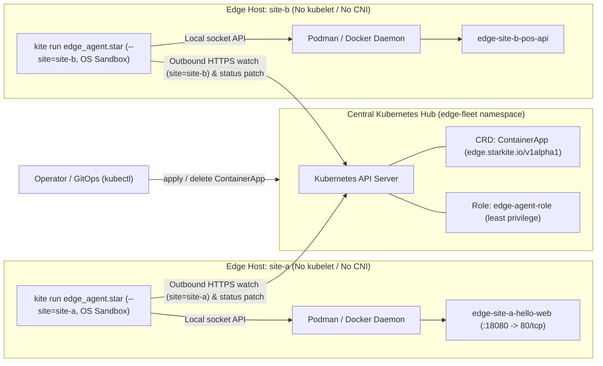
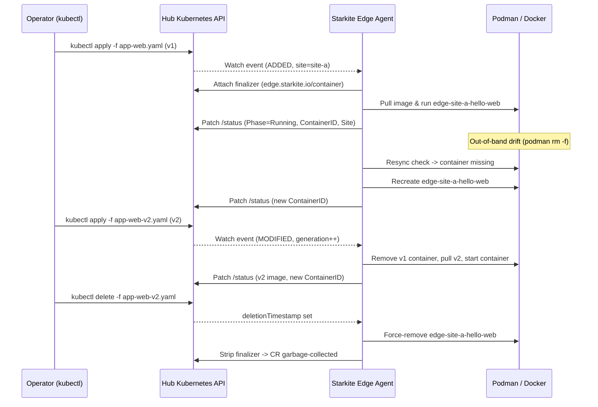

# Edge Container Orchestration with a Central Kubernetes Hub

You can manage containers on remote edge hosts from a central Kubernetes cluster without installing `kubelet`, a CNI plugin, or a local Kubernetes control plane on those hosts. In this tutorial, a central Kubernetes cluster acts as the declarative control plane, storing desired state in custom `ContainerApp` resources. Each edge machine runs only a local container runtime (**Podman** or **Docker**) and a single sandboxed **Starkite** (`kite`) agent that reconciles those resources over an outbound HTTPS watch.

---

## Why Separate the Control Plane from the Edge Runtime?

Teams running containers in retail stores, factory gateways, branch offices, or remote lab boxes usually get pushed toward one of two extremes.

The first extreme installs a full Kubernetes distribution such as `k3s` on every edge machine. That gives you `kubectl`, RBAC, and GitOps, but it also puts an API server, embedded datastore, `kubelet`, CoreDNS, and overlay networking onto every box—even when the host only runs two or three static containers. Every site now requires certificate rotation, Kubernetes version upgrades, and per-cluster credential management.

The second extreme drops Kubernetes entirely and manages containers over SSH with shell scripts, Ansible playbooks, or `docker compose` files. That removes the edge overhead, but it also discards continuous reconciliation. If a container crashes or gets removed out of band, nothing heals it until the next manual run. There is no live fleet-wide status view, no unified RBAC boundary, and no centralized audit trail.

This tutorial takes a middle path built on a straightforward observation: **Kubernetes's main advantage at the edge is its API machinery, not its Pod scheduler.** CRDs, label-filtered watches, RBAC, status subresources, events, and finalizers solve fleet coordination cleanly on their own. When an edge host only needs to run discrete containers with mapped host ports, you can keep that API machinery centralized in one hub cluster and run a lightweight agent at each site.

| Dimension | `k3s` per Edge Node | KubeEdge / OpenYurt | **Kubernetes Hub + Starkite Edge Agent** |
| :--- | :--- | :--- | :--- |
| **Edge footprint** | API server, SQLite/etcd, `kubelet`, Flannel, CoreDNS | Cloud-core + edge-core daemons, MetaManager, CNI | Single `kite` binary + Podman or Docker daemon |
| **Network direction** | Inbound API access or VPN mesh into each site | Persistent WebSocket/QUIC tunnel | Outbound HTTPS watch from edge to hub |
| **Site targeting** | Separate kubeconfig/context per site | Node labels and custom edge node pools | Native label selector (`edge.starkite.io/site=<site>`) |
| **Workload API** | Full Kubernetes Pod, Service, and Ingress API | Pod API with edge extensions | Focused `ContainerApp` CRD (`edge.starkite.io/v1alpha1`) |
| **Edge confinement** | Privileged `kubelet` + container runtime | Privileged edge node agent | Namespace-scoped K8s `Role` + OS kernel sandbox |
| **Trade-off** | High per-site operational overhead | Custom control-plane components to maintain | No cross-host Pod overlay network or cluster DNS on edge hosts |

That trade-off in the last row is intentional. If your edge sites need multi-Pod Kubernetes `Services`, `Ingress` controllers, or East-West overlay routing between multiple hosts at the same site, run `k3s` or KubeEdge. If your edge hosts run independent containers that expose host ports or talk outbound to upstream services, a central hub plus a sandboxed Starkite agent removes almost all per-site infrastructure while keeping the exact same `kubectl` workflow.

### How the Hub-and-Spoke Topology Flows

Each edge host initiates an outbound HTTPS connection to the hub Kubernetes API server. That direction matters for edge environments: remote hosts frequently sit behind NAT gateways or restrictive firewalls where inbound SSH or API ports cannot be opened. Because the agent pulls desired state and pushes status back over standard TLS port 443, the hub never needs inbound network reachability into any edge site.



### Why a Level-Triggered Loop Handles Every Failure Mode

Instead of writing separate scripts for deploy, restart, upgrade, and cleanup, the edge agent runs a level-triggered reconciliation loop powered by `k8s.control`. Every trigger—whether a watch event from the hub or a periodic local resync timer—asks the same question: *does the container currently running on this host match the declared `ContainerApp` spec?*

If the container is missing, the agent pulls the image and starts it. If someone removed the container manually on the host, the next resync cycle recreates it. If an operator updates `spec.image`, the watch fires immediately and replaces the container. When an operator deletes the `ContainerApp`, a Kubernetes finalizer holds garbage collection until the agent removes the local container cleanly.



---

## Companion Files and Script Boundaries

All manifests and Starlark scripts live flat inside [`k8s/edge-containers/`](./). Notice that hub provisioning (`setup.star`), cleanup (`teardown.star`), and the edge agent (`edge_agent.star`) are intentionally split into separate files rather than bundled into one multi-mode script. That separation mirrors real operational privileges: a cluster administrator runs `setup.star` once to install cluster-scoped CRDs and RBAC, while edge hosts only ever receive and run `edge_agent.star` with namespace-scoped credentials.

| File | Role |
| :--- | :--- |
| [`namespace.yaml`](namespace.yaml) | Creates the `edge-fleet` namespace isolating edge workloads and agent RBAC. |
| [`rbac-agent.yaml`](rbac-agent.yaml) | Defines `ServiceAccount/edge-agent`, `Role/edge-agent-role`, and `RoleBinding/edge-agent-binding`. |
| [`crd-containerapp.yaml`](crd-containerapp.yaml) | Registers the `ContainerApp` CRD (`edge.starkite.io/v1alpha1`, short name `capp`). |
| [`app-web.yaml`](app-web.yaml) | Sample `ContainerApp` (`hello-web`, `nginx:1.27-alpine`) targeted to `site-a` on port `18080`. |
| [`app-web-v2.yaml`](app-web-v2.yaml) | Upgrade manifest bumping `hello-web` to `nginx:1.28-alpine` and `APP_RELEASE: v2`. |
| [`setup.star`](setup.star) | Hub bootstrap script that applies namespace, RBAC, and CRD, then waits for CRD readiness. |
| [`edge_agent.star`](edge_agent.star) | Long-running site-scoped reconciliation agent using `k8s.control` and `containers`. |
| [`provision_fleet.star`](provision_fleet.star) | End-to-end SSH fleet orchestrator that provisions a kubelet-free `k3s` hub, mints a scoped `edge-agent` kubeconfig, installs Podman and `kite` across edge hosts, and launches site-scoped agents. |
| [`teardown.star`](teardown.star) | Cleanup script with stale-finalizer recovery, local container removal, and optional CRD deletion. |
| [`edge_agent_test.star`](edge_agent_test.star) | Offline unit tests covering helper logic across `edge_agent.star`, `provision_fleet.star`, `setup.star`, and `teardown.star`. |

---

## Designing the `ContainerApp` API (`crd-containerapp.yaml`)

Why introduce a custom resource instead of reusing built-in Kubernetes `Pod` objects? A built-in `Pod` belongs to the hub cluster's own `kube-scheduler` and expects a registered `Node` running `kubelet`. Trying to hijack `Pod` objects for non-Kubernetes edge hosts forces workarounds with fake nodes, custom schedulers, or taints. A custom `ContainerApp` resource stays completely out of the hub's Pod lifecycle while still inheriting OpenAPI schema validation, admission control, RBAC, and `kubectl` support.

Three details in [`crd-containerapp.yaml`](crd-containerapp.yaml) shape how the agent and operators interact with it:

```yaml
spec:
  group: edge.starkite.io
  names:
    kind: ContainerApp
    plural: containerapps
    shortNames:
      - capp
  scope: Namespaced
  versions:
    - name: v1alpha1
      served: true
      storage: true
      subresources:
        status: {}
      additionalPrinterColumns:
        - name: Site
          type: string
          jsonPath: .status.site
        - name: Image
          type: string
          jsonPath: .spec.image
        - name: Phase
          type: string
          jsonPath: .status.phase
        - name: Container
          type: string
          jsonPath: .status.containerId
        - name: Port
          type: string
          jsonPath: .status.hostPort
        - name: Age
          type: date
          jsonPath: .metadata.creationTimestamp
```

1. **Separated `status` subresource (`subresources.status: {}`)**: In Kubernetes, writing `.status` on a CRD *without* a status subresource increments `metadata.generation`, which tricks controllers into thinking the user edited `.spec` and triggers an endless reconciliation loop. Enabling `subresources.status` isolates desired state (`.spec`, written by operators) from observed state (`.status`, written by the edge agent via `k8s.status(...)`).
2. **Custom `kubectl` printer columns**: Without `additionalPrinterColumns`, `kubectl get capp` prints only `NAME` and `AGE`. Declaring `Site`, `Image`, `Phase`, `Container`, and `Port` turns `kubectl get capp -n edge-fleet` into a live fleet dashboard without external CLI plugins or `jq` scripts.
3. **Label-based site targeting (`edge.starkite.io/site`)**: Workloads declare their target host via `metadata.labels["edge.starkite.io/site"]` rather than a field inside `.spec`. Kubernetes API servers index labels for server-side watch filtering, so an agent watching `edge.starkite.io/site=site-a` only receives events for its own site instead of downloading every manifest in the fleet.

---

## Defense in Depth: Two Independent Trust Boundaries

Edge hosts rarely sit inside locked data centers. A store back-office server or industrial gateway can be physically accessed or compromised on an untrusted local network. To limit the blast radius in both directions, this design places a hard boundary on the hub cluster and a second hard boundary on the edge host itself.

### Boundary 1: Least-Privilege Hub RBAC (`rbac-agent.yaml`)

An edge agent only needs to read `ContainerApp` specs, attach or strip its finalizer, update `containerapps/status`, and emit audit `events` inside its assigned namespace. It never needs access to cluster `Secrets`, `Pods`, `Nodes`, or other namespaces—and it does not even need `delete` permission on `ContainerApp` resources.

[`rbac-agent.yaml`](rbac-agent.yaml) enforces that exact surface:

```yaml
apiVersion: rbac.authorization.k8s.io/v1
kind: Role
metadata:
  name: edge-agent-role
  namespace: edge-fleet
rules:
  - apiGroups: ["edge.starkite.io"]
    resources: ["containerapps"]
    verbs: ["get", "list", "watch", "patch", "update"]
  - apiGroups: ["edge.starkite.io"]
    resources: ["containerapps/status"]
    verbs: ["get", "patch", "update"]
  - apiGroups: [""]
    resources: ["events"]
    verbs: ["create", "patch"]
```

In production, mint a restricted token or kubeconfig bound to `ServiceAccount/edge-agent` (for example with `kubectl create token edge-agent -n edge-fleet`) and deploy that credential to the edge host instead of an admin kubeconfig. Even if an attacker extracts the kubeconfig from a remote host, they cannot read cluster `Secrets` or touch workloads outside `edge-fleet`.

### Boundary 2: OS Kernel Sandbox on the Edge Host

On the edge machine, `kite` executes scripts in `deny-all` mode by default and applies an OS kernel sandbox (Seatbelt on macOS, Landlock and Seccomp-BPF on Linux, AppContainer and Job Objects on Windows) before the Starlark runtime starts. Rather than giving the agent unrestricted host access, you grant only the three resources it genuinely needs:

- `--sandbox-profile=sandbox-net`: Allows outbound HTTPS connections to the hub API server and local container socket connections, while blocking arbitrary filesystem writes and shell execution.
- `--sandbox-path-read="$KUBECONFIG"` and `--sandbox-path-write="<socket-dir>"`: Unveils only the kubeconfig file for reading and the Podman or Docker socket directory for writing. The rest of the host filesystem stays unreachable to the process.
- `--env KUBECONFIG` (plus `--env TMPDIR` on macOS or `--env XDG_RUNTIME_DIR` on Linux): Starkite scrubs all ambient host environment variables by default so cloud keys, SSH tokens, or database passwords in your shell never leak into the agent. Only the explicit variables required for client discovery pass through.

---

## Inside the Reconciliation Agent (`edge_agent.star`)

Because Starkite ships built-in `k8s`, `containers`, `args`, `log`, and `retry` modules inside a single binary, [`edge_agent.star`](edge_agent.star) implements the entire controller in roughly 220 lines of Starlark with zero external dependencies or build steps.

Three implementation choices keep the agent predictable under real-world edge conditions.

### 1. Flat Top-Level Handlers and Zero-Noise Status Updates

Each controller hook (`reconcile`, `finalize`, and `on_delete`) is a plain top-level function taking the watched `ContainerApp` object. Because `k8s.control` filters watches by `edge.starkite.io/site=<site>`, every matched resource already carries its site label on `app.metadata.labels`, and the `containers` module exposes cached module-level operations (`containers.try_list`, `containers.image_pull`, `containers.run`, `containers.try_remove`) that discover the local Podman or Docker daemon (or `DOCKER_HOST`) automatically.

When `reconcile(app)` runs, `find_container` queries `containers.try_list(all=True)` rather than `inspect` so running and stopped containers share the same normalized schema (`id`, `name`, `status`, `image`). If the container is already running with the declared image, `ensure_container` returns immediately. Next, `status_matches` compares the six key status fields (`site`, `phase`, `containerId`, `image`, `hostPort`, `observedGeneration`) before calling `k8s.status(...)`, keeping idle poll cycles quiet on the hub API server:

```python
def reconcile(app):
    name = app.metadata.name
    namespace = app.metadata.namespace
    site = site_from_object(app)
    generation = app.metadata.get("generation", 1)
    spec = extract_spec(app)
    cname = container_name(site, name)

    box, changed = ensure_container(cname, spec)
    desired_status = build_status(box, site, spec["image"], spec["ports"], generation)
    current_status = app.get("status", {})

    if not status_matches(current_status, desired_status):
        k8s.status(app, desired_status, namespace = namespace)

    if changed:
        ev_res = k8s.try_event(
            app,
            "Reconciled",
            "Container %s running image %s on %s" % (cname, spec["image"], site),
            namespace = namespace,
        )
        if not ev_res.ok:
            log.warn("Failed to emit Reconciled event", attrs = {"app": name, "error": str(ev_res.err)})
```

Registering `on_delete = on_delete` routes `DELETED` watch events away from `reconcile(app)`, so `reconcile` stays a single-argument handler focused purely on converging active workloads.

### 2. Preventing Orphaned Containers with a Finalizer

Without a finalizer, running `kubectl delete -f app-web.yaml` removes the `ContainerApp` from the hub immediately. If the edge host misses that delete event—or reconnects after a brief outage—the local container keeps running indefinitely with no record left in Kubernetes.

Passing `finalizer="edge.starkite.io/container"` and `finalize=finalize` to `k8s.control` closes that gap. On creation, `k8s.control` attaches the finalizer to `metadata.finalizers`. When the object is deleted, Kubernetes sets `metadata.deletionTimestamp` and holds the object until `finalize(app)` removes `edge-<site>-<app>` locally and returns cleanly:

```python
def finalize(app):
    name = app.metadata.name
    site = site_from_object(app)
    cname = container_name(site, name)
    if find_container(cname) != None:
        rm_res = containers.try_remove(cname, force = True)
        if rm_res.ok:
            log.info("Removed container during finalization", attrs = {
                "app": name,
                "site": site,
                "container": cname,
            })
        else:
            log.warn("Failed to remove container during finalization", attrs = {
                "app": name,
                "site": site,
                "container": cname,
                "error": str(rm_res.err),
            })
```

### 3. Wiring the Controller Loop in One Call

All of the informer plumbing—watching `containerapps` in `cli.namespace`, filtering server-side with `labels=selector`, requeuing active resources on the `poll` interval for drift detection, managing the finalizer, and serving `/healthz` and `/readyz` on `cli.health_port`—collapses into one call in `main()`:

```python
k8s.control(
    "containerapps",
    reconcile = reconcile,
    finalize = finalize,
    on_delete = on_delete,
    finalizer = FINALIZER,
    namespace = cli.namespace,
    labels = selector,
    poll = cli.poll,
    health_port = cli.health_port,
)
```

---

## Prerequisites

Before running the walkthrough, make sure your workstation or test host has these four components ready:

- **A reachable Kubernetes hub cluster**: Any standard cluster works—a local `kind`, `k3d`, or `minikube` cluster for single-machine testing, or a remote cluster for multi-host edge validation. Confirm access with `kubectl cluster-info`.
- **Podman or Docker on the edge host**: Starkite's `containers.config()` auto-discovers standard Podman (v4/v5) and Docker sockets on Linux, macOS, and Windows.
- **Starkite (`kite`)**: Installed in your `PATH` (`kite version`).
- **Kubernetes CLI (`kubectl`)**: Pointing at your hub cluster context.

Move into the tutorial directory:

```bash
cd k8s/edge-containers
```

---

## Step 1: Verify Script Logic Offline Before Touching a Cluster

Because `setup.star`, `teardown.star`, `edge_agent.star`, and `provision_fleet.star` keep CLI parsing inside `main()` and isolate pure functions (site selectors, port formatting, status diffing, manifest retargeting, kubeconfig rendering, container prefix matching) from network I/O, you can lint and unit-test every script offline in milliseconds. Catching a naming bug or discarded error result before connecting to a cluster is faster and safer than debugging it against live infrastructure.

Run strict validation and the unit test suite:

```bash
kite validate --lint --strict ./setup.star ./teardown.star ./edge_agent.star ./provision_fleet.star ./edge_agent_test.star
kite test ./edge_agent_test.star --sandbox-enabled=false
```

```text
./setup.star: OK
./teardown.star: OK
./edge_agent.star: OK
./provision_fleet.star: OK
./edge_agent_test.star: OK
Found 1 test file(s)
============================================================
Tests: 7 passed, 0 failed, 7 total
Time:  14ms
============================================================
```

Passing `--lint --strict` verifies not only Starlark syntax, but also that no `try_*` result is silently ignored without checking `.ok`.

---

## Step 2: Bootstrap the Hub Cluster (`setup.star`)

Now prepare the central hub cluster by creating the `edge-fleet` namespace, installing the least-privilege RBAC rules, and registering the `ContainerApp` CRD.

[`setup.star`](setup.star) declares typed CLI flags via the built-in `args` module so you can target an alternate namespace, kubeconfig, or context without editing YAML files. Inspect its options first:

```bash
kite run ./setup.star --sandbox-enabled=false -- --help
```

```text
Usage: kite run ./setup.star [flags]

Flags:
  -n, --namespace string      Target namespace for edge workloads and RBAC (default: "edge-fleet")
      --kubeconfig string     Path to kubeconfig (defaults to KUBECONFIG / ~/.kube/config) (default: "")
      --context string        Optional kubeconfig context name (default: "")
  -h, --help                  Show help for setup.star
```

Inside `setup.star`, `yaml.file(filename).decode_all()` parses both single-document and multi-document YAML files (such as `rbac-agent.yaml`), retargets namespace fields if `--namespace` differs from `edge-fleet`, and applies each document via server-side apply. Instead of polling in a `sleep` loop while the API server registers the new API group, `setup.star` blocks cleanly on `client.wait_for("customresourcedefinition", CRD_NAME, condition="Established", timeout="30s")` and fails immediately if `crd_wait.ready` is false.

Run `setup.star` under Starkite's network sandbox (or pass `--allow-all` for quick local iteration):

```bash
export KUBECONFIG="${KUBECONFIG:-$HOME/.kube/config}"

kite run ./setup.star \
  --sandbox-profile=sandbox-net \
  --sandbox-path-read="$KUBECONFIG" \
  --env KUBECONFIG
```

Expected output (cluster context, version, and timestamps differ by host):

```text
time=2026-11-19T10:00:04Z level=INFO msg="Connected to hub Kubernetes cluster" context=hub-cluster server_version=v1.35.0 namespace=edge-fleet
time=2026-11-19T10:00:04Z level=INFO msg="Applied manifest" file=namespace.yaml resources=[Namespace/edge-fleet]
time=2026-11-19T10:00:04Z level=INFO msg="Applied manifest" file=rbac-agent.yaml resources="[ServiceAccount/edge-agent Role/edge-agent-role RoleBinding/edge-agent-binding]"
time=2026-11-19T10:00:04Z level=INFO msg="Applied manifest" file=crd-containerapp.yaml resources=[CustomResourceDefinition/containerapps.edge.starkite.io]
time=2026-11-19T10:00:04Z level=INFO msg="Hub cluster ready" crd=containerapps.edge.starkite.io namespace=edge-fleet

Hub cluster configured (context: hub-cluster, namespace: edge-fleet).
```

Before starting any edge agent, verify that the RBAC boundary you just installed grants `edge-agent` the exact permissions it needs and denies sensitive cluster resources such as `Secrets`:

```bash
kubectl auth can-i get containerapps -n edge-fleet \
  --as=system:serviceaccount:edge-fleet:edge-agent
# yes

kubectl auth can-i patch containerapps/status -n edge-fleet \
  --as=system:serviceaccount:edge-fleet:edge-agent
# yes

kubectl auth can-i get secrets -n edge-fleet \
  --as=system:serviceaccount:edge-fleet:edge-agent
# no
```

Seeing `yes`, `yes`, and `no` confirms the hub-side boundary is active before any edge process connects.

---

## Step 3: Run the Four-Stage Edge Lifecycle Walkthrough

To observe the hub and edge host working independently, open two terminals inside `k8s/edge-containers/`. Terminal 1 acts as the **edge host** running `edge_agent.star`; Terminal 2 acts as the **platform operator** running `kubectl` against the hub.

### Start the Sandboxed Edge Agent (Terminal 1)

Launch `edge_agent.star` bound to `--site=site-a` with a 10-second polling interval so you can watch drift recovery quickly. Pass `--timeout=0` to disable `kite run`'s default 300-second script execution timeout for this long-running controller, and pass the socket directory that matches your container runtime:

**macOS (Podman):**
```bash
export KUBECONFIG="${KUBECONFIG:-$HOME/.kube/config}"

kite run ./edge_agent.star \
  --site=site-a \
  --poll=10s \
  --timeout=0 \
  --sandbox-profile=sandbox-net \
  --sandbox-path-read="$KUBECONFIG" \
  --sandbox-path-write="${TMPDIR}podman" \
  --env KUBECONFIG \
  --env TMPDIR
```

**Linux (rootless Podman — use `/var/run` for Docker):**
```bash
export KUBECONFIG="${KUBECONFIG:-$HOME/.kube/config}"

kite run ./edge_agent.star \
  --site=site-a \
  --poll=10s \
  --timeout=0 \
  --sandbox-profile=sandbox-net \
  --sandbox-path-read="$KUBECONFIG" \
  --sandbox-path-write="/run/user/$(id -u)/podman" \
  --env KUBECONFIG \
  --env XDG_RUNTIME_DIR
```

*(For local testing without explicit sandbox paths, substitute `--allow-all`.)*

Terminal 1 prints the site selector and confirms the embedded health server is listening:

```text
time=2026-11-19T10:01:27Z level=INFO msg="Starting edge container agent" site=site-a namespace=edge-fleet selector="edge.starkite.io/site=site-a" poll=10s health_port=18081
k8s.control: health server listening on :18081
```

On real edge hosts, `systemd` or a local watchdog needs a way to verify that the agent process is still healthy and connected to the hub. From Terminal 2, probe the embedded `/healthz` endpoint:

```bash
curl -sS -w " (HTTP %{http_code})\n" http://127.0.0.1:18081/healthz
# ok (HTTP 200)
```

### Stage 1: Declarative Deployment (`v1`)

Inspect [`app-web.yaml`](app-web.yaml) before applying it. Notice how concise the workload contract is compared to a full Kubernetes `Deployment` + `Service` + `Ingress`:

```yaml
apiVersion: edge.starkite.io/v1alpha1
kind: ContainerApp
metadata:
  name: hello-web
  namespace: edge-fleet
  labels:
    edge.starkite.io/site: site-a
spec:
  image: docker.io/library/nginx:1.27-alpine
  ports:
    "80/tcp": 18080
  env:
    APP_SITE: site-a
    APP_RELEASE: v1
```

Apply the manifest from Terminal 2:

```bash
kubectl apply -f app-web.yaml
```

The hub API server delivers the `ADDED` event to the `site-a` agent immediately. The agent attaches its finalizer, pulls `nginx:1.27-alpine`, starts `edge-site-a-hello-web`, and writes the observed container ID and port mapping back to `.status`. Query both the hub and the local container runtime to see them in sync (container IDs and timestamps differ by host):

```bash
kubectl get capp -n edge-fleet
```

```text
NAME        SITE     IMAGE                                 PHASE     CONTAINER      PORT            AGE
hello-web   site-a   docker.io/library/nginx:1.27-alpine   Running   7b71e6b5b3a8   18080->80/tcp   6s
```

```bash
podman ps --filter name=edge-site-a-
```

```text
CONTAINER ID  IMAGE                                COMMAND               CREATED        STATUS        PORTS                  NAMES
7b71e6b5b3a8  docker.io/library/nginx:1.27-alpine  nginx -g daemon o...  5 seconds ago  Up 5 seconds  0.0.0.0:18080->80/tcp  edge-site-a-hello-web
```

Confirm that the container serves HTTP traffic directly on the edge host's mapped port:

```bash
curl -sI http://127.0.0.1:18080 | head -n 3
```

```text
HTTP/1.1 200 OK
Server: nginx/1.27.5
Date: Thu, 19 Nov 2026 10:01:54 GMT
```

Notice that the `CONTAINER` column returned by `kubectl get capp` (`7b71e6b5b3a8`) matches the live container ID reported by Podman. An operator sitting hundreds of miles away can verify the exact running container state without ever logging into the edge machine.

### Stage 2: Out-of-Band Drift and Automatic Self-Healing

A Kubernetes watch only notifies the agent when something changes in the hub API server. It does not fire when a container dies locally—whether from an OOM kill, a host daemon restart, or an operator running `podman rm -f` directly on the box. That is why `k8s.control` pairs its event watch with a periodic `--poll` timer.

Simulate an out-of-band failure by forcefully removing the running container from Terminal 2:

```bash
podman rm -f edge-site-a-hello-web
```

Wait one poll interval (10 seconds), then check `kubectl get capp` and `curl` again:

```bash
kubectl get capp -n edge-fleet
```

```text
NAME        SITE     IMAGE                                 PHASE     CONTAINER      PORT            AGE
hello-web   site-a   docker.io/library/nginx:1.27-alpine   Running   ab03538cc435   18080->80/tcp   36s
```

```bash
curl -sI http://127.0.0.1:18080 | head -n 3
```

```text
HTTP/1.1 200 OK
Server: nginx/1.27.5
Date: Thu, 19 Nov 2026 10:02:24 GMT
```

On the next poll tick, `find_container` saw that `edge-site-a-hello-web` was gone, recreated it from the hub's declared spec, and patched `.status.containerId` to the new ID (`ab03538cc435`).

### Stage 3: Declarative Image Upgrade (`v1 -> v2`)

Unlike local drift, a spec change on the hub does not wait for the poll timer. Applying [`app-web-v2.yaml`](app-web-v2.yaml) updates `spec.image` to `docker.io/library/nginx:1.28-alpine`, which increments `metadata.generation` and delivers a `MODIFIED` event immediately over the watch stream:

```bash
kubectl apply -f app-web-v2.yaml
```

In Terminal 1, the agent detects that the running container image no longer matches `spec.image`, removes the v1 container, pulls `nginx:1.28-alpine`, starts the replacement container, and patches status. Verify the new version through both `kubectl` and HTTP headers:

```bash
kubectl get capp -n edge-fleet
```

```text
NAME        SITE     IMAGE                                 PHASE     CONTAINER      PORT            AGE
hello-web   site-a   docker.io/library/nginx:1.28-alpine   Running   24a1260df6c1   18080->80/tcp   92s
```

```bash
curl -sI http://127.0.0.1:18080 | head -n 3
```

```text
HTTP/1.1 200 OK
Server: nginx/1.28.3
Date: Thu, 19 Nov 2026 10:03:20 GMT
```

Because `reconcile` also emits Kubernetes events on every container change, you get a built-in chronological audit log on the hub:

```bash
kubectl get events -n edge-fleet --field-selector involvedObject.name=hello-web
```

```text
LAST SEEN   TYPE     REASON       OBJECT                   MESSAGE
91s         Normal   Reconciled   containerapp/hello-web   Container edge-site-a-hello-web running image docker.io/library/nginx:1.27-alpine on site-a
62s         Normal   Reconciled   containerapp/hello-web   Container edge-site-a-hello-web running image docker.io/library/nginx:1.27-alpine on site-a
5s          Normal   Reconciled   containerapp/hello-web   Container edge-site-a-hello-web running image docker.io/library/nginx:1.28-alpine on site-a
```

Each line traces a real lifecycle transition: initial deploy, drift self-heal, and upgrade to `1.28-alpine`.

### Stage 4: Finalizer-Driven Removal

Delete the workload from the hub:

```bash
kubectl delete -f app-web-v2.yaml
```

Rather than deleting the object immediately, Kubernetes triggers the `edge.starkite.io/container` finalizer. The agent removes `edge-site-a-hello-web` locally, strips the finalizer, and allows Kubernetes to finish deleting the `ContainerApp`:

```bash
kubectl get capp -n edge-fleet
# No resources found in edge-fleet namespace.

podman ps -a --filter name=edge-site-a-
# (empty — zero orphaned containers)
```

---

## Step 4: Provisioning and Running a Multi-Node Edge Fleet Over SSH (`provision_fleet.star`)

Running the agent locally against a single cluster validates the control loop, but real edge deployments span multiple physical hosts—often a moderately sized hub machine (`hub-01`, `10.0.0.10`, 4–8 GiB RAM) fronting a private LAN of constrained 1 GiB edge nodes (`edge-01` through `edge-04`, `10.0.0.11`–`10.0.0.14`) where `hub-01` also serves as the SSH bastion jump box.

Rather than switching to Ansible or hand-rolled shell loops to provision those machines, you can use Starkite's built-in `ssh` module to orchestrate the entire fleet from a single Starlark script: [`provision_fleet.star`](provision_fleet.star). The same `kite` binary that reconciles containers on each edge host handles SSH key generation, bastion jump-host key distribution, hub control-plane installation, scoped kubeconfig minting, concurrent Podman provisioning, and `systemd` service startup.

### Why Each Provisioning Step Is Shaped This Way

Four operational choices inside [`provision_fleet.star`](provision_fleet.star) keep multi-host rollouts repeatable and low-overhead on constrained Linux boards:

1. **Scoped temporary SSH keys over a bastion (`ssh.keygen` + `ssh.copy_id` + `jump`)**: Instead of copying your personal private key onto the bastion host, `provision_fleet.star` generates an ephemeral Ed25519 key pair locally with `ssh.keygen`, authorizes its public key on `hub-01` via `ssh.copy_id`, and reaches `edge-01`–`edge-04` through `jump={"host": hub_host, ...}`:

   ```python
   keys = ssh.keygen(
       type = "ed25519",
       comment = "starkite-edge-fleet",
       path = key_path,
       overwrite = True,
   )

   hub_bootstrap = ssh.config(
       hosts = [cli.hub_host],
       auth = {"user": cli.hub_user, "use_agent": True},
       host_key_check = False,
   )
   require_ok(hub_bootstrap.copy_id(key = keys.pub_path, prompt = False, key_check = True), "copy_id hub")
   ```

   If the edge nodes only accept password authentication on first touch, exporting `EDGE_NODE_PASSWORD` lets `ssh.config` authorize the temporary public key across all edge nodes in parallel without embedding passwords in scripts or printing them to logs. Once `copy_id` finishes, all subsequent SSH calls authenticate strictly with the generated Ed25519 key.

2. **Kubelet-free hub control plane (`k3s server --disable-agent`)**: Because `hub-01` only stores `ContainerApp` resources and serves watch streams, it does not need to schedule local Pods. Passing `--disable-agent --disable=traefik,servicelb` starts only the Kubernetes API server, controller-manager, and datastore—skipping `kubelet`, `containerd`, and memory-cgroup kernel boot flags on single-board computers. After running `setup.star` on `hub-01`, the script mints a short-lived token for `ServiceAccount/edge-agent` (`kubectl create token edge-agent -n edge-fleet --duration=24h`) and renders a scoped kubeconfig so no edge host ever receives cluster-admin credentials.

3. **Concurrent rootless Podman and `kite` provisioning (`exec_policy="concurrent"`)**: Setting `exec_policy="concurrent"` on `ssh.config` installs `podman`, enables user lingering (`loginctl enable-linger`) plus rootless `podman.socket`, installs `kite`, and uploads `edge_agent.star` and the scoped kubeconfig across all edge hosts in parallel:

   ```python
   edges = ssh.config(
       hosts = edge_hosts,
       auth = {"user": cli.edge_user, "key": keys.path},
       jump = jump_cfg,
       host_key_check = False,
       exec_policy = "concurrent",
   )
   require_ok(edges.exec(edge_install_cmd), "provision podman and kite on edge hosts")
   require_ok(edges.upload("edge_agent.star", "$HOME/edge-containers/edge_agent.star"), "upload edge_agent.star")
   require_ok(edges.upload(local_cfg_path, "$HOME/.kube/edge-agent.yaml", mode = "0600"), "upload scoped kubeconfig")
   ```

4. **Long-running `systemd --user` agents with `--timeout=0` and kernel Landlock detection**: On each edge host, `provision_fleet.star` starts `starkite-edge-agent.service` via `systemd-run --user` bound to `site-1` through `site-4`. Passing `--timeout=0` disables `kite run`'s default 300-second execution timeout so the watch loop runs indefinitely. Before launching, the command inspects `/sys/kernel/security/lsm`: kernels with Landlock enabled run under `--sandbox-profile=sandbox-net`, while minimal embedded Linux kernels that compile without Landlock fall back to `--sandbox-enabled=false` while keeping the least-privilege hub RBAC boundary intact.

### Running the Fleet Orchestrator

Inspect the orchestrator flags first:

```bash
kite run ./provision_fleet.star --sandbox-enabled=false -- --help
```

Provision `hub-01` (`10.0.0.10`) and four edge nodes (`edge-01` through `edge-04`) in a single command (pass `--env EDGE_NODE_PASSWORD` only if your edge nodes require a bootstrap password on first key copy):

```bash
kite run ./provision_fleet.star \
  --hub-host=hub-01.example.local \
  --hub-ip=10.0.0.10 \
  --hub-user=alice \
  --edge-hosts=edge-01,edge-02,edge-03,edge-04 \
  --edge-user=edgeops \
  --poll=10s \
  --sandbox-enabled=false
```

Once provisioning finishes, the script probes `/healthz` across every edge node from `hub-01` (hostnames and timings differ by environment):

```text
edge-01 -> HTTP 200
edge-02 -> HTTP 200
edge-03 -> HTTP 200
edge-04 -> HTTP 200
```

### Deploying and Validating Workloads Across All Four Sites

On `hub-01`, deploy one `ContainerApp` per site (`web-1` through `web-4`, labeled `edge.starkite.io/site: site-1` through `site-4`):

```yaml
apiVersion: edge.starkite.io/v1alpha1
kind: ContainerApp
metadata:
  name: web-1
  namespace: edge-fleet
  labels:
    edge.starkite.io/site: site-1
spec:
  image: docker.io/library/nginx:1.27-alpine
  ports:
    "80/tcp": 18080
  env:
    APP_SITE: site-1
    APP_RELEASE: v1
```

Repeat the manifest for `web-2` (`site-2`), `web-3` (`site-3`), and `web-4` (`site-4`), then apply and watch the fleet converge in a single `kubectl` view (container IDs and ages differ by host):

```bash
kubectl apply -f fleet-v1.yaml
kubectl get capp -n edge-fleet
```

```text
NAME    SITE     IMAGE                                 PHASE     CONTAINER      PORT            AGE
web-1   site-1   docker.io/library/nginx:1.27-alpine   Running   6d698e2d925d   18080->80/tcp   95s
web-2   site-2   docker.io/library/nginx:1.27-alpine   Running   a11318c00707   18080->80/tcp   95s
web-3   site-3   docker.io/library/nginx:1.27-alpine   Running   98f12e7f9f8f   18080->80/tcp   95s
web-4   site-4   docker.io/library/nginx:1.27-alpine   Running   916dcde1a113   18080->80/tcp   95s
```

Verify HTTP responses across all four edge hosts from `hub-01`:

```bash
for h in edge-01 edge-02 edge-03 edge-04; do
  echo -n "$h:18080 -> "
  curl -sI "http://$h:18080" | grep -iE "^(HTTP/|Server:)" | tr "\r\n" " "
  echo
done
```

```text
edge-01:18080 -> HTTP/1.1 200 OK  Server: nginx/1.27.5
edge-02:18080 -> HTTP/1.1 200 OK  Server: nginx/1.27.5
edge-03:18080 -> HTTP/1.1 200 OK  Server: nginx/1.27.5
edge-04:18080 -> HTTP/1.1 200 OK  Server: nginx/1.27.5
```

From there, every Stage 2–4 lifecycle operation works identically at fleet scale:

- **Single-node drift recovery**: Removing `edge-site-2-web-2` on `edge-02` heals only `web-2` on the next `--poll=10s` tick without disturbing `edge-01`, `edge-03`, or `edge-04`.
- **Fleet-wide image upgrade**: Updating `spec.image` to `docker.io/library/nginx:1.28-alpine` across `web-1`–`web-4` triggers concurrent upgrades across all four hosts (`Server: nginx/1.28.3`) with new container IDs reported back to `.status`.
- **Clean finalization & low memory footprint**: Deleting `fleet-v2.yaml` removes every edge container cleanly with zero orphans. On 1 GiB ARM64 Linux edge hosts, each `starkite-edge-agent.service` unit consumes roughly **10–18 MiB RSS**—leaving almost all system memory free for actual workloads.

---

## Optional: Swapping the Hub Cluster for `kcp`

Notice what `edge_agent.star` does *not* touch: it never creates `Pods`, queries `Nodes`, or calls `kube-scheduler`. It only uses core Kubernetes API machinery—CRDs, label-filtered watches, the `status` subresource, events, and finalizers.

Because that API surface is completely decoupled from Kubernetes compute primitives, you can point `KUBECONFIG` at a **[kcp](https://kcp.io)** logical cluster workspace and run `setup.star`, `edge_agent.star`, and `teardown.star` without changing a single line of Starlark. Swapping in `kcp` makes sense when you manage multi-tenant edge fleets where each customer, region, or business unit needs its own isolated virtual control plane without spinning up separate full Kubernetes clusters.

---

## Step 5: Tearing Down Cleanly (`teardown.star`)

Stop any running `edge_agent.star` processes with `Ctrl+C`, then run [`teardown.star`](teardown.star) to remove hub resources and local containers.

Tearing down finalizer-protected CRDs has a well-known operational trap in Kubernetes: if you stop the edge agent while a `ContainerApp` still exists, that object still carries `edge.starkite.io/container` in `metadata.finalizers`. Deleting the namespace normally leaves both the `ContainerApp` and the `Namespace` stuck in `Terminating` indefinitely because no controller is alive to clear the finalizer.

`teardown.star` handles both cases automatically:

1. It requests normal deletion of every `ContainerApp` in the target namespace and polls briefly with `retry.try_do(...)` so a live agent can run its finalizer cleanly.
2. If any `ContainerApp` remains after that window (meaning the agent is already offline), it patches `metadata.finalizers` to `[]` so namespace deletion cannot stall.
3. It removes matching local `edge-*` containers, waits for the namespace to disappear, and deletes the CRD when you pass `--delete-crd`.

Run a full cleanup including CRD removal:

```bash
kite run ./teardown.star \
  --delete-crd \
  --sandbox-profile=sandbox-net \
  --sandbox-path-read="$KUBECONFIG" \
  --sandbox-path-write="${TMPDIR}podman" \
  --env KUBECONFIG \
  --env TMPDIR
```

```text
time=2026-11-19T10:05:02Z level=INFO msg="Deleting namespace" namespace=edge-fleet
time=2026-11-19T10:05:31Z level=INFO msg="Deleted CRD" crd=containerapps.edge.starkite.io
Teardown complete (namespace: edge-fleet, delete_crd: True).
```
