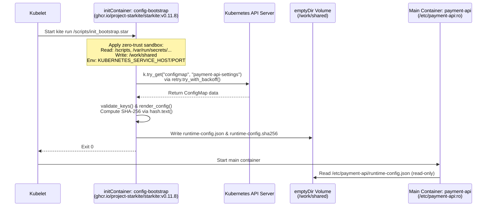

# Why Starkite Is a Better Runtime for Kubernetes Init Containers

Kubernetes `initContainers` execute critical startup choreography before your application containers are allowed to start. In production clusters, pods frequently need an init container to poll the Kubernetes API until an upstream `ConfigMap` or `Secret` is populated by an operator, validate that required configuration parameters are present and properly typed, transform flat key-value strings into a structured configuration file on a shared `emptyDir` volume, and compute a SHA-256 checksum for integrity verification.

Despite how critical this startup phase is, platform teams almost always implement init containers using ad-hoc Bash scripts inside general-purpose utility images (`bitnami/kubectl`, `alpine`, or `ubuntu` with `curl`, `jq`, and `envsubst`) or heavyweight Python images. Both approaches introduce operational friction, unnecessary security exposure, and slow feedback loops.

Starkite (`kite`) provides a purpose-built alternative: a single static binary and deterministic Starlark runtime packaged as a minimal container image (`ghcr.io/project-starkite/starkite:v0.11.8`). Because Starkite embeds native Kubernetes API access, structured JSON/YAML serialization, exponential backoff retries, cryptographic hashing, unit testing, and kernel-level sandboxing directly into the runtime, you can write, unit-test, build, and deploy init containers without a shell or an operating system userland.

---

## Why Traditional Init Containers Fall Short

To understand why init containers become a maintenance burden, compare how a typical shell-based init container is constructed against what the task actually requires. Suppose your `payment-api` service needs an init container to wait for a `ConfigMap` named `payment-api-settings`, verify four required keys (`DB_HOST`, `DB_PORT`, `RATE_LIMIT_RPS`, and `TLS_MODE`), convert `DB_PORT` and `RATE_LIMIT_RPS` from strings to integers, and write `/work/shared/runtime-config.json` along with `/work/shared/runtime-config.sha256`.

In a traditional Deployment, engineers embed an inline `/bin/sh -c` script that chains together `kubectl`, `jq`, and `sha256sum`:

```yaml
# Traditional Bash + kubectl + jq init container
initContainers:
  - name: config-bootstrap
    image: bitnami/kubectl:1.32
    command: ["/bin/sh", "-c"]
    args:
      - |
        set -euo pipefail
         ATTEMPTS=0
        until kubectl get configmap payment-api-settings -n init-demo -o json > /tmp/cm.json 2>/dev/null; do
          ATTEMPTS=$((ATTEMPTS + 1))
          if [ "$ATTEMPTS" -ge 5 ]; then
            echo "Timed out waiting for ConfigMap" >&2
            exit 1
          fi
          sleep 1
        done
        for KEY in DB_HOST DB_PORT RATE_LIMIT_RPS TLS_MODE; do
          VAL=$(jq -r ".data.${KEY} // empty" /tmp/cm.json)
          if [ -z "$VAL" ]; then
            echo "Missing required key: $KEY" >&2
            exit 1
          fi
        done
        jq -n \
          --arg host "$(jq -r '.data.DB_HOST' /tmp/cm.json)" \
          --argjson port "$(jq -r '.data.DB_PORT' /tmp/cm.json)" \
          --arg tls "$(jq -r '.data.TLS_MODE' /tmp/cm.json)" \
          --argjson rps "$(jq -r '.data.RATE_LIMIT_RPS' /tmp/cm.json)" \
          '{service:"payment-api",namespace:"init-demo",database:{host:$host,port:$port,tls_mode:$tls},limits:{rps:$rps}}' \
          > /work/shared/runtime-config.json
        sha256sum /work/shared/runtime-config.json > /work/shared/runtime-config.sha256
```

This 25-line shell snippet suffers from five architectural problems:

1. **Bloated Image & CVE Surface**: To run 25 lines of glue logic, the node must pull an image containing `/bin/sh`, `coreutils`, `kubectl`, `jq`, and shared C libraries. Every package in that base layer triggers vulnerability scanner findings that your team must patch and rebuild.
2. **Fragile String Interpolation & Quoting**: Type conversions (`--argjson`) and shell variable expansions break silently or fail with cryptic syntax errors when a `ConfigMap` value contains whitespace, quotes, or non-numeric characters.
3. **No Local Unit Testing**: You cannot unit-test an inline YAML shell string in CI without spinning up a container or mocking `kubectl` binaries on `$PATH`.
4. **Unconfined Execution**: If an attacker compromises an upstream configuration value or injects a command flag, `/bin/sh` and every utility binary in the container are available for arbitrary command execution.
5. **Ambient Environment Exposure**: Kubernetes automatically injects service discovery variables and any `envFrom` secrets into the container's process environment, exposing them to every subprocess spawned by the shell script.

Starkite eliminates each of these failure modes by replacing the shell and external CLI binaries with built-in Starlark modules and a default-deny sandbox:

| Operational Dimension | Bash + `kubectl` / `jq` Image | Python + `kubernetes` SDK Image | Starkite (`ghcr.io/project-starkite/starkite:v0.11.8`) |
| :--- | :--- | :--- | :--- |
| **Container Base Image** | 80–250 MB OS layer + CLI tools | 120–300 MB OS + Python + `pip` packages | Minimal static binary built on `cgr.dev/chainguard/static` |
| **Shell & Binary Surface** | Requires `/bin/sh`, `kubectl`, `jq`, `coreutils` | Requires Python interpreter + shared libs | Zero shell (`/bin/sh` does not exist in the image) |
| **Kubernetes API Client** | Spawns `kubectl` subprocesses | External `kubernetes` pip package | Built-in `k8s` module with native `InClusterConfig` |
| **Retries & Backoff** | Hand-rolled `until ... sleep` loops | Third-party `tenacity` or custom loops | Built-in `retry.try_with_backoff()` with jitter/delay |
| **Error Handling** | `set -e` exit codes and stderr parsing | Uncaught exceptions and stack traces | Structured `Result` values (`res.ok`, `res.value`, `res.error`) |
| **Unit Testing** | Manual cluster deploys or `bats` | Requires `pytest` + virtualenv setup | Built-in `kite test` runner (executes in <10ms) |
| **Process Confinement** | Unconfined access to container filesystem/env | Unconfined access to container filesystem/env | Zero-trust env scrubbing + path/network sandboxing |

---

## How Starkite Init Containers Work Inside a Pod

Before writing code, it helps to understand how a Starkite init container interacts with the Kubernetes control plane, the Pod's mounted volumes, and the Linux kernel sandbox.



When `kite run` starts inside the `config-bootstrap` init container, two security boundaries work together:

1. **Kubernetes Pod Security (`securityContext` & RBAC)**: The container runs as user `65532` (`runAsNonRoot: true`), drops all Linux capabilities (`drop: ["ALL"]`), enforces a read-only root filesystem (`readOnlyRootFilesystem: true`), and authenticates to the Kubernetes API using a dedicated `ServiceAccount` (`payment-api-sa`) bound to a `Role` that permits only `get` and `list` on `configmaps` in the `init-demo` namespace.
2. **Starkite Zero-Trust Sandbox**: Even within the container, Starkite blocks all filesystem paths, network sockets, and environment variables by default. You grant the script only the exact capabilities it needs via CLI flags:
   - `--sandbox-path-read=/scripts`: Allows reading the mounted `init_bootstrap.star` script.
   - `--sandbox-path-read=/var/run/secrets/kubernetes.io/serviceaccount`: Allows `k8s.config()` to read the Pod's mounted ServiceAccount token and CA certificate.
   - `--sandbox-path-write=/work/shared`: Allows creating and writing `runtime-config.json` and `runtime-config.sha256` inside the shared `emptyDir` volume.
   - `--sandbox-net-allow`: Allows outbound HTTPS calls to the Kubernetes API server.
   - `--env KUBERNETES_SERVICE_HOST --env KUBERNETES_SERVICE_PORT`: Explicitly forwards the two environment variables required by `InClusterConfig` while scrubbing all other ambient variables.

---

## Prerequisites & Companion Files

To run the examples in this guide locally and on a cluster, verify that you have the following tools installed:

- **Starkite CLI (`kite` v0.11.8+)**: Installed on your `$PATH` (or run via `docker run ghcr.io/project-starkite/starkite:v0.11.8`).
- **`kubectl` and a Kubernetes cluster**: Any local cluster (`kind`, `minikube`, `k3d`) or remote development cluster. To create a local `kind` cluster if one is not already running, execute `kind create cluster`.
- **`docker` (Optional)**: Needed only if you want to build a custom self-contained image in Step 3 (Pattern B).

All source files for this walkthrough are located in the [`k8s/init-cluster/`](./) directory:

| File | Purpose |
| :--- | :--- |
| [`init_bootstrap.star`](./init_bootstrap.star) | The Starlark init script that polls the `ConfigMap`, validates keys, and writes the JSON config and SHA-256 digest. |
| [`init_bootstrap_test.star`](./init_bootstrap_test.star) | Unit test suite executed by `kite test` to verify key validation, type conversion, and file output offline. |
| [`generate_manifest.star`](./generate_manifest.star) | Manifest generator that builds the complete 7-resource Kubernetes YAML stack and validates it against a CEL security policy. |
| [`manifest.yaml`](./manifest.yaml) | Pre-generated multi-document Kubernetes manifest ready for `kubectl apply -f ./manifest.yaml`. |
| [`Dockerfile`](./Dockerfile) | Container build definition for packaging `init_bootstrap.star` into a self-contained immutable image on top of `ghcr.io/project-starkite/starkite:v0.11.8`. |
| [`deploy_and_verify.star`](./deploy_and_verify.star) | End-to-end verification script that applies RBAC + ConfigMap prerequisites to your cluster and tests the init workflow live. |

---

## Step 1: Write a Modular Init Container Script

Writing maintainable init container logic starts with separating pure data validation and transformation from cluster I/O. When your key validation and JSON rendering live in standalone Starlark functions (`validate_keys` and `render_config`), your unit tests can import and exercise them directly without needing a live Kubernetes API server.

Examine [`init_bootstrap.star`](./init_bootstrap.star):

```python
#!/usr/bin/env kite

REQUIRED_KEYS = ["DB_HOST", "DB_PORT", "RATE_LIMIT_RPS", "TLS_MODE"]

def validate_keys(raw_data):
    missing = []
    for k in REQUIRED_KEYS:
        if k not in raw_data:
            missing.append(k)
    return missing

def render_config(ns, raw_data):
    return {
        "service": "payment-api",
        "namespace": ns,
        "database": {
            "host": raw_data.get("DB_HOST", "localhost"),
            "port": int(raw_data.get("DB_PORT", "5432")),
            "tls_mode": raw_data.get("TLS_MODE", "strict"),
        },
        "limits": {
            "rps": int(raw_data.get("RATE_LIMIT_RPS", "100")),
        },
    }

def main():
    ns = var_str("namespace", "init-demo")
    cm_name = var_str("configmap", "payment-api-settings")
    out_dir = var_str("out.dir", "/tmp/shared-config")

    k = k8s.config(namespace=ns, timeout="15s")

    printf("Polling ConfigMap %s/%s...\n", ns, cm_name)
    poll_res = retry.try_with_backoff(
        lambda: k.try_get("configmap", cm_name, namespace=ns),
        max_attempts=5,
        delay="300ms",
    )
    if not poll_res.ok:
        fail("dependency check failed for %s/%s: %s" % (ns, cm_name, poll_res.error))

    cm = poll_res.value.value
    raw_data = cm.get("data", {})

    missing = validate_keys(raw_data)
    if len(missing) > 0:
        fail("missing required keys %s in ConfigMap %s" % (", ".join(missing), cm_name))

    dir_res = fs.path(out_dir).try_mkdir(parents=True)
    if not dir_res.ok:
        fail("failed to create output directory %s: %s" % (out_dir, dir_res.error))

    rendered = render_config(ns, raw_data)
    payload = json.encode(rendered)
    digest = hash.text(payload).sha256()

    out_file = out_dir + "/runtime-config.json"
    write_res = fs.path(out_file).try_write_text(payload)
    if not write_res.ok:
        fail("failed to write %s: %s" % (out_file, write_res.error))

    sha_file = out_dir + "/runtime-config.sha256"
    sha_res = fs.path(sha_file).try_write_text(digest + "  runtime-config.json\n")
    if not sha_res.ok:
        fail("failed to write %s: %s" % (sha_file, sha_res.error))

    printf("Init bootstrap complete (attempts=%d):\n", poll_res.value.attempts)
    printf("  Source ConfigMap: %s/%s\n", ns, cm_name)
    printf("  Rendered Config:  %s\n", out_file)
    printf("  SHA-256 Digest:   %s\n", digest[:16] + "...")
```

Notice how each section of `main()` maps to a specific init container requirement:

- **Runtime Parameterization (`var_str`)**: Instead of reading environment variables directly, `var_str("namespace", "init-demo")`, `var_str("configmap", "payment-api-settings")`, and `var_str("out.dir", "/tmp/shared-config")` declare typed script inputs with sensible defaults. You override them via `--var out.dir=/work/shared` in the Pod spec.
- **Dual-Mode Kubernetes Client (`k8s.config`)**: Calling `k8s.config(namespace=ns, timeout="15s")` automatically uses `~/.kube/config` when invoked on your laptop and seamlessly switches to `rest.InClusterConfig()` when running inside a Kubernetes Pod.
- **Resilient Dependency Polling (`retry.try_with_backoff`)**: When a Deployment and its `ConfigMap` are applied simultaneously by Argo CD or Flux, the Pod may start before the `ConfigMap` is visible. Wrapping `k.try_get("configmap", cm_name, namespace=ns)` inside `retry.try_with_backoff(..., max_attempts=5, delay="300ms")` retries transient `NotFound` errors automatically. Once `poll_res.ok` succeeds, `poll_res.value.value` holds the `ConfigMap` dictionary and `poll_res.value.attempts` records how many attempts were required.
- **Fail-Fast Validation (`validate_keys` & `fail`)**: If any required key is absent from `cm.get("data", {})`, calling `fail(...)` terminates the process immediately with a non-zero exit code and prints the missing keys to stderr so Kubernetes blocks the main container from starting.
- **Atomic Artifact & Checksum Generation (`json`, `hash`, `fs`)**: `json.encode()` serializes the typed dictionary (`port` and `rps` as integers), `hash.text(payload).sha256()` computes its 64-character hex digest, and `fs.path(...).try_write_text(...)` writes both files to `out_dir`.

---

## Step 2: Lint and Unit-Test Locally Before Containerization

Before building an image or touching a Kubernetes cluster, you can statically analyze `init_bootstrap.star` and run unit tests against its validation and rendering functions.

The test file [`init_bootstrap_test.star`](./init_bootstrap_test.star) loads `init_bootstrap.star` as a module and defines three `test_*` functions:

```python
#!/usr/bin/env kite

load("./init_bootstrap.star", "init_bootstrap")

def test_validate_keys():
    valid = {
        "DB_HOST": "postgres.internal.svc.cluster.local",
        "DB_PORT": "5432",
        "RATE_LIMIT_RPS": "250",
        "TLS_MODE": "strict",
    }
    assert(len(init_bootstrap.validate_keys(valid)) == 0, "expected no missing keys")

    incomplete = {"DB_HOST": "postgres.internal.svc.cluster.local"}
    missing = init_bootstrap.validate_keys(incomplete)
    assert(len(missing) == 3, "expected 3 missing keys")
    assert("TLS_MODE" in missing, "expected TLS_MODE in missing list")

def test_render_config_types():
    raw = {
        "DB_HOST": "postgres.internal.svc.cluster.local",
        "DB_PORT": "5432",
        "RATE_LIMIT_RPS": "250",
        "TLS_MODE": "strict",
    }
    cfg = init_bootstrap.render_config("init-demo", raw)
    assert(cfg["service"] == "payment-api", "expected service payment-api")
    assert(cfg["namespace"] == "init-demo", "expected namespace init-demo")
    assert(cfg["database"]["port"] == 5432, "expected integer port 5432")
    assert(cfg["limits"]["rps"] == 250, "expected integer rps 250")

def test_json_and_digest_output():
    raw = {
        "DB_HOST": "db.init-demo.svc",
        "DB_PORT": "5432",
        "RATE_LIMIT_RPS": "500",
        "TLS_MODE": "strict",
    }
    payload = json.encode(init_bootstrap.render_config("init-demo", raw))
    digest = hash.text(payload).sha256()
    assert(len(digest) == 64, "expected 64-char sha256 hex digest")

    out_path = "/tmp/test-runtime-config.json"
    w_res = fs.path(out_path).try_write_text(payload)
    assert(w_res.ok, "expected file write to succeed")

    r_res = fs.path(out_path).try_read_text()
    assert(r_res.ok, "expected file read to succeed")
    decoded = json.decode(r_res.value)
    assert(decoded["limits"]["rps"] == 500, "expected decoded rps 500")
```

Run `kite validate --lint` to check syntax and static sandbox lint rules, then execute `kite test` to run the unit test suite:

```bash
cd k8s/init-cluster
kite validate --lint ./init_bootstrap.star ./init_bootstrap_test.star
kite test ./init_bootstrap_test.star \
  --sandbox-path-read=. \
  --sandbox-path-write=/tmp \
  --verbose
```

The linter verifies both files and `kite test` executes all three assertions in under 10 milliseconds:

```text
# (host-specific values differ)
/home/alice/projects/starkite-tutorials/k8s/init-cluster/init_bootstrap.star: OK
/home/alice/projects/starkite-tutorials/k8s/init-cluster/init_bootstrap_test.star: OK
Found 1 test file(s)
Running /home/alice/projects/starkite-tutorials/k8s/init-cluster/init_bootstrap_test.star
  ✓ test_json_and_digest_output (836.546µs)
  ✓ test_render_config_types (38.959µs)
  ✓ test_validate_keys (346.693µs)
============================================================
Tests: 3 passed, 0 failed, 3 total
Time:  9ms
============================================================
```

Because `kite test` runs under the same Starlark sandbox as `kite run`, `--sandbox-path-read=.` grants permission to load `./init_bootstrap.star` and `--sandbox-path-write=/tmp` permits `test_json_and_digest_output` to write `/tmp/test-runtime-config.json`.

---

## Step 3: Build and Package the Init Container

Once your init script passes unit tests, you can package it for Kubernetes using either of two deployment patterns. Both patterns use the official **`ghcr.io/project-starkite/starkite:v0.11.8`** container image.

### Pattern A: Zero-Build Deployment Using Official Image + ConfigMap Mount

In GitOps and rapid-iteration environments, building and pushing a new Docker image every time you tweak an init script adds unnecessary CI overhead. Instead, you can run the upstream `ghcr.io/project-starkite/starkite:v0.11.8` image directly and mount `init_bootstrap.star` into `/scripts/init_bootstrap.star` via a Kubernetes `ConfigMap`.

To make this repeatable and error-free, [`generate_manifest.star`](./generate_manifest.star) reads `./init_bootstrap.star` from disk, constructs the entire 7-resource Kubernetes stack (`Namespace`, `ServiceAccount`, `Role`, `RoleBinding`, settings `ConfigMap`, script `ConfigMap`, and `Deployment`), validates the `Deployment` against a CEL security policy, and prints multi-document YAML:

```python
#!/usr/bin/env kite

def main():
    app = var_str("app", "payment-api")
    ns = var_str("namespace", "init-demo")
    app_image = var_str("image", "busybox:1.37")
    kite_image = var_str("kite.image", "ghcr.io/project-starkite/starkite:v0.11.8")
    script_path = var_str("script.path", "./init_bootstrap.star")

    script_res = fs.path(script_path).try_read_text()
    if not script_res.ok:
        fail("failed to read init script %s: %s" % (script_path, script_res.error))

    ns_obj = k8s.obj.namespace(name=ns)

    sa_name = app + "-sa"
    sa_obj = k8s.obj.service_account(
        name=sa_name,
        namespace=ns,
        automount_service_account_token=True,
    )

    role_name = app + "-config-reader"
    role_obj = k8s.obj.role(
        name=role_name,
        namespace=ns,
        rules=[
            {
                "apiGroups": [""],
                "resources": ["configmaps"],
                "verbs": ["get", "list"],
            },
        ],
    )

    rb_obj = k8s.obj.role_binding(
        name=role_name + "-binding",
        namespace=ns,
        role_ref={
            "apiGroup": "rbac.authorization.k8s.io",
            "kind": "Role",
            "name": role_name,
        },
        subjects=[
            {
                "kind": "ServiceAccount",
                "name": sa_name,
                "namespace": ns,
            },
        ],
    )

    settings_cm = k8s.obj.config_map(
        name=app + "-settings",
        namespace=ns,
        data={
            "DB_HOST": "postgres.internal.svc.cluster.local",
            "DB_PORT": "5432",
            "RATE_LIMIT_RPS": "250",
            "TLS_MODE": "strict",
        },
    )

    script_cm = k8s.obj.config_map(
        name=app + "-init-script",
        namespace=ns,
        data={
            "init_bootstrap.star": script_res.value,
        },
    )

    non_root_ctx = k8s.obj.security_context(
        run_as_non_root=True,
        run_as_user=65532,
        read_only_root=True,
        capabilities={"drop": ["ALL"]},
    )

    init_container = k8s.obj.container(
        name="config-bootstrap",
        image=kite_image,
        args=[
            "run",
            "/scripts/init_bootstrap.star",
            "--sandbox-path-read=/scripts",
            "--sandbox-path-read=/var/run/secrets/kubernetes.io/serviceaccount",
            "--sandbox-path-write=/work/shared",
            "--sandbox-net-allow",
            "--env",
            "KUBERNETES_SERVICE_HOST",
            "--env",
            "KUBERNETES_SERVICE_PORT",
            "--var",
            "namespace=" + ns,
            "--var",
            "out.dir=/work/shared",
        ],
        security_context=non_root_ctx,
        resources=k8s.obj.resource_requirements(
            requests={"cpu": "25m", "memory": "32Mi"},
            limits={"cpu": "100m", "memory": "64Mi"},
        ),
        volume_mounts=[
            k8s.obj.volume_mount(name="shared-config", mount_path="/work/shared"),
            k8s.obj.volume_mount(name="bootstrap-script", mount_path="/scripts", read_only=True),
        ],
    )

    app_container = k8s.obj.container(
        name=app,
        image=app_image,
        command=[
            "sh",
            "-c",
            "cat /etc/payment-api/runtime-config.json && echo '' && cat /etc/payment-api/runtime-config.sha256 && sleep 3600",
        ],
        ports=[k8s.obj.container_port(container_port=8080, name="http")],
        security_context=non_root_ctx,
        resources=k8s.obj.resource_requirements(
            requests={"cpu": "100m", "memory": "128Mi"},
            limits={"cpu": "500m", "memory": "256Mi"},
        ),
        volume_mounts=[
            k8s.obj.volume_mount(name="shared-config", mount_path="/etc/payment-api", read_only=True),
        ],
    )

    dep = k8s.obj.deployment(
        name=app,
        namespace=ns,
        labels={"app": app},
        replicas=2,
        service_account=sa_name,
        init_containers=[init_container],
        containers=[app_container],
        volumes=[
            k8s.obj.volume(name="shared-config", empty_dir={}),
            k8s.obj.volume(name="bootstrap-script", config_map={"name": app + "-init-script"}),
        ],
    )

    check = k8s.try_validate(
        manifest=dep,
        expression="object.spec.template.spec.initContainers.all(c, c.securityContext.runAsNonRoot == true && c.securityContext.readOnlyRootFilesystem == true)",
    )
    if not check.ok:
        fail("validation call failed: %s" % check.error)
    if not check.value.valid:
        fail("init container security validation failed: %s" % check.value.violations)

    stack = [ns_obj, sa_obj, role_obj, rb_obj, settings_cm, script_cm, dep]
    print(k8s.yaml(stack))
```

Generate the manifest file locally by running `generate_manifest.star`:

```bash
kite run ./generate_manifest.star \
  --sandbox-path-read=. \
  --var script.path=./init_bootstrap.star > ./manifest.yaml
```

Inspect the `Deployment` section of the resulting [`manifest.yaml`](./manifest.yaml):

```yaml
apiVersion: apps/v1
kind: Deployment
metadata:
  labels:
    app: payment-api
  name: payment-api
  namespace: init-demo
spec:
  replicas: 2
  selector:
    matchLabels:
      app: payment-api
  template:
    metadata:
      labels:
        app: payment-api
    spec:
      containers:
        - command:
            - sh
            - -c
            - cat /etc/payment-api/runtime-config.json && echo '' && cat /etc/payment-api/runtime-config.sha256 && sleep 3600
          image: busybox:1.37
          name: payment-api
          ports:
            - containerPort: 8080
              name: http
              protocol: TCP
          resources:
            limits:
              cpu: 500m
              memory: 256Mi
            requests:
              cpu: 100m
              memory: 128Mi
          securityContext:
            capabilities:
              drop:
                - ALL
            readOnlyRootFilesystem: true
            runAsNonRoot: true
            runAsUser: 65532
          volumeMounts:
            - mountPath: /etc/payment-api
              name: shared-config
              readOnly: true
      initContainers:
        - args:
            - run
            - /scripts/init_bootstrap.star
            - --sandbox-path-read=/scripts
            - --sandbox-path-read=/var/run/secrets/kubernetes.io/serviceaccount
            - --sandbox-path-write=/work/shared
            - --sandbox-net-allow
            - --env
            - KUBERNETES_SERVICE_HOST
            - --env
            - KUBERNETES_SERVICE_PORT
            - --var
            - namespace=init-demo
            - --var
            - out.dir=/work/shared
          image: ghcr.io/project-starkite/starkite:v0.11.8
          name: config-bootstrap
          resources:
            limits:
              cpu: 100m
              memory: 64Mi
            requests:
              cpu: 25m
              memory: 32Mi
          securityContext:
            capabilities:
              drop:
                - ALL
            readOnlyRootFilesystem: true
            runAsNonRoot: true
            runAsUser: 65532
          volumeMounts:
            - mountPath: /work/shared
              name: shared-config
            - mountPath: /scripts
              name: bootstrap-script
              readOnly: true
      serviceAccountName: payment-api-sa
      volumes:
        - emptyDir: {}
          name: shared-config
        - configMap:
            name: payment-api-init-script
          name: bootstrap-script
```

Notice how `shared-config` (`emptyDir`) bridges the two containers with least privilege: `config-bootstrap` mounts it read-write at `/work/shared` (and grants `--sandbox-path-write=/work/shared`), while the main `payment-api` container mounts the exact same volume **read-only** (`readOnly: true`) at `/etc/payment-api`.

---

### Pattern B: Self-Contained Immutable Image via `Dockerfile`

Some regulated production environments prohibit mounting executable scripts from `ConfigMap` objects and require every artifact to be baked into a signed, immutable container image. Because `ghcr.io/project-starkite/starkite:v0.11.8` already contains the `kite` binary and CA certificates on a minimal `chainguard/static` rootfs, your [`Dockerfile`](./Dockerfile) only needs a single `COPY` layer:

```dockerfile
FROM ghcr.io/project-starkite/starkite:v0.11.8

COPY init_bootstrap.star /scripts/init_bootstrap.star

USER 65532:65532
ENTRYPOINT ["kite", "run", "/scripts/init_bootstrap.star"]
CMD [ \
    "--sandbox-path-read=/scripts", \
    "--sandbox-path-read=/var/run/secrets/kubernetes.io/serviceaccount", \
    "--sandbox-path-write=/work/shared", \
    "--sandbox-net-allow", \
    "--env", "KUBERNETES_SERVICE_HOST", \
    "--env", "KUBERNETES_SERVICE_PORT", \
    "--var", "out.dir=/work/shared" \
]
```

Build the custom init image and load it into your `kind` cluster (or push it to your container registry):

```bash
# Build the self-contained init image
docker build -t payment-api-init:v0.1.0 .

# Load the image directly into a local kind cluster
kind load docker-image payment-api-init:v0.1.0
```

When using the self-contained `payment-api-init:v0.1.0` image, you no longer need the `bootstrap-script` `ConfigMap` volume. You can generate the manifest with `--var kite.image=payment-api-init:v0.1.0` or pass runtime `--var` overrides in `args`.

---

## Step 4: Deploy and Test on a Kubernetes Cluster

Now that the script, unit tests, and manifests are ready, you can verify the init container against a live Kubernetes cluster in three stages: automated pre-deployment verification, full Pod deployment inspection, and failure-mode testing.

### 1. Automated Live-Cluster Verification (`deploy_and_verify.star`)

During development or CI integration testing, you often want to apply the RBAC and `ConfigMap` prerequisites to a test cluster, run `init_bootstrap.star` against the live Kubernetes API server, and verify the rendered files on disk in a single command.

The script in [`deploy_and_verify.star`](./deploy_and_verify.star) automates this entire verification loop:

```python
#!/usr/bin/env kite

load("./init_bootstrap.star", "init_bootstrap")

def main():
    app = var_str("app", "payment-api")
    ns = var_str("namespace", "init-demo")
    out_dir = var_str("out.dir", "/tmp/shared-config")

    k = k8s.config(namespace=ns, timeout="15s")

    ns_obj = k8s.obj.namespace(name=ns)
    sa_name = app + "-sa"
    sa_obj = k8s.obj.service_account(
        name=sa_name,
        namespace=ns,
        automount_service_account_token=True,
    )
    role_name = app + "-config-reader"
    role_obj = k8s.obj.role(
        name=role_name,
        namespace=ns,
        rules=[
            {
                "apiGroups": [""],
                "resources": ["configmaps"],
                "verbs": ["get", "list"],
            },
        ],
    )
    rb_obj = k8s.obj.role_binding(
        name=role_name + "-binding",
        namespace=ns,
        role_ref={
            "apiGroup": "rbac.authorization.k8s.io",
            "kind": "Role",
            "name": role_name,
        },
        subjects=[
            {
                "kind": "ServiceAccount",
                "name": sa_name,
                "namespace": ns,
            },
        ],
    )
    settings_cm = k8s.obj.config_map(
        name=app + "-settings",
        namespace=ns,
        data={
            "DB_HOST": "postgres.internal.svc.cluster.local",
            "DB_PORT": "5432",
            "RATE_LIMIT_RPS": "250",
            "TLS_MODE": "strict",
        },
    )

    prereqs = [ns_obj, sa_obj, role_obj, rb_obj, settings_cm]
    for obj in prereqs:
        res = k.try_apply(obj, namespace=ns)
        if not res.ok:
            fail("failed to apply %s: %s" % (obj.kind, res.error))

    init_bootstrap.main()

    cfg_path = out_dir + "/runtime-config.json"
    sha_path = out_dir + "/runtime-config.sha256"

    cfg_res = fs.path(cfg_path).try_read_text()
    if not cfg_res.ok:
        fail("failed to read rendered config: %s" % cfg_res.error)

    sha_res = fs.path(sha_path).try_read_text()
    if not sha_res.ok:
        fail("failed to read sha256 file: %s" % sha_res.error)

    actual_digest = hash.text(cfg_res.value).sha256()
    recorded_digest = sha_res.value.split(" ")[0]
    if actual_digest != recorded_digest:
        fail("digest mismatch: actual=%s recorded=%s" % (actual_digest, recorded_digest))

    parsed = json.decode(cfg_res.value)

    tbl = table.new(["Check", "Target", "Result"])
    tbl.add_row("RBAC & ConfigMap Apply", ns + "/" + app + "-settings", "APPLIED (5 resources)")
    tbl.add_row("Init Script Execution", cfg_path, "RENDERED")
    tbl.add_row("Database Endpoint", parsed["database"]["host"] + ":" + str(int(parsed["database"]["port"])), "VERIFIED")
    tbl.add_row("Rate Limit (RPS)", str(int(parsed["limits"]["rps"])), "VERIFIED")
    tbl.add_row("SHA-256 Integrity", actual_digest[:16] + "...", "MATCHED")
    print("\n" + tbl.render().strip())
```

Execute `deploy_and_verify.star` against your cluster:

```bash
kite run ./deploy_and_verify.star \
  --sandbox-path-read=. \
  --sandbox-path-read=$HOME/.kube \
  --sandbox-path-write=/tmp \
  --sandbox-net-allow \
  --env HOME
```

```text
# (host-specific values differ)
Polling ConfigMap init-demo/payment-api-settings...
Init bootstrap complete (attempts=1):
  Source ConfigMap: init-demo/payment-api-settings
  Rendered Config:  /tmp/shared-config/runtime-config.json
  SHA-256 Digest:   6a06456e6644f130...

Check                  | Target                                   | Result               
-----------------------+------------------------------------------+----------------------
RBAC & ConfigMap Apply | init-demo/payment-api-settings           | APPLIED (5 resources)
Init Script Execution  | /tmp/shared-config/runtime-config.json   | RENDERED             
Database Endpoint      | postgres.internal.svc.cluster.local:5432 | VERIFIED             
Rate Limit (RPS)       | 250                                      | VERIFIED             
SHA-256 Integrity      | 6a06456e6644f130...                      | MATCHED
```

### 2. Full Pod Deployment & Container Log Inspection (`kubectl`)

Next, deploy the full stack (including the `Deployment` with the `ghcr.io/project-starkite/starkite:v0.11.8` init container) to your cluster using `manifest.yaml` (or by piping `generate_manifest.star` directly into `kubectl apply -f -`):

```bash
kubectl apply -f ./manifest.yaml
kubectl -n init-demo rollout status deployment/payment-api --timeout=60s
```

Inspect the running Pods and view the logs emitted by both the `config-bootstrap` init container and the `payment-api` application container:

```bash
# 1. Verify Pod status
kubectl -n init-demo get pods -l app=payment-api

# 2. Check the Starkite init container output
kubectl -n init-demo logs deployment/payment-api -c config-bootstrap

# 3. Verify the main container read the rendered JSON and SHA-256 checksum
kubectl -n init-demo logs deployment/payment-api -c payment-api
```

```text
# (host-specific values differ)
$ kubectl -n init-demo logs deployment/payment-api -c config-bootstrap
Polling ConfigMap init-demo/payment-api-settings...
Init bootstrap complete (attempts=1):
  Source ConfigMap: init-demo/payment-api-settings
  Rendered Config:  /work/shared/runtime-config.json
  SHA-256 Digest:   6a06456e6644f130...

$ kubectl -n init-demo logs deployment/payment-api -c payment-api
{"database":{"host":"postgres.internal.svc.cluster.local","port":5432,"tls_mode":"strict"},"limits":{"rps":250},"namespace":"init-demo","service":"payment-api"}
6a06456e6644f13083c2459a4a63578cf88b17344f97f42a30a41a2b204237a5  runtime-config.json
```

### 3. Testing Failure Gating When Configuration Is Invalid

A reliable init container must block the application container from starting when upstream configuration is incomplete or malformed. You can verify this failure gate by removing the required `TLS_MODE` key from `payment-api-settings` and restarting the Deployment:

```bash
# Remove TLS_MODE from the ConfigMap
kubectl -n init-demo patch configmap payment-api-settings --type=json \
  -p='[{"op": "remove", "path": "/data/TLS_MODE"}]'

# Trigger a rollout to run the init container against the incomplete ConfigMap
kubectl -n init-demo rollout restart deployment/payment-api
```

When you inspect the new Pod's init container logs, Starkite pinpoints the exact missing key and halts Pod initialization (`Init:Error` / `Init:CrashLoopBackOff`) before the main application container ever starts:

```text
# (host-specific values differ)
Polling ConfigMap init-demo/payment-api-settings...
Error: script error: fail: missing required keys TLS_MODE in ConfigMap payment-api-settings
```

Re-applying `manifest.yaml` restores `TLS_MODE: strict` to the `ConfigMap` and allows the Pod to complete initialization cleanly:

```bash
kubectl apply -f ./manifest.yaml
```

By replacing ad-hoc shell scripts and utility images with `ghcr.io/project-starkite/starkite:v0.11.8`, your Kubernetes init containers gain fast offline unit tests, native Kubernetes API retries, CEL-validated manifests, and default-deny runtime sandboxing.
