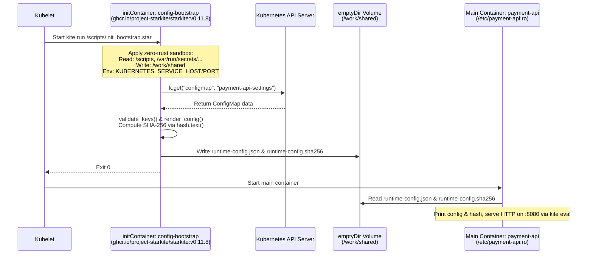

# Why Starkite Is a Better Runtime for Kubernetes Init Containers

Kubernetes `initContainers` execute critical startup choreography before your application containers are allowed to start. In production clusters, pods frequently need an init container to retrieve configuration from the Kubernetes API, validate that required parameters are present and properly typed, transform flat key-value strings into structured configuration on a shared `emptyDir` volume, and compute a SHA-256 checksum for integrity verification.

Despite how critical this startup phase is, platform teams almost always implement init containers using ad-hoc shell scripts inside general-purpose utility images (`alpine/k8s`, `alpine`, or `ubuntu` with `kubectl`, `curl`, and `jq`) or heavyweight Python images. Both approaches introduce operational friction, unnecessary security exposure, and slow feedback loops.

Starkite (`kite`) provides a purpose-built alternative: a single static binary and deterministic Starlark runtime packaged as a minimal container image (`ghcr.io/project-starkite/starkite:v0.11.8`). Because Starkite embeds Kubernetes API access, structured JSON/YAML serialization, cryptographic hashing, unit testing, and kernel-level sandboxing directly into the runtime, you can write, unit-test, and deploy init containers without a shell or an operating system userland.

---

## Why Traditional Init Containers Fall Short

To understand why init containers become a maintenance burden, compare how a typical shell-based init container is constructed against what the task actually requires. Suppose your `payment-api` service needs an init container to read a `ConfigMap` named `payment-api-settings`, verify four required keys (`DB_HOST`, `DB_PORT`, `RATE_LIMIT_RPS`, and `TLS_MODE`), convert `DB_PORT` and `RATE_LIMIT_RPS` from strings to integers, and write `/work/shared/runtime-config.json` along with `/work/shared/runtime-config.sha256`.

In a traditional Deployment—assuming the Pod mounts a `shared-config` `emptyDir` volume and binds a `ServiceAccount` authorized to read `configmaps`—engineers embed an inline `/bin/sh -c` script inside a utility image such as `alpine/k8s` to chain together `kubectl`, `jq`, and `sha256sum`:

```yaml
# Traditional POSIX sh + kubectl + jq init container
initContainers:
  - name: config-bootstrap
    image: alpine/k8s:1.32.2
    command: ["/bin/sh", "-c"]
    args:
      - |
        set -eu

        cm_json=$(kubectl -n init-demo get configmap payment-api-settings -o json)

        for key in DB_HOST DB_PORT RATE_LIMIT_RPS TLS_MODE; do
          if [ -z "$(printf '%s\n' "$cm_json" | jq -r ".data.${key} // empty")" ]; then
            echo "Missing required key ${key} in ConfigMap payment-api-settings" >&2
            exit 1
          fi
        done

        cd /work/shared
        printf '%s\n' "$cm_json" | jq -c '{
          service: "payment-api",
          namespace: "init-demo",
          database: {
            host: .data.DB_HOST,
            port: (.data.DB_PORT | tonumber),
            tls_mode: .data.TLS_MODE
          },
          limits: {
            rps: (.data.RATE_LIMIT_RPS | tonumber)
          }
        }' > runtime-config.json
        sha256sum runtime-config.json > runtime-config.sha256
    volumeMounts:
      - name: shared-config
        mountPath: /work/shared
```

Even when written cleanly, this shell-based approach carries four structural limitations:

1. **Bloated Image & CVE Surface**: For ~25 lines of startup logic, the node must pull a multi-tool utility image (`alpine/k8s`) bundling an OS userland, `/bin/sh`, `kubectl`, `jq`, `curl`, and shared C/TLS libraries. Every package in that base layer increases pull latency and triggers vulnerability scanner findings.
2. **Opaque Subprocess & Error Plumbing**: The script glues together `kubectl`, `jq`, and `sha256sum` through text streams and exit codes. Type conversion errors (`tonumber`) surface only as raw stderr text at Pod startup.
3. **Fragile String Interpolation**: Building structured JSON through shell variable expansions breaks silently or fails with cryptic syntax errors when values contain whitespace or quotes.
4. **Unconfined Runtime Inside the Container**: Even in restricted namespaces, `/bin/sh`, `curl`, `kubectl`, and every utility binary in the image remain executable, with unrestricted read access across the container rootfs and outbound network access.

Starkite eliminates each of these failure modes by replacing the shell and external CLI binaries with built-in Starlark modules and a default-deny sandbox:

| Operational Dimension | Shell + Utility Image (`alpine/k8s`) | Python + `kubernetes` SDK Image | Starkite (`ghcr.io/project-starkite/starkite:v0.11.8`) |
| :--- | :--- | :--- | :--- |
| **Container Base Image** | 80–250 MB OS layer + CLI tools | 120–300 MB OS + Python + `pip` packages | Minimal static binary built on `cgr.dev/chainguard/static` |
| **Shell & Binary Surface** | Requires `/bin/sh`, `kubectl`, `jq`, `coreutils` | Requires Python interpreter + shared libs | Zero shell (`/bin/sh` does not exist in the image) |
| **Kubernetes API Client** | Spawns `kubectl` subprocesses | External `kubernetes` pip package | Built-in `k8s` module with `InClusterConfig` |
| **Error Handling** | `set -eu` exit codes and stderr redirection | Uncaught exceptions and stack traces | Fail-fast Starlark statements (`fail(...)`) |
| **Unit Testing** | Manual cluster deploys or `bats` | Requires `pytest` + virtualenv setup | Built-in `kite test` runner (executes in <10ms) |
| **Process Confinement** | Unconfined access to container filesystem/env | Unconfined access to container filesystem/env | Zero-trust env scrubbing + path/network sandboxing |

---

## How Starkite Init Containers Work Inside a Pod

Before writing code, examine how a Starkite init container interacts with the Kubernetes control plane, the Pod's mounted volumes, and the Linux kernel sandbox.



When `kite run` starts inside the `config-bootstrap` init container, Starkite blocks all filesystem paths, network sockets, and environment variables by default. You grant the script only the exact capabilities it needs via CLI flags:

- `--sandbox-path-read=/scripts`: Allows reading the mounted `init_bootstrap.star` script.
- `--sandbox-path-read=/var/run/secrets/kubernetes.io/serviceaccount`: Allows `k8s.config()` to read the Pod's mounted ServiceAccount token and CA certificate.
- `--sandbox-path-write=/work/shared`: Allows creating and writing `runtime-config.json` and `runtime-config.sha256` inside the shared `emptyDir` volume.
- `--sandbox-net-allow`: Allows outbound HTTPS calls to the Kubernetes API server.
- `--env=KUBERNETES_SERVICE_HOST --env=KUBERNETES_SERVICE_PORT`: Forwards the environment variables required by `InClusterConfig` while scrubbing all other ambient variables.

---

## Companion Files

All files for this walkthrough are located in [`k8s/init-cluster/`](./):

| File | Purpose |
| :--- | :--- |
| [`init_bootstrap.star`](./init_bootstrap.star) | Standalone Starlark init script that retrieves the `ConfigMap`, validates keys, and writes the JSON configuration and SHA-256 digest. |
| [`init_bootstrap_test.star`](./init_bootstrap_test.star) | Simple unit test script executed offline by `kite test` to verify validation and config rendering logic. |
| [`manifest.star`](./manifest.star) | Manifest generator that builds the complete Kubernetes stack and prints YAML for direct piping to `kubectl`. |
| [`manifest.yaml`](./manifest.yaml) | Pre-generated multi-document Kubernetes manifest ready for `kubectl apply -f ./manifest.yaml`. |
| [`verify.star`](./verify.star) | Verification script that waits for deployment availability and verifies container logs and SHA-256 digests. |

---

## Step 1: Write a Simple Init Script

Keep the bootstrap logic minimal and direct. Separate pure key validation and configuration rendering into functions so they can be unit-tested offline.

Examine [`init_bootstrap.star`](./init_bootstrap.star):

```python
#!/usr/bin/env kite

REQUIRED_KEYS = ["DB_HOST", "DB_PORT", "RATE_LIMIT_RPS", "TLS_MODE"]

def validate_keys(data):
    return [k for k in REQUIRED_KEYS if not data.get(k)]

def render_config(ns, data):
    return {
        "service": "payment-api",
        "namespace": ns,
        "database": {
            "host": data["DB_HOST"],
            "port": int(data["DB_PORT"]),
            "tls_mode": data["TLS_MODE"],
        },
        "limits": {
            "rps": int(data["RATE_LIMIT_RPS"]),
        },
    }

def main():
    ns = var_str("namespace", "init-demo")
    out = fs.path(var_str("out.dir", "/work/shared"))

    k = k8s.config(namespace=ns)
    cm = k.get("configmap", "payment-api-settings")

    data = cm.get("data", {})
    missing = validate_keys(data)
    if missing:
        fail("missing required keys: %s" % ", ".join(missing))

    payload = json.encode(render_config(ns, data))
    out.mkdir(parents=True)
    (out / "runtime-config.json").write_text(payload)
    (out / "runtime-config.sha256").write_text(hash.text(payload).sha256() + "  runtime-config.json\n")
```

The script is direct and readable:

- **Dual-Mode Kubernetes Client (`k8s.config`)**: In-cluster, `k8s.config(namespace=ns)` automatically loads `rest.InClusterConfig()` using the Pod's mounted ServiceAccount token and CA cert.
- **Direct Resource Retrieval (`k.get`)**: Retrieves `payment-api-settings` directly from the Kubernetes API server.
- **Fail-Fast Validation (`validate_keys` & `fail`)**: `[k for k in REQUIRED_KEYS if not data.get(k)]` checks that all required keys are present and non-empty. If any key is missing, `fail(...)` exits non-zero immediately.
- **Structured Rendering & Checksum**: `json.encode` converts types (`port` and `rps` to integers), `hash.text(payload).sha256()` produces the digest, and `(out / "filename").write_text(...)` writes both files directly into `/work/shared`.

---

## Step 2: Unit-Test the Init Script Offline

Before deploying to a cluster, verify the validation and rendering functions using `kite test`.

Examine [`init_bootstrap_test.star`](./init_bootstrap_test.star):

```python
#!/usr/bin/env kite

load("./init_bootstrap.star", "init_bootstrap")

SAMPLE_DATA = {
    "DB_HOST": "postgres.internal.svc.cluster.local",
    "DB_PORT": "5432",
    "RATE_LIMIT_RPS": "250",
    "TLS_MODE": "strict",
}

def test_validate_keys():
    assert_equal(init_bootstrap.validate_keys(SAMPLE_DATA), [])
    missing = init_bootstrap.validate_keys({"DB_HOST": "db", "TLS_MODE": ""})
    assert_equal(len(missing), 3)

def test_render_config():
    cfg = init_bootstrap.render_config("init-demo", SAMPLE_DATA)
    assert_equal(cfg["service"], "payment-api")
    assert_equal(cfg["database"]["port"], 5432)
    assert_equal(cfg["limits"]["rps"], 250)
```

Run `kite test` from the `k8s/init-cluster` directory:

```bash
cd k8s/init-cluster
kite test ./init_bootstrap_test.star --sandbox-path-read=.
```

```text
# (host-specific values differ)
Found 1 test file(s)
============================================================
Tests: 2 passed, 0 failed, 2 total
Time:  4ms
============================================================
```

---

## Step 3: Generate Manifest and Deploy with `kubectl`

[`manifest.star`](./manifest.star) constructs the complete Kubernetes stack (`Namespace`, `ServiceAccount`, `Role`, `RoleBinding`, settings `ConfigMap`, script `ConfigMap`, and `Deployment`) and outputs multi-document YAML:

```python
#!/usr/bin/env kite

def build_stack(
    app="payment-api",
    ns="init-demo",
    kite_image="ghcr.io/project-starkite/starkite:v0.11.8",
):
    sa = k8s.obj.service_account(name=app + "-sa", namespace=ns)
    role_name = app + "-config-reader"
    role = k8s.obj.role(
        name=role_name,
        namespace=ns,
        rules=[k8s.obj.policy_rule(api_groups=[""], resources=["configmaps"], verbs=["get", "list"])],
    )
    rb = k8s.obj.role_binding(
        name=role_name + "-binding",
        namespace=ns,
        role_ref={"apiGroup": "rbac.authorization.k8s.io", "kind": "Role", "name": role_name},
        subjects=[k8s.obj.subject(kind="ServiceAccount", name=sa, namespace=ns)],
    )
    settings_cm = k8s.obj.config_map(
        name=app + "-settings",
        namespace=ns,
        data={
            "DB_HOST": "postgres.internal.svc.cluster.local",
            "DB_PORT": "5432",
            "RATE_LIMIT_RPS": "250",
            "TLS_MODE": "strict",
        },
    )
    script_path = var_str("script", "./init_bootstrap.star")
    script_cm = k8s.obj.config_map(
        name=app + "-init-script",
        namespace=ns,
        data={"init_bootstrap.star": fs.read_text(script_path)},
    )

    init_container = k8s.obj.container(
        name="config-bootstrap",
        image=kite_image,
        args=[
            "run",
            "/scripts/init_bootstrap.star",
            "--sandbox-path-read=/scripts",
            "--sandbox-path-read=/var/run/secrets/kubernetes.io/serviceaccount",
            "--sandbox-path-write=/work/shared",
            "--sandbox-net-allow",
            "--env=KUBERNETES_SERVICE_HOST",
            "--env=KUBERNETES_SERVICE_PORT",
        ],
        volume_mounts=[
            k8s.obj.volume_mount(name="shared-config", mount_path="/work/shared"),
            k8s.obj.volume_mount(name="bootstrap-script", mount_path="/scripts", read_only=True),
        ],
    )

    app_container = k8s.obj.container(
        name=app,
        image=kite_image,
        command=["kite", "eval"],
        args=[
            """def main():
    cfg = fs.read_text("/etc/payment-api/runtime-config.json")
    sha = fs.read_text("/etc/payment-api/runtime-config.sha256")
    print(cfg)
    print(sha)
    http.serve({"GET /": lambda req: {"status": 200, "headers": {"Content-Type": "application/json"}, "body": cfg}}, port=8080)
""",
            "--sandbox-path-read=/etc/payment-api",
            "--sandbox-net-allow",
        ],
        ports=[k8s.obj.container_port(container_port=8080, name="http")],
        volume_mounts=[
            k8s.obj.volume_mount(name="shared-config", mount_path="/etc/payment-api", read_only=True),
        ],
    )

    dep = k8s.obj.deployment(
        name=app,
        namespace=ns,
        labels={"app": app},
        replicas=2,
        service_account=sa,
        init_containers=[init_container],
        containers=[app_container],
        volumes=[
            k8s.obj.volume(name="shared-config", empty_dir=True),
            k8s.obj.volume(name="bootstrap-script", config_map=script_cm),
        ],
    )

    return [k8s.obj.namespace(name=ns), sa, role, rb, settings_cm, script_cm, dep]

def main():
    stack = build_stack(
        app=var_str("app", "payment-api"),
        ns=var_str("namespace", "init-demo"),
    )
    print(k8s.yaml(stack))
```

Deploy the stack directly to your cluster by piping `manifest.star` into `kubectl apply`:

```bash
kite run ./manifest.star --sandbox-path-read=. | kubectl apply -f -
```

Or save to [`manifest.yaml`](./manifest.yaml) first:

```bash
kite run ./manifest.star --sandbox-path-read=. > ./manifest.yaml
kubectl apply -f ./manifest.yaml
```

```text
# (host-specific values differ)
namespace/init-demo created
serviceaccount/payment-api-sa created
role.rbac.authorization.k8s.io/payment-api-config-reader created
rolebinding.rbac.authorization.k8s.io/payment-api-config-reader-binding created
configmap/payment-api-settings created
configmap/payment-api-init-script created
deployment.apps/payment-api created
```

---

## Step 4: Verify Deployment on Cluster

[`verify.star`](./verify.star) uses `k8s.wait_for` to poll for Deployment readiness, inspects the running Pod logs, and checks the SHA-256 digest:

```python
#!/usr/bin/env kite

def main():
    app = var_str("app", "payment-api")
    ns = var_str("namespace", "init-demo")

    k = k8s.config(namespace=ns, timeout="30s")

    ready = k.wait_for("deployment", app, condition="Available", timeout="60s")
    if not ready.ready:
        fail("deployment %s not available: %s" % (app, ready.message))

    pods = [p for p in k.list("pods", labels="app=" + app) if p.status.phase == "Running"]
    if not pods:
        fail("no running pods found for app=%s" % app)
    pod_name = pods[0].metadata.name

    app_lines = [l for l in k.logs(pod_name, container=app).strip().split("\n") if not l.startswith("sandbox:")]
    raw_json = app_lines[0]
    recorded_digest = app_lines[1].split(" ")[0]

    actual_digest = hash.text(raw_json).sha256()
    if actual_digest != recorded_digest:
        fail("digest mismatch: actual=%s recorded=%s" % (actual_digest, recorded_digest))

    parsed = json.decode(raw_json)

    tbl = table.new(["Check", "Target", "Result"])
    tbl.add_row("Deployment Readiness", "deployment/" + app, "AVAILABLE (%d pods)" % len(pods))
    tbl.add_row("Database Endpoint", "%s:%d" % (parsed["database"]["host"], int(parsed["database"]["port"])), "VERIFIED")
    tbl.add_row("Rate Limit (RPS)", str(int(parsed["limits"]["rps"])), "VERIFIED")
    tbl.add_row("SHA-256 Integrity", actual_digest[:16] + "...", "MATCHED")
    print(tbl.render().strip())
```

Run `verify.star`:

```bash
kite run ./verify.star \
  --sandbox-path-read=. \
  --sandbox-path-read=$HOME/.kube \
  --sandbox-net-allow \
  --env=HOME
```

```text
# (host-specific values differ)
Check                | Target                                   | Result            
---------------------+------------------------------------------+-------------------
Deployment Readiness | deployment/payment-api                   | AVAILABLE (2 pods)
Database Endpoint    | postgres.internal.svc.cluster.local:5432 | VERIFIED          
Rate Limit (RPS)     | 250                                      | VERIFIED          
SHA-256 Integrity    | 6a06456e6644f130...                      | MATCHED
```

### Testing Failure Gating

To verify that the init container halts the Pod rollout when required configuration is missing, remove `TLS_MODE` from `payment-api-settings` and trigger a restart:

```bash
# Remove TLS_MODE from ConfigMap
kubectl -n init-demo patch configmap payment-api-settings --type=json \
  -p='[{"op": "remove", "path": "/data/TLS_MODE"}]'

# Rollout restart
kubectl -n init-demo rollout restart deployment/payment-api
```

Checking the Pod status and `config-bootstrap` logs confirms that Kubernetes keeps existing healthy replicas serving traffic while halting replacement Pods in `Init:Error`:

```text
# (host-specific values differ)
$ kubectl -n init-demo get pods -l app=payment-api
NAME                           READY   STATUS       RESTARTS   AGE
payment-api-5bb4c8f84d-d7mpb   1/1     Running      0          2m
payment-api-5bb4c8f84d-sglb8   1/1     Running      0          2m
payment-api-7b89f7f45c-k9x2w   0/1     Init:Error   0          8s

$ kubectl -n init-demo logs payment-api-7b89f7f45c-k9x2w -c config-bootstrap
Error: script error: missing required keys: TLS_MODE
```

Restore `manifest.yaml` to complete initialization cleanly:

```bash
kubectl apply -f ./manifest.yaml
```
