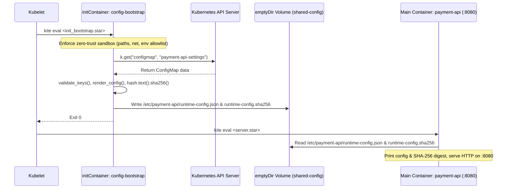

# Sandboxed Kubernetes Init Containers with Starkite

Kubernetes `initContainers` run to completion before the Kubelet starts any application container in a Pod. You use them to fetch configuration from the cluster API, validate required values, stage files onto a shared volume, or check upstream services. When an init container exits non-zero, Kubernetes halts the Pod startup so a misconfigured application never receives traffic.

Starkite (`kite`) replaces the shell scripts and utility images in that startup step with a single static binary (`ghcr.io/project-starkite/starkite:v0.11.8`, built on `cgr.dev/chainguard/static`). It embeds Starlark modules for the Kubernetes API (`k8s`), filesystem operations (`fs`), JSON (`json`), and hashing (`hash`), and runs every script inside a default-deny kernel sandbox with no shell in the image.

---

## Why Shell Init Containers Break Down

Consider a `payment-api` Deployment that needs configuration from a `ConfigMap` named `payment-api-settings` before its HTTP server starts. The init container must check four required keys (`DB_HOST`, `DB_PORT`, `RATE_LIMIT_RPS`, and `TLS_MODE`), parse `DB_PORT` and `RATE_LIMIT_RPS` as integers, write `/etc/payment-api/runtime-config.json`, and write a SHA-256 checksum to `/etc/payment-api/runtime-config.sha256`.

In a typical Pod spec, you mount a shared `emptyDir` volume, bind a `ServiceAccount` with read access to `configmaps`, and embed an inline `/bin/sh -c` script inside an image like `alpine/k8s`:

```yaml
# Traditional POSIX sh + kubectl + jq init container
initContainers:
  - name: config-bootstrap
    image: alpine/k8s:1.32.2
    command: ["/bin/sh", "-c"]
    args:
      - |
        set -eu

        cm_json=$(kubectl -n init-demo get configmap payment-api-settings -o json)

        for key in DB_HOST DB_PORT RATE_LIMIT_RPS TLS_MODE; do
          if [ -z "$(printf '%s\n' "$cm_json" | jq -r ".data.${key} // empty")" ]; then
            echo "Missing required key ${key} in ConfigMap payment-api-settings" >&2
            exit 1
          fi
        done

        cd /etc/payment-api
        printf '%s\n' "$cm_json" | jq -c '{
          service: "payment-api",
          namespace: "init-demo",
          database: {
            host: .data.DB_HOST,
            port: (.data.DB_PORT | tonumber),
            tls_mode: .data.TLS_MODE
          },
          limits: {
            rps: (.data.RATE_LIMIT_RPS | tonumber)
          }
        }' > runtime-config.json
        sha256sum runtime-config.json > runtime-config.sha256
    volumeMounts:
      - name: shared-config
        mountPath: /etc/payment-api
```

That script works for a small prototype, then creates friction as the service grows:

- **Large images for small tasks.** Pulling `alpine/k8s` brings in 80–250 MB of OS userland, `/bin/sh`, `kubectl`, `curl`, `jq`, and shared libraries just to read one `ConfigMap` and write two files.
- **Constant CVE triage.** Every unused binary and C library in that base image shows up in container vulnerability scans that your team has to patch and rebuild.
- **Fragile text plumbing.** Passing JSON through shell variables (`$cm_json`), `printf`, and `jq` breaks when values contain quotes, backslashes, or newlines.
- **Noisy error paths.** POSIX `sh` lacks `pipefail` in many minimal builds and can swallow errors inside command substitutions. Type failures like `tonumber` surface only as raw stderr at Pod startup.
- **Unconfined processes.** Even with dropped Linux capabilities, `/bin/sh`, `curl`, and `kubectl` stay executable inside the container with read access to the rootfs and projected tokens.
- **No offline unit tests.** Inline shell scripts inside YAML cannot be imported as functions. Testing edge cases—like an empty key versus a missing key—requires deploying to a cluster.

Starkite replaces those shell pipelines with typed Starlark code, a minimal static image, and an offline test runner:

| Dimension | Shell + `alpine/k8s` | Python + `kubernetes` SDK | Starkite (`ghcr.io/project-starkite/starkite:v0.11.8`) |
| :--- | :--- | :--- | :--- |
| **Base image** | 80–250 MB OS layer + CLI tools | 120–300 MB OS layer + Python + `pip` | Static binary on `cgr.dev/chainguard/static` |
| **Shell surface** | Ships `/bin/sh`, `coreutils`, `curl` | Ships shell, Python, C libraries | No shell (`/bin/sh` is not in the image) |
| **Kubernetes client** | Spawns `kubectl` subprocesses | External `kubernetes` package | Built-in `k8s` module with `InClusterConfig` |
| **Config & hashing** | Pipes text across `jq` and `sha256sum` | Imports `json`, `pathlib`, `hashlib` | Built-in `fs`, `json`, and `hash` modules |
| **Error handling** | `set -eu` and stderr text | Uncaught tracebacks | Typed conversions and `fail(...)` |
| **Unit testing** | Cluster deploys or `bats` | `pytest` and virtualenv setup | `kite test` (<10ms local run) |
| **Sandbox** | Unconfined container filesystem and net | Unconfined container filesystem and net | Kernel path/net sandbox and env allowlist |

---

## How the Pod Starts Up

Inside the Pod, the Kubelet runs `config-bootstrap` to completion before starting `payment-api`. Both containers use `ghcr.io/project-starkite/starkite:v0.11.8` and share an `emptyDir` volume (`shared-config`).



### Zero-Trust Sandbox Confinement

When `kite eval` starts inside `config-bootstrap`, Starkite begins under the `deny-all` profile. Filesystem paths, network sockets, subprocess execution, and environment variables stay blocked unless granted via CLI flags:

- `--sandbox-path-read=/var/run/secrets/kubernetes.io/serviceaccount`: Lets `k8s.config()` read the Pod's projected ServiceAccount token and cluster `ca.crt`.
- `--sandbox-path-write=/etc/payment-api`: Restricts writes to the `shared-config` `emptyDir` mount where `runtime-config.json` and `runtime-config.sha256` live.
- `--sandbox-net-allow`: Permits outbound HTTPS calls to the Kubernetes API server.
- `--env=KUBERNETES_SERVICE_HOST` and `--env=KUBERNETES_SERVICE_PORT`: Forwards only the two discovery variables required by `InClusterConfig`, scrubbing all other environment variables.

After `config-bootstrap` exits `0`, `payment-api` mounts `shared-config` read-only at `/etc/payment-api` (`readOnly: true`) with `--sandbox-path-read=/etc/payment-api` and `--sandbox-net-allow`. The HTTP server cannot modify its bootstrapped config, read the ServiceAccount token, or spawn a subprocess.

---

## Prerequisites and Companion Files

Before running the steps below, ensure you have:

1. **Starkite CLI (`kite`)**: Installed in your `PATH` (`kite version`). See the [root README](../../README.md#installation) for installation instructions.
2. **Kubernetes Cluster & `kubectl`**: An active cluster (`kind`, `k3s`, `minikube`, or remote) configured in `~/.kube/config`.

Change into the tutorial directory:

```bash
cd /home/alice/projects/starkite-tutorials/k8s/init-cluster
```

All files for this tutorial reside in [`k8s/init-cluster/`](./):

| File | Purpose |
| :--- | :--- |
| [`init_bootstrap.star`](./init_bootstrap.star) | Sandboxed init container script that fetches the `ConfigMap`, validates required keys, writes typed JSON, and records a SHA-256 checksum. |
| [`init_bootstrap_test.star`](./init_bootstrap_test.star) | Offline unit test suite executed with `kite test` to verify key validation and configuration rendering without a cluster. |
| [`server.star`](./server.star) | HTTP application script executed in the main container to log the configuration and serve it on port `8080`. |
| [`manifest.star`](./manifest.star) | Starlark manifest generator that builds the Namespace, RBAC, ConfigMaps, and Deployment as multi-document YAML. |
| [`manifest.yaml`](./manifest.yaml) | Pre-rendered Kubernetes manifest ready for `kubectl apply -f ./manifest.yaml`. |
| [`verify.star`](./verify.star) | Live cluster verifier that polls Deployment readiness, reads Pod logs, and asserts SHA-256 digest integrity. |

---

## Step 1: Write the Init Script (`init_bootstrap.star`)

Structure the bootstrap script so pure validation and rendering functions (`validate_keys` and `render_config`) stay separate from Kubernetes API and filesystem calls in `main()`. Keeping validation logic free of cluster I/O makes every rule directly testable offline.

Inspect [`init_bootstrap.star`](./init_bootstrap.star):

```python
#!/usr/bin/env kite

REQUIRED_KEYS = ["DB_HOST", "DB_PORT", "RATE_LIMIT_RPS", "TLS_MODE"]

def validate_keys(data):
    return [k for k in REQUIRED_KEYS if not data.get(k)]

def render_config(ns, data):
    return {
        "service": "payment-api",
        "namespace": ns,
        "database": {
            "host": data["DB_HOST"],
            "port": int(data["DB_PORT"]),
            "tls_mode": data["TLS_MODE"],
        },
        "limits": {
            "rps": int(data["RATE_LIMIT_RPS"]),
        },
    }

def main():
    ns = "init-demo"
    out = fs.path("/etc/payment-api")

    k = k8s.config(namespace=ns)
    cm = k.get("configmap", "payment-api-settings")

    data = cm.get("data", {})
    missing = validate_keys(data)
    if missing:
        fail("missing required keys: %s" % ", ".join(missing))

    payload = json.encode(render_config(ns, data))
    out.mkdir(parents=True)
    (out / "runtime-config.json").write_text(payload)
    (out / "runtime-config.sha256").write_text(hash.text(payload).sha256() + "  runtime-config.json\n")
```

Each part of the script handles one startup responsibility:

- **Key Validation (`validate_keys`)**: Checks all four entries in `REQUIRED_KEYS`. Evaluating `not data.get(k)` catches both omitted keys and keys set to an empty string `""`.
- **Typed Rendering (`render_config`)**: Kubernetes `ConfigMap` entries are always stored as strings. Converting `int(data["DB_PORT"])` and `int(data["RATE_LIMIT_RPS"])` during initialization catches non-numeric values before the main container starts.
- **In-Cluster Client (`k8s.config` & `k.get`)**: When running inside a Pod, `k8s.config(namespace=ns)` loads the mounted ServiceAccount credentials (`InClusterConfig`) automatically and retrieves `payment-api-settings` from the API server.
- **Fail-Fast Exit (`fail`)**: If any required key is missing, `fail(...)` terminates the process immediately with a non-zero exit code and prints the missing key names to stderr.
- **JSON Output & Checksum (`json.encode` & `hash.text`)**: Encodes the dictionary to JSON, writes `runtime-config.json` into `/etc/payment-api`, and writes a `sha256sum`-compatible digest file (`<digest>  runtime-config.json\n`).

---

## Step 2: Unit-Test Offline (`init_bootstrap_test.star`)

Before building manifests or touching a cluster, verify `validate_keys` and `render_config` locally with `kite test`. The test runner loads `./init_bootstrap.star` as a Starlark module and executes every `test_*` function in memory.

Inspect [`init_bootstrap_test.star`](./init_bootstrap_test.star):

```python
#!/usr/bin/env kite

load("./init_bootstrap.star", "init_bootstrap")

SAMPLE_DATA = {
    "DB_HOST": "postgres.internal.svc.cluster.local",
    "DB_PORT": "5432",
    "RATE_LIMIT_RPS": "250",
    "TLS_MODE": "strict",
}

def test_validate_keys():
    assert_equal(init_bootstrap.validate_keys(SAMPLE_DATA), [])
    missing = init_bootstrap.validate_keys({"DB_HOST": "db", "TLS_MODE": ""})
    assert_equal(len(missing), 3)

def test_render_config():
    cfg = init_bootstrap.render_config("init-demo", SAMPLE_DATA)
    assert_equal(cfg["service"], "payment-api")
    assert_equal(cfg["database"]["port"], 5432)
    assert_equal(cfg["limits"]["rps"], 250)
```

Lint all Starlark files in the directory and run the unit test suite under `--sandbox-path-read=.`:

```bash
kite validate --lint *.star
kite test ./init_bootstrap_test.star --sandbox-path-read=.
```

```text
# (host-specific values differ)
init_bootstrap.star: OK
init_bootstrap_test.star: OK
manifest.star: OK
server.star: OK
verify.star: OK
Found 1 test file(s)
============================================================
Tests: 2 passed, 0 failed, 2 total
Time:  4ms
============================================================
```

`test_validate_keys` confirms both the happy path and partial data where `DB_PORT` and `RATE_LIMIT_RPS` are omitted while `TLS_MODE` is empty (`3` missing keys). `test_render_config` confirms string-to-integer conversion for `port` (`5432`) and `rps` (`250`) in milliseconds with zero network access.

---

## Step 3: Inspect the Application Server (`server.star`)

Once `config-bootstrap` writes `/etc/payment-api/runtime-config.json` and exits `0`, the Kubelet starts `payment-api`. The container runs [`server.star`](./server.star) via `kite eval` on the same Starkite image:

```python
#!/usr/bin/env kite

def main():
    cfg = fs.read_text("/etc/payment-api/runtime-config.json")
    sha = fs.read_text("/etc/payment-api/runtime-config.sha256")
    print(cfg)
    print(sha)
    http.serve({"GET /": lambda req: {"status": 200, "headers": {"Content-Type": "application/json"}, "body": cfg}}, port=8080)
```

At startup, `server.star` reads the JSON config and SHA-256 checksum from `/etc/payment-api`, prints both to stdout, and serves the config on `GET /` over port `8080`.

---

## Step 4: Generate Manifests and Deploy (`manifest.star` & `manifest.yaml`)

[`manifest.star`](./manifest.star) builds the six-resource Kubernetes stack (`Namespace`, `ServiceAccount`, `Role`, `RoleBinding`, settings `ConfigMap`, and `Deployment`) with `k8s.obj.*` constructors. It reads [`init_bootstrap.star`](./init_bootstrap.star) and [`server.star`](./server.star) from disk via `fs.read_text()` and injects both directly into their containers via `kite eval`, so your Starlark scripts never get out of sync with the manifests:

```python
#!/usr/bin/env kite

def main():
    app = "payment-api"
    ns = "init-demo"
    kite_image = "ghcr.io/project-starkite/starkite:v0.11.8"

    sa = k8s.obj.service_account(name=app + "-sa", namespace=ns)
    role_name = app + "-config-reader"
    role = k8s.obj.role(
        name=role_name,
        namespace=ns,
        rules=[k8s.obj.policy_rule(api_groups=[""], resources=["configmaps"], verbs=["get", "list"])],
    )
    rb = k8s.obj.role_binding(
        name=role_name + "-binding",
        namespace=ns,
        role_ref={"apiGroup": "rbac.authorization.k8s.io", "kind": "Role", "name": role_name},
        subjects=[k8s.obj.subject(kind="ServiceAccount", name=sa, namespace=ns)],
    )
    settings_cm = k8s.obj.config_map(
        name=app + "-settings",
        namespace=ns,
        data={
            "DB_HOST": "postgres.internal.svc.cluster.local",
            "DB_PORT": "5432",
            "RATE_LIMIT_RPS": "250",
            "TLS_MODE": "strict",
        },
    )
    script_path = "./init_bootstrap.star"
    server_script_path = "./server.star"

    init_container = k8s.obj.container(
        name="config-bootstrap",
        image=kite_image,
        command=["kite", "eval"],
        args=[
            fs.read_text(script_path),
            "--sandbox-path-read=/var/run/secrets/kubernetes.io/serviceaccount",
            "--sandbox-path-write=/etc/payment-api",
            "--sandbox-net-allow",
            "--env=KUBERNETES_SERVICE_HOST",
            "--env=KUBERNETES_SERVICE_PORT",
        ],
        volume_mounts=[
            k8s.obj.volume_mount(name="shared-config", mount_path="/etc/payment-api"),
        ],
    )

    app_container = k8s.obj.container(
        name=app,
        image=kite_image,
        command=["kite", "eval"],
        args=[
            fs.read_text(server_script_path),
            "--sandbox-path-read=/etc/payment-api",
            "--sandbox-net-allow",
        ],
        ports=[k8s.obj.container_port(container_port=8080, name="http")],
        volume_mounts=[
            k8s.obj.volume_mount(name="shared-config", mount_path="/etc/payment-api", read_only=True),
        ],
    )

    dep = k8s.obj.deployment(
        name=app,
        namespace=ns,
        labels={"app": app},
        replicas=2,
        service_account=sa,
        init_containers=[init_container],
        containers=[app_container],
        volumes=[
            k8s.obj.volume(name="shared-config", empty_dir=True),
        ],
    )

    print(k8s.yaml([k8s.obj.namespace(name=ns), sa, role, rb, settings_cm, dep]))
```

When generating [`manifest.yaml`](./manifest.yaml), `k8s.yaml(...)` serializes multi-line Starlark strings as YAML literal block scalars (`|`) rather than JSON-escaped `\n` strings:

```yaml
      containers:
        - args:
            - |
              #!/usr/bin/env kite

              def main():
                  cfg = fs.read_text("/etc/payment-api/runtime-config.json")
                  sha = fs.read_text("/etc/payment-api/runtime-config.sha256")
                  print(cfg)
                  print(sha)
                  http.serve({"GET /": lambda req: {"status": 200, "headers": {"Content-Type": "application/json"}, "body": cfg}}, port=8080)
            - --sandbox-path-read=/etc/payment-api
            - --sandbox-net-allow
          command:
            - kite
            - eval
          image: ghcr.io/project-starkite/starkite:v0.11.8
          name: payment-api
```

Render [`manifest.yaml`](./manifest.yaml) and apply it to your cluster (or pipe directly with `kite run ./manifest.star --sandbox-path-read=. | kubectl apply -f -`):

```bash
kite run ./manifest.star --sandbox-path-read=. > ./manifest.yaml
kubectl apply -f ./manifest.yaml
```

```text
# (host-specific values differ)
namespace/init-demo created
serviceaccount/payment-api-sa created
role.rbac.authorization.k8s.io/payment-api-config-reader created
rolebinding.rbac.authorization.k8s.io/payment-api-config-reader-binding created
configmap/payment-api-settings created
deployment.apps/payment-api created
```

---

## Step 5: Verify the Live Deployment (`verify.star`)

[`verify.star`](./verify.star) automates post-deployment verification against the live cluster. It waits for the Deployment to report `Available`, reads the startup output logged by `payment-api`, recomputes the SHA-256 digest of the JSON payload, and asserts that it matches the checksum written by `config-bootstrap`:

```python
#!/usr/bin/env kite

def main():
    app = "payment-api"
    ns = "init-demo"

    k = k8s.config(namespace=ns, timeout="30s")

    ready = k.wait_for("deployment", app, condition="Available", timeout="60s")
    if not ready.ready:
        fail("deployment %s not available: %s" % (app, ready.message))

    pods = [p for p in k.list("pods", labels="app=" + app) if p.status.phase == "Running"]
    if not pods:
        fail("no running pods found for app=%s" % app)
    pod_name = pods[0].metadata.name

    app_lines = [l for l in k.logs(pod_name, container=app).strip().split("\n") if not l.startswith("sandbox:")]
    raw_json = app_lines[0]
    recorded_digest = app_lines[1].split(" ")[0]

    actual_digest = hash.text(raw_json).sha256()
    if actual_digest != recorded_digest:
        fail("digest mismatch: actual=%s recorded=%s" % (actual_digest, recorded_digest))

    parsed = json.decode(raw_json)

    tbl = table.new(["Check", "Target", "Result"])
    tbl.add_row("Deployment Readiness", "deployment/" + app, "AVAILABLE (%d pods)" % len(pods))
    tbl.add_row("Database Endpoint", "%s:%d" % (parsed["database"]["host"], int(parsed["database"]["port"])), "VERIFIED")
    tbl.add_row("Rate Limit (RPS)", str(int(parsed["limits"]["rps"])), "VERIFIED")
    tbl.add_row("SHA-256 Integrity", actual_digest[:16] + "...", "MATCHED")
    print(tbl.render().strip())
```

Run `verify.star` from your workstation, granting read access to the local directory and `~/.kube` along with outbound network access to your cluster API server:

```bash
kite run ./verify.star \
  --sandbox-path-read=. \
  --sandbox-path-read=$HOME/.kube \
  --sandbox-net-allow \
  --env=HOME
```

```text
# (host-specific values differ)
Check                | Target                                   | Result            
---------------------+------------------------------------------+-------------------
Deployment Readiness | deployment/payment-api                   | AVAILABLE (2 pods)
Database Endpoint    | postgres.internal.svc.cluster.local:5432 | VERIFIED          
Rate Limit (RPS)     | 250                                      | VERIFIED          
SHA-256 Integrity    | 6a06456e6644f130...                      | MATCHED
```

Both `payment-api` replicas completed initialization, parsed `DB_PORT` (`5432`) and `RATE_LIMIT_RPS` (`250`) into JSON integers, and served payloads matching the SHA-256 digest generated by `config-bootstrap`.

---

## Step 6: Simulate Configuration Failure Gating

An init container protects production rollouts when a bad configuration change lands in the cluster. Because Kubernetes holds main containers back until every `initContainer` exits `0`, `fail(...)` in `init_bootstrap.star` stops broken replacement Pods during a rolling update while existing healthy replicas stay online.

Remove the required `TLS_MODE` key from `payment-api-settings` and trigger a rolling restart:

```bash
kubectl -n init-demo patch configmap payment-api-settings --type=json \
  -p='[{"op": "remove", "path": "/data/TLS_MODE"}]'

kubectl -n init-demo rollout restart deployment/payment-api
```

Inspect the Pod status and the `config-bootstrap` init container logs:

```bash
kubectl -n init-demo get pods -l app=payment-api
kubectl -n init-demo logs payment-api-7b89f7f45c-k9x2w -c config-bootstrap
```

```text
# (host-specific values differ)
NAME                           READY   STATUS       RESTARTS   AGE
payment-api-5bb4c8f84d-d7mpb   1/1     Running      0          2m
payment-api-5bb4c8f84d-sglb8   1/1     Running      0          2m
payment-api-7b89f7f45c-k9x2w   0/1     Init:Error   0          8s

Error: script error: missing required keys: TLS_MODE
```

During the rollout:

- Both original Pods (`payment-api-5bb4c8f84d-*`) remain `1/1 Running` and continue serving HTTP traffic from their previously validated `emptyDir` configuration.
- The replacement Pod (`payment-api-7b89f7f45c-k9x2w`) halts in `Init:Error` inside `config-bootstrap`, preventing an unconfigured `payment-api` container from starting.
- Container logs report `Error: script error: missing required keys: TLS_MODE`, identifying the exact missing key without shell pipeline noise.

Re-apply [`manifest.yaml`](./manifest.yaml) to restore `TLS_MODE` and let the rollout finish cleanly:

```bash
kubectl apply -f ./manifest.yaml
kubectl -n init-demo rollout status deployment/payment-api
```

---

## Cleanup

Delete the `init-demo` namespace when finished to remove all Pods, RBAC bindings, ConfigMaps, and Deployments created in this tutorial:

```bash
kubectl delete namespace init-demo
```
