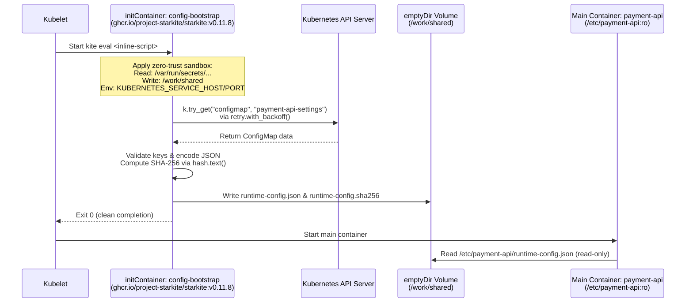

# Why Starkite Is a Better Runtime for Kubernetes Init Containers

Kubernetes `initContainers` execute critical startup choreography before your application containers are allowed to start. In production clusters, pods frequently need an init container to poll the Kubernetes API until an upstream `ConfigMap` or `Secret` is populated by an operator, validate that required configuration parameters are present and properly typed, transform flat key-value strings into a structured configuration file on a shared `emptyDir` volume, and compute a SHA-256 checksum for integrity verification.

In practice, platform teams almost always implement init containers using ad-hoc shell scripts embedded directly in the Pod spec (`/bin/sh -c`) inside general-purpose utility images (`alpine/k8s`, `alpine`, or `ubuntu` with `kubectl`, `curl`, and `jq`). Teams choose inline shell scripts because they want **zero ceremony**: they want to avoid creating extra `ConfigMap` resources, mounting extra volumes, or maintaining dedicated container build pipelines just to run a few lines of startup glue logic.

However, inline shell scripts introduce severe operational and security trade-offs: bloated base images full of unpatched CVEs, fragile JSON and subshell piping, unconfined execution permissions, ambient secret exposure, and lack of exponential backoff.

Starkite (`kite`) provides a purpose-built alternative: a single static binary and deterministic Starlark runtime packaged as a minimal container image (`ghcr.io/project-starkite/starkite:v0.11.8`). Using **`kite eval`**, you get the exact same zero-ceremony inline convenience—embedding startup logic directly in your Pod manifest—while eliminating the shell, the operating system userland, and unconfined container access.

---

## Why Traditional Init Containers Fall Short

To understand why traditional init containers become a maintenance and security burden, compare how an inline shell init container is constructed against what the task actually requires. Suppose your `payment-api` service needs an init container to wait for a `ConfigMap` named `payment-api-settings`, verify four required keys (`DB_HOST`, `DB_PORT`, `RATE_LIMIT_RPS`, and `TLS_MODE`), convert `DB_PORT` and `RATE_LIMIT_RPS` from strings to integers, and write `/work/shared/runtime-config.json` along with `/work/shared/runtime-config.sha256`.

In a traditional Deployment—assuming the Pod mounts a `shared-config` `emptyDir` volume and binds a `ServiceAccount` authorized to read `configmaps`—engineers embed an inline `/bin/sh -c` script inside a utility image such as `alpine/k8s` to chain together `kubectl`, `jq`, and `sha256sum`:

```yaml
# Traditional POSIX sh + kubectl + jq init container
initContainers:
  - name: config-bootstrap
    image: alpine/k8s:1.32.2
    command: ["/bin/sh", "-c"]
    args:
      - |
        set -eu

        i=0
        until cm_json=$(kubectl -n init-demo get configmap payment-api-settings -o json 2>/dev/null); do
          i=$((i + 1))
          if [ "$i" -ge 5 ]; then
            echo "Timed out waiting for ConfigMap init-demo/payment-api-settings" >&2
            exit 1
          fi
          sleep 1
        done

        for key in DB_HOST DB_PORT RATE_LIMIT_RPS TLS_MODE; do
          if [ -z "$(printf '%s\n' "$cm_json" | jq -r ".data.${key} // empty")" ]; then
            echo "Missing required key ${key} in ConfigMap payment-api-settings" >&2
            exit 1
          fi
        done

        cd /work/shared
        printf '%s\n' "$cm_json" | jq -c '{
          service: "payment-api",
          namespace: "init-demo",
          database: {
            host: .data.DB_HOST,
            port: (.data.DB_PORT | tonumber),
            tls_mode: .data.TLS_MODE
          },
          limits: {
            rps: (.data.RATE_LIMIT_RPS | tonumber)
          }
        }' > runtime-config.json
        sha256sum runtime-config.json > runtime-config.sha256
    securityContext:
      runAsNonRoot: true
      runAsUser: 65532
      readOnlyRootFilesystem: true
      capabilities:
        drop: ["ALL"]
    volumeMounts:
      - name: shared-config
        mountPath: /work/shared
```

Even when hardened with non-root execution and a read-only root filesystem, this shell-based pattern suffers from five structural problems:

1. **Bloated Image & CVE Surface**: For ~30 lines of startup logic, the node must pull a multi-tool utility image (`alpine/k8s`) bundling an OS userland, `/bin/sh`, `kubectl`, `jq`, `curl`, and shared C/TLS libraries. Every package in that base layer increases pull latency and triggers vulnerability scanner findings.
2. **Opaque Subprocess & Error Plumbing**: The script glues together `kubectl`, `jq`, and `sha256sum` through text streams and exit codes. Suppressing stderr (`2>/dev/null`) inside a fixed `sleep 1` loop hides whether `kubectl` failed due to transient `NotFound` or permanent RBAC/TLS errors, lacks exponential backoff with jitter, and surfaces type conversion errors (`tonumber`) only as raw stderr text.
3. **No Direct Language Structure**: Shell script quoting, variable expansion, and string interpolation easily fail when data contains unexpected characters. Building structured nested JSON requires piping data through multiple subshells or invoking complex `jq` programs.
4. **Unconfined Runtime Inside the Container**: Even under a restricted `securityContext`, `/bin/sh`, `curl`, `kubectl`, and every utility binary in the image remain executable, with unrestricted read access across the container rootfs and outbound network access beyond what Pod `securityContext` fields constrain.
5. **Ambient Environment Exposure**: Kubernetes injects cluster service discovery variables (`KUBERNETES_SERVICE_HOST`, `*_SERVICE_PORT`) and any Pod-level environment variables into the container environment, exposing them to every subprocess spawned by the shell script.

Starkite eliminates each of these failure modes by combining zero-ceremony inline execution (`kite eval`) with built-in cloud primitives and a default-deny sandbox:

| Operational Dimension | Shell + Utility Image (`alpine/k8s`) | Python + `kubernetes` SDK Image | Starkite (`ghcr.io/project-starkite/starkite:v0.11.8`) |
| :--- | :--- | :--- | :--- |
| **Container Base Image** | 80–250 MB OS layer + CLI tools | 120–300 MB OS + Python + `pip` packages | Minimal static binary built on `cgr.dev/chainguard/static` |
| **Shell & Binary Surface** | Requires `/bin/sh`, `kubectl`, `jq`, `coreutils` | Requires Python interpreter + shared libs | Zero shell (`/bin/sh` does not exist in the image) |
| **Script Deployment** | Inline `/bin/sh -c` in Pod manifest | Requires image build or script mount | Zero-ceremony inline `kite eval` in Pod manifest |
| **Kubernetes API Client** | Spawns `kubectl` subprocesses | External `kubernetes` pip package | Built-in `k8s` module with `InClusterConfig` |
| **Retries & Backoff** | Hand-rolled `until ... sleep` loops | Third-party `tenacity` or custom loops | Built-in `retry.with_backoff()` with jitter/delay |
| **Error Handling** | `set -eu` exit codes and stderr redirection | Uncaught exceptions and stack traces | Fail-fast statements (`fail(...)`) terminating rollout |
| **Process Confinement** | Unconfined access to container filesystem/env | Unconfined access to container filesystem/env | Zero-trust env scrubbing + path/network sandboxing |

---

## How Starkite Inline Init Containers Work Inside a Pod

Before writing code, examine how an inline Starkite init container interacts with the Kubernetes control plane, the Pod's mounted volumes, and the kernel sandbox.



When `kite eval` starts inside the `config-bootstrap` init container, two security boundaries work together:

1. **Kubernetes Pod Security (`securityContext` & RBAC)**: The container runs as user `65532` (`runAsNonRoot: true`), drops all Linux capabilities (`drop: ["ALL"]`), enforces a read-only root filesystem (`readOnlyRootFilesystem: true`), and authenticates to the Kubernetes API using a dedicated `ServiceAccount` (`payment-api-sa`) bound to a `Role` permitting only `get` and `list` on `configmaps` in the `init-demo` namespace.
2. **Starkite Zero-Trust Sandbox**: Even within the container, Starkite blocks all filesystem paths, network sockets, and environment variables by default. You grant the script only the exact capabilities it needs via CLI flags:
   - `--sandbox-path-read=/var/run/secrets/kubernetes.io/serviceaccount`: Allows `k8s.config()` to read the Pod's mounted ServiceAccount token and CA certificate.
   - `--sandbox-path-write=/work/shared`: Allows creating and writing `runtime-config.json` and `runtime-config.sha256` inside the shared `emptyDir` volume.
   - `--sandbox-net-allow`: Allows outbound HTTPS calls to the Kubernetes API server.
   - `--env=KUBERNETES_SERVICE_HOST --env=KUBERNETES_SERVICE_PORT`: Explicitly forwards the two environment variables required by `InClusterConfig` while scrubbing all other ambient variables.

Because the code is evaluated inline with `kite eval`, **no script ConfigMap** and **no script volume mount** are required. The single shared `emptyDir` volume is the only volume needed.

---

## Companion Files

All files for this walkthrough are located in [`k8s/init-cluster/`](./):

| File | Purpose |
| :--- | :--- |
| [`init_bootstrap.star`](./init_bootstrap.star) | Standalone reference implementation of the concise bootstrap logic. |
| [`generate_manifest.star`](./generate_manifest.star) | Manifest generator that constructs the 6-resource Kubernetes stack with an inline `kite eval` init container and CEL validation. |
| [`manifest.yaml`](./manifest.yaml) | Pre-generated multi-document Kubernetes manifest ready for `kubectl apply -f ./manifest.yaml`. |
| [`deploy_and_verify.star`](./deploy_and_verify.star) | End-to-end verification script that applies the stack to your cluster, waits for rollout availability, and verifies container logs and SHA-256 digests. |
| [`Dockerfile`](./Dockerfile) | Optional container build definition for packaging the script into an immutable image for environments requiring signed artifacts. |

---

## Step 1: Write the Concise Bootstrap Logic

The bootstrap logic handles four tasks: polling the dependency ConfigMap, validating required keys, rendering structured JSON, and writing the configuration along with its SHA-256 checksum.

Examine [`init_bootstrap.star`](./init_bootstrap.star):

```python
#!/usr/bin/env kite

def main():
    ns = var_str("namespace", "init-demo")
    out = fs.path(var_str("out.dir", "/work/shared"))

    k = k8s.config(namespace=ns)
    poll = retry.with_backoff(
        lambda: k.try_get("configmap", "payment-api-settings"),
        max_attempts=5,
        delay="300ms",
    )
    if not poll.ok:
        fail("dependency check failed for %s/payment-api-settings: %s" % (ns, poll.error))

    data = poll.value.get("data", {})
    missing = [k for k in ["DB_HOST", "DB_PORT", "RATE_LIMIT_RPS", "TLS_MODE"] if not data.get(k)]
    if missing:
        fail("missing required keys %s in ConfigMap payment-api-settings" % ", ".join(missing))

    payload = json.encode({
        "service": "payment-api",
        "namespace": ns,
        "database": {
            "host": data["DB_HOST"],
            "port": int(data["DB_PORT"]),
            "tls_mode": data["TLS_MODE"],
        },
        "limits": {
            "rps": int(data["RATE_LIMIT_RPS"]),
        },
    })

    out.mkdir(parents=True)
    (out / "runtime-config.json").write_text(payload)
    (out / "runtime-config.sha256").write_text(hash.text(payload).sha256() + "  runtime-config.json\n")
```

The script is short and focused:

- **Dual-Mode Kubernetes Client (`k8s.config`)**: Automatically uses `~/.kube/config` when run on a workstation, and switches to `rest.InClusterConfig()` when running inside a Kubernetes Pod.
- **Exponential Backoff Polling (`retry.with_backoff`)**: Wraps `k.try_get` in a 5-attempt retry loop with exponential backoff and jitter, guarding against race conditions when workloads and ConfigMaps are applied simultaneously.
- **Single-Line Key Validation**: `[k for k in [...] if not data.get(k)]` catches both missing keys and empty strings without nested loops.
- **Direct JSON & Checksum Output**: `json.encode` converts types (`port` and `rps` to integers), `hash.text(payload).sha256()` produces the digest, and `(out / "filename").write_text(...)` writes both files directly into `/work/shared`.
- **Zero Logging Noise**: Adhering to the Unix philosophy, the script produces no output on success and exits `0`. If an error occurs, `fail(...)` terminates execution with a descriptive error message on stderr, signaling Kubernetes to stop Pod initialization.

---

## Step 2: Generate the Manifest Stack with `kite eval`

In traditional workflows, avoiding extra ConfigMaps meant resorting to shell scripts. With Starkite, [`generate_manifest.star`](./generate_manifest.star) embeds the bootstrap script directly into the `initContainers` specification using `command: ["kite", "eval"]`:

```python
#!/usr/bin/env kite

def build_stack(
    app="payment-api",
    ns="init-demo",
    app_image="busybox:1.37",
    kite_image="ghcr.io/project-starkite/starkite:v0.11.8",
    script_path="./init_bootstrap.star",
):
    sa = k8s.obj.service_account(
        name=app + "-sa",
        namespace=ns,
        automount_service_account_token=True,
    )
    role_name = app + "-config-reader"
    role = k8s.obj.role(
        name=role_name,
        namespace=ns,
        rules=[k8s.obj.policy_rule(api_groups=[""], resources=["configmaps"], verbs=["get", "list"])],
    )
    rb = k8s.obj.role_binding(
        name=role_name + "-binding",
        namespace=ns,
        role_ref={"apiGroup": "rbac.authorization.k8s.io", "kind": "Role", "name": role_name},
        subjects=[k8s.obj.subject(kind="ServiceAccount", name=sa, namespace=ns)],
    )
    settings_cm = k8s.obj.config_map(
        name=app + "-settings",
        namespace=ns,
        data={
            "DB_HOST": "postgres.internal.svc.cluster.local",
            "DB_PORT": "5432",
            "RATE_LIMIT_RPS": "250",
            "TLS_MODE": "strict",
        },
    )

    non_root = k8s.obj.security_context(
        run_as_non_root=True,
        run_as_user=65532,
        read_only_root=True,
        capabilities={"drop": ["ALL"]},
    )

    init_container = k8s.obj.container(
        name="config-bootstrap",
        image=kite_image,
        command=["kite", "eval"],
        args=[
            fs.read_text(script_path),
            "--sandbox-path-read=/var/run/secrets/kubernetes.io/serviceaccount",
            "--sandbox-path-write=/work/shared",
            "--sandbox-net-allow",
            "--env=KUBERNETES_SERVICE_HOST",
            "--env=KUBERNETES_SERVICE_PORT",
        ],
        security_context=non_root,
        resources=k8s.obj.resource_requirements(
            requests={"cpu": "25m", "memory": "32Mi"},
            limits={"cpu": "100m", "memory": "64Mi"},
        ),
        volume_mounts=[
            k8s.obj.volume_mount(name="shared-config", mount_path="/work/shared"),
        ],
    )

    app_container = k8s.obj.container(
        name=app,
        image=app_image,
        command=[
            "sh",
            "-c",
            "cat /etc/payment-api/runtime-config.json && echo '' && cat /etc/payment-api/runtime-config.sha256 && sleep 3600",
        ],
        ports=[k8s.obj.container_port(container_port=8080, name="http")],
        security_context=non_root,
        resources=k8s.obj.resource_requirements(
            requests={"cpu": "100m", "memory": "128Mi"},
            limits={"cpu": "500m", "memory": "256Mi"},
        ),
        volume_mounts=[
            k8s.obj.volume_mount(name="shared-config", mount_path="/etc/payment-api", read_only=True),
        ],
    )

    dep = k8s.obj.deployment(
        name=app,
        namespace=ns,
        labels={"app": app},
        replicas=2,
        service_account=sa,
        init_containers=[init_container],
        containers=[app_container],
        volumes=[
            k8s.obj.volume(name="shared-config", empty_dir=True),
        ],
    )

    k8s.validate(
        manifest=dep,
        expression="object.spec.template.spec.initContainers.all(c, c.securityContext.runAsNonRoot == true && c.securityContext.readOnlyRootFilesystem == true)",
        strict=True,
    )

    return [k8s.obj.namespace(name=ns), sa, role, rb, settings_cm, dep]

def main():
    stack = build_stack(
        app=var_str("app", "payment-api"),
        ns=var_str("namespace", "init-demo"),
        app_image=var_str("image", "busybox:1.37"),
        kite_image=var_str("kite.image", "ghcr.io/project-starkite/starkite:v0.11.8"),
        script_path=var_str("script.path", "./init_bootstrap.star"),
    )
    print(k8s.yaml(stack))
```

Generate [`manifest.yaml`](./manifest.yaml):

```bash
kite run ./generate_manifest.star --sandbox-path-read=. > ./manifest.yaml
```

Inspect the `Deployment` in the generated [`manifest.yaml`](./manifest.yaml):

```yaml
apiVersion: apps/v1
kind: Deployment
metadata:
  labels:
    app: payment-api
  name: payment-api
  namespace: init-demo
spec:
  replicas: 2
  selector:
    matchLabels:
      app: payment-api
  template:
    metadata:
      labels:
        app: payment-api
    spec:
      containers:
        - command:
            - sh
            - -c
            - cat /etc/payment-api/runtime-config.json && echo '' && cat /etc/payment-api/runtime-config.sha256 && sleep 3600
          image: busybox:1.37
          name: payment-api
          ports:
            - containerPort: 8080
              name: http
              protocol: TCP
          resources:
            limits:
              cpu: 500m
              memory: 256Mi
            requests:
              cpu: 100m
              memory: 128Mi
          securityContext:
            capabilities:
              drop:
                - ALL
            readOnlyRootFilesystem: true
            runAsNonRoot: true
            runAsUser: 65532
          volumeMounts:
            - mountPath: /etc/payment-api
              name: shared-config
              readOnly: true
      initContainers:
        - args:
            - |
              #!/usr/bin/env kite

              def main():
                  ns = var_str("namespace", "init-demo")
                  out = fs.path(var_str("out.dir", "/work/shared"))

                  k = k8s.config(namespace=ns)
                  poll = retry.with_backoff(
                      lambda: k.try_get("configmap", "payment-api-settings"),
                      max_attempts=5,
                      delay="300ms",
                  )
                  if not poll.ok:
                      fail("dependency check failed for %s/payment-api-settings: %s" % (ns, poll.error))

                  data = poll.value.get("data", {})
                  missing = [k for k in ["DB_HOST", "DB_PORT", "RATE_LIMIT_RPS", "TLS_MODE"] if not data.get(k)]
                  if missing:
                      fail("missing required keys %s in ConfigMap payment-api-settings" % ", ".join(missing))

                  payload = json.encode({
                      "service": "payment-api",
                      "namespace": ns,
                      "database": {
                          "host": data["DB_HOST"],
                          "port": int(data["DB_PORT"]),
                          "tls_mode": data["TLS_MODE"],
                      },
                      "limits": {
                          "rps": int(data["RATE_LIMIT_RPS"]),
                      },
                  })

                  out.mkdir(parents=True)
                  (out / "runtime-config.json").write_text(payload)
                  (out / "runtime-config.sha256").write_text(hash.text(payload).sha256() + "  runtime-config.json\n")
            - --sandbox-path-read=/var/run/secrets/kubernetes.io/serviceaccount
            - --sandbox-path-write=/work/shared
            - --sandbox-net-allow
            - --env=KUBERNETES_SERVICE_HOST
            - --env=KUBERNETES_SERVICE_PORT
          command:
            - kite
            - eval
          image: ghcr.io/project-starkite/starkite:v0.11.8
          name: config-bootstrap
          resources:
            limits:
              cpu: 100m
              memory: 64Mi
            requests:
              cpu: 25m
              memory: 32Mi
          securityContext:
            capabilities:
              drop:
                - ALL
            readOnlyRootFilesystem: true
            runAsNonRoot: true
            runAsUser: 65532
          volumeMounts:
            - mountPath: /work/shared
              name: shared-config
      serviceAccountName: payment-api-sa
      volumes:
        - emptyDir: {}
          name: shared-config
```

The stack requires only **6 resources** instead of 7. The script `ConfigMap` is eliminated, and `shared-config` (`emptyDir`) is the only volume defined.

---

## Step 3: Deploy and Test on a Kubernetes Cluster

Verify the inline init container against a live Kubernetes cluster using automated verification, `kubectl` deployment inspection, and failure-mode testing.

### 1. Automated Live-Cluster Verification (`deploy_and_verify.star`)

[`deploy_and_verify.star`](./deploy_and_verify.star) applies all 6 resources in one Server-Side Apply call (`k.apply(stack, force=True)`), waits for `deployment/payment-api` to reach `Available`, retrieves the main container logs, and verifies that the JSON configuration matches its recorded SHA-256 digest:

```python
#!/usr/bin/env kite

load("./generate_manifest.star", "generate_manifest")

def main():
    app = var_str("app", "payment-api")
    ns = var_str("namespace", "init-demo")

    k = k8s.config(namespace=ns, timeout="30s")
    stack = generate_manifest.build_stack(
        app=app,
        ns=ns,
        kite_image=var_str("kite.image", "ghcr.io/project-starkite/starkite:v0.11.8"),
        script_path=var_str("script.path", "./init_bootstrap.star"),
    )
    k.apply(stack, force=True)

    ready = k.wait_for("deployment", app, condition="Available", timeout="90s")
    if not ready.ready:
        fail("deployment %s did not become Available: %s" % (app, ready.message))

    pods = [p for p in k.list("pods", labels="app=" + app) if p.status.phase == "Running"]
    if not pods:
        fail("no running pods found for app=%s" % app)
    pod_name = pods[0].metadata.name

    app_lines = k.logs(pod_name, container=app).strip().split("\n")
    raw_json = app_lines[0]
    recorded_digest = app_lines[1].split(" ")[0]

    actual_digest = hash.text(raw_json).sha256()
    if actual_digest != recorded_digest:
        fail("digest mismatch: actual=%s recorded=%s" % (actual_digest, recorded_digest))

    parsed = json.decode(raw_json)

    tbl = table.new(["Check", "Target", "Result"])
    tbl.add_row("Manifest Stack Apply", ns + "/" + app, "APPLIED (%d resources)" % len(stack))
    tbl.add_row("Deployment Readiness", "deployment/" + app, "AVAILABLE (%d pods)" % len(pods))
    tbl.add_row("Database Endpoint", "%s:%d" % (parsed["database"]["host"], int(parsed["database"]["port"])), "VERIFIED")
    tbl.add_row("Rate Limit (RPS)", str(int(parsed["limits"]["rps"])), "VERIFIED")
    tbl.add_row("SHA-256 Integrity", actual_digest[:16] + "...", "MATCHED")
    print(tbl.render().strip())
```

Execute `deploy_and_verify.star`:

```bash
kite run ./deploy_and_verify.star \
  --sandbox-path-read=. \
  --sandbox-path-read=$HOME/.kube \
  --sandbox-net-allow \
  --env=HOME
```

```text
# (host-specific values differ)
Check                | Target                                   | Result               
---------------------+------------------------------------------+----------------------
Manifest Stack Apply | init-demo/payment-api                    | APPLIED (6 resources)
Deployment Readiness | deployment/payment-api                   | AVAILABLE (2 pods)   
Database Endpoint    | postgres.internal.svc.cluster.local:5432 | VERIFIED             
Rate Limit (RPS)     | 250                                      | VERIFIED             
SHA-256 Integrity    | 6a06456e6644f130...                      | MATCHED
```

### 2. Full Pod Deployment & Container Log Inspection (`kubectl`)

Apply [`manifest.yaml`](./manifest.yaml) directly with `kubectl`:

```bash
kubectl apply -f ./manifest.yaml
kubectl -n init-demo rollout status deployment/payment-api --timeout=60s
```

Inspect the running Pods and read the logs:

```bash
# 1. Verify Pod status
kubectl -n init-demo get pods -l app=payment-api

# 2. Check init container logs (quiet on success)
kubectl -n init-demo logs deployment/payment-api -c config-bootstrap

# 3. Verify main container read the rendered JSON and SHA-256 checksum
kubectl -n init-demo logs deployment/payment-api -c payment-api
```

```text
# (host-specific values differ)
$ kubectl -n init-demo logs deployment/payment-api -c payment-api
{"database":{"host":"postgres.internal.svc.cluster.local","port":5432,"tls_mode":"strict"},"limits":{"rps":250},"namespace":"init-demo","service":"payment-api"}
6a06456e6644f13083c2459a4a63578cf88b17344f97f42a30a41a2b204237a5  runtime-config.json
```

### 3. Testing Failure Gating When Configuration Is Invalid

A reliable init container must block the application container from starting when upstream configuration is incomplete. Remove the required `TLS_MODE` key from `payment-api-settings` and restart the Deployment:

```bash
# Remove TLS_MODE from the ConfigMap
kubectl -n init-demo patch configmap payment-api-settings --type=json \
  -p='[{"op": "remove", "path": "/data/TLS_MODE"}]'

# Trigger a rollout to run the init container against the incomplete ConfigMap
kubectl -n init-demo rollout restart deployment/payment-api
```

Inspecting the Pod status and `config-bootstrap` logs confirms that Kubernetes keeps existing healthy replicas serving traffic while halting the replacement Pod in `Init:Error` before the main application container starts:

```text
# (host-specific values differ)
$ kubectl -n init-demo get pods -l app=payment-api
NAME                           READY   STATUS       RESTARTS   AGE
payment-api-5bb4c8f84d-d7mpb   1/1     Running      0          60s
payment-api-5bb4c8f84d-sglb8   1/1     Running      0          60s
payment-api-5f5bcfdd8d-8kqxx   0/1     Init:Error   0          5s

$ kubectl -n init-demo logs payment-api-5f5bcfdd8d-8kqxx -c config-bootstrap
Error: script error: missing required keys TLS_MODE in ConfigMap payment-api-settings
```

Re-applying `manifest.yaml` restores `TLS_MODE: strict` to the `ConfigMap` and allows the rollout to complete cleanly:

```bash
kubectl apply -f ./manifest.yaml
```

---

## Alternative: Self-Contained Immutable Image (`Dockerfile`)

While inline `kite eval` provides zero-ceremony deployment for most workloads, regulated enterprise environments sometimes prohibit inline script execution in manifests and mandate that all executable code be packaged into signed, immutable container images.

Because `ghcr.io/project-starkite/starkite:v0.11.8` includes the `kite` binary and CA certificates on a minimal rootfs, [`Dockerfile`](./Dockerfile) needs only a single `COPY` layer:

```dockerfile
FROM ghcr.io/project-starkite/starkite:v0.11.8

COPY init_bootstrap.star /scripts/init_bootstrap.star

USER 65532:65532
ENTRYPOINT ["kite", "run", "/scripts/init_bootstrap.star"]
CMD [ \
    "--sandbox-path-read=/scripts", \
    "--sandbox-path-read=/var/run/secrets/kubernetes.io/serviceaccount", \
    "--sandbox-path-write=/work/shared", \
    "--sandbox-net-allow", \
    "--env=KUBERNETES_SERVICE_HOST", \
    "--env=KUBERNETES_SERVICE_PORT" \
]
```

Build the custom init image and load it into your cluster:

```bash
docker build -t payment-api-init:v0.1.0 .
kind load docker-image payment-api-init:v0.1.0
```

When using `payment-api-init:v0.1.0`, the Pod runs `kite run /scripts/init_bootstrap.star` directly from the immutable container filesystem.
