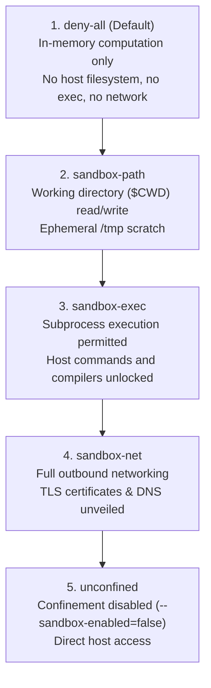

# Tutorial 01: Zero-Trust Capability Ladder

Starkite enforces a zero-trust execution boundary by default. Rather than requiring you to opt into security, every script executed with `kite run` or `kite eval`, and every external command launched with `kite exec`, begins confined under the `deny-all` capability profile.

This tutorial guides you through the five rungs of Starkite's capability ladder. You will run a multi-phase audit script (`system_audit.star`) that systematically exercises pure computation, filesystem access, subprocess execution, and outbound networking. By stepping from `deny-all` to `unconfined`, you will observe how each capability rung unlocks specific runtime privileges and how unauthorized operations are trapped with actionable diagnostics.

---

## The 5-Rung Capability Ladder

Privileges in Starkite form a strict superset hierarchy. Each rung expands upon the permissions of the previous rung:



| Rung / Profile | Filesystem (`$CWD`) | Process Execution | Network Egress | Typical Use Case |
| :--- | :--- | :--- | :--- | :--- |
| `deny-all` (default) | Isolated | Denied (`no_exec: true`) | Blocked (`none`) | Data transformation, hashing, parsing, pure computation |
| `sandbox-path` | Read / Write | Denied (`no_exec: true`) | Blocked (`none`) | File generation, template rendering, report compilation |
| `sandbox-exec` | Read / Write | Allowed (`exec.allow: ["*"]`) | Blocked (`none`) | Local compilation, linters, code generators, build scripts |
| `sandbox-net` | Read / Write | Allowed (`exec.allow: ["*"]`) | Allowed (`host`) | Cloud-native operations, API clients, Kubernetes, SSH |
| `unconfined` | Unrestricted | Unrestricted | Unrestricted | Legacy administrative scripts requiring unconfined host root access |

---

## The Audit Script: `system_audit.star`

The script executes four sequential audit phases, each requiring a higher capability level:

```python
#!/usr/bin/env kite
# system_audit.star — Capability ladder audit script across 4 execution phases

# -----------------------------------------------------------------------------
# Phase 1: Pure In-Memory Computation (Allowed under default 'deny-all')
# -----------------------------------------------------------------------------
print("==> [Phase 1] Pure In-Memory Computation")
audit_id = hash.text("system-audit-task-01").sha256()
calc_result = 42 * 1024
telemetry = {
    "audit_id": audit_id,
    "metric": calc_result,
    "timestamp": time.now().string(),
}
print("  SHA256 Digest : " + audit_id[:16] + "...")
print("  Encoded JSON  : " + json.encode(telemetry))
print("  Phase 1 Status: PASSED (Pure computation requires no host privileges)\n")

# -----------------------------------------------------------------------------
# Phase 2: Local Filesystem Inspection (Requires 'sandbox-path' or --sandbox-path-read)
# -----------------------------------------------------------------------------
print("==> [Phase 2] Local Filesystem Inspection")
readme_content = fs.read_text("README.md")
first_line = readme_content.splitlines()[0] if readme_content else "<empty>"
print("  Inspecting    : ./README.md")
print("  Header Text   : " + first_line)
print("  Phase 2 Status: PASSED (Filesystem read authorized)\n")

# -----------------------------------------------------------------------------
# Phase 3: Subprocess Tool Execution (Requires 'sandbox-exec' or --sandbox-exec-allow)
# -----------------------------------------------------------------------------
print("==> [Phase 3] Subprocess Tool Execution")
exec_out = os.exec("echo", ["starkite-audit-worker-active"])
print("  Tool Executed : echo starkite-audit-worker-active")
print("  Process Output: " + exec_out.strip())
print("  Phase 3 Status: PASSED (Subprocess execution authorized)\n")

# -----------------------------------------------------------------------------
# Phase 4: Network Egress (Requires 'sandbox-net' or --sandbox-net-allow)
# -----------------------------------------------------------------------------
print("==> [Phase 4] Outbound Network Egress")
print("  Probing       : https://httpbin.org/get")
response = http.get("https://httpbin.org/get")
print("  HTTP Status   : " + str(response.status_code))
print("  Phase 4 Status: PASSED (Outbound network authorized)\n")

print("==> [Audit Complete] All 4 capability rungs executed successfully!")
```

---

## Step-by-Step Walkthrough

Navigate to the tutorial directory before running the commands:

```bash
cd sandbox/01-zero-trust-ladder
```

### Step 1: Default Confinement (`deny-all`)

Execute the script with no flags to use the default `deny-all` profile:

```bash
kite run ./system_audit.star
```

*(host-specific values differ)*
```text
==> [Phase 1] Pure In-Memory Computation
  SHA256 Digest : 17488a475ec424cc...
  Encoded JSON  : {"audit_id":"17488a475ec424cc98e0c2a9395f3cb13b88c8fcc2206b9c0781ac1c2e7cc8e3","metric":43008,"timestamp":"2026-10-31T14:38:21Z"}
  Phase 1 Status: PASSED (Pure computation requires no host privileges)

==> [Phase 2] Local Filesystem Inspection
Error: script error: permission denied: fs.read read_file("/home/alice/projects/starkite-tutorials/sandbox/01-zero-trust-ladder/README.md") - no matching allow rule
  grant "fs.read" with --sandbox-profile=sandbox-path (or higher), or in the sandbox: section of config.yaml
  Hint: pass --sandbox-path-read=. on CLI, or add "." to sandbox.<profile>.paths.read in config.yaml
```

**Why it failed:** Under `deny-all`, the script has access only to pure compute modules (`hash`, `json`, `math`, `strings`, `time`). The host working directory is not mounted, and `fs.read` has no matching grant. The runtime immediately emits an actionable hint.

---

### Step 2: Unlocking the Filesystem (`sandbox-path`)

Advance to the second rung by passing `--sandbox-profile=sandbox-path`:

```bash
kite run ./system_audit.star --sandbox-profile=sandbox-path
```

*(host-specific values differ)*
```text
==> [Phase 1] Pure In-Memory Computation
  SHA256 Digest : 17488a475ec424cc...
  Encoded JSON  : {"audit_id":"17488a475ec424cc98e0c2a9395f3cb13b88c8fcc2206b9c0781ac1c2e7cc8e3","metric":43008,"timestamp":"2026-10-31T14:38:52Z"}
  Phase 1 Status: PASSED (Pure computation requires no host privileges)

==> [Phase 2] Local Filesystem Inspection
  Inspecting    : ./README.md
  Header Text   : # Tutorial 01: Zero-Trust Capability Ladder
  Phase 2 Status: PASSED (Filesystem read authorized)

==> [Phase 3] Subprocess Tool Execution
Error: script error: permission denied: os.exec exec("/bin/echo") - blocked by deny rule: os.exec
  Hint: pass --sandbox-exec-allow=echo on CLI, or add "echo" to sandbox.<profile>.exec.allow in config.yaml
```

**Why Phase 2 passed:** `sandbox-path` grants read/write access to `$CWD` and an isolated `/tmp` scratch workspace.  
**Why Phase 3 failed:** `sandbox-path` maintains `no_exec: true`. Subprocess creation is blocked at both the in-VM call gate and the OS kernel boundary.

---

### Step 3: Authorizing Subprocess Execution (`sandbox-exec`)

Advance to the third rung by selecting `--sandbox-profile=sandbox-exec`:

```bash
kite run ./system_audit.star --sandbox-profile=sandbox-exec
```

*(host-specific values differ)*
```text
==> [Phase 1] Pure In-Memory Computation
  SHA256 Digest : 17488a475ec424cc...
  Encoded JSON  : {"audit_id":"17488a475ec424cc98e0c2a9395f3cb13b88c8fcc2206b9c0781ac1c2e7cc8e3","metric":43008,"timestamp":"2026-10-31T14:39:14Z"}
  Phase 1 Status: PASSED (Pure computation requires no host privileges)

==> [Phase 2] Local Filesystem Inspection
  Inspecting    : ./README.md
  Header Text   : # Tutorial 01: Zero-Trust Capability Ladder
  Phase 2 Status: PASSED (Filesystem read authorized)

==> [Phase 3] Subprocess Tool Execution
  Tool Executed : echo starkite-audit-worker-active
  Process Output: starkite-audit-worker-active
  Phase 3 Status: PASSED (Subprocess execution authorized)

==> [Phase 4] Outbound Network Egress
  Probing       : https://httpbin.org/get
Error: script error: permission denied: http.client GET("https://httpbin.org/get") - no matching allow rule
  grant "http.client" with --sandbox-profile=sandbox-net (or higher), or in the sandbox: section of config.yaml
  Hint: pass --sandbox-net-allow=httpbin.org on CLI, or add "httpbin.org" to sandbox.<profile>.network.allow in config.yaml
```

**Why Phase 3 passed:** `sandbox-exec` permits host command execution while still keeping the process air-gapped from the network.  
**Why Phase 4 failed:** Outbound networking remains disabled (`network: none`).

---

### Step 4: Enabling Network Egress (`sandbox-net`)

Advance to the fourth rung by selecting `--sandbox-profile=sandbox-net`:

```bash
kite run ./system_audit.star --sandbox-profile=sandbox-net
```

*(host-specific values differ)*
```text
==> [Phase 1] Pure In-Memory Computation
  SHA256 Digest : 17488a475ec424cc...
  Encoded JSON  : {"audit_id":"17488a475ec424cc98e0c2a9395f3cb13b88c8fcc2206b9c0781ac1c2e7cc8e3","metric":43008,"timestamp":"2026-10-31T14:39:31Z"}
  Phase 1 Status: PASSED (Pure computation requires no host privileges)

==> [Phase 2] Local Filesystem Inspection
  Inspecting    : ./README.md
  Header Text   : # Tutorial 01: Zero-Trust Capability Ladder
  Phase 2 Status: PASSED (Filesystem read authorized)

==> [Phase 3] Subprocess Tool Execution
  Tool Executed : echo starkite-audit-worker-active
  Process Output: starkite-audit-worker-active
  Phase 3 Status: PASSED (Subprocess execution authorized)

==> [Phase 4] Outbound Network Egress
  Probing       : https://httpbin.org/get
  HTTP Status   : 200
  Phase 4 Status: PASSED (Outbound network authorized)

==> [Audit Complete] All 4 capability rungs executed successfully!
```

**Why all phases passed:** `sandbox-net` combines filesystem read/write access, subprocess execution, and outbound host networking (`network: host`). The sandbox driver automatically unmasks system DNS resolvers (`/etc/resolv.conf`) and TLS CA bundles.

---

### Step 5: Surgical Composition Without Full Profile Jumps

Rather than elevating your entire workload to `sandbox-net`, you can selectively grant only the specific resources the script needs using composable CLI flags:

```bash
kite run ./system_audit.star \
  --sandbox-path-read=. \
  --sandbox-exec-allow=echo \
  --sandbox-net-allow
```

This composition grants:
- Read-only access to `$CWD` (`--sandbox-path-read=.`), protecting files outside the directory from modification.
- Execution rights strictly for the `echo` binary (`--sandbox-exec-allow=echo`). Attempts to invoke any other binary (e.g. `curl` or `sh`) will fail.
- Outbound network egress (`--sandbox-net-allow`).

---

### Step 6: Running Unconfined (`--sandbox-enabled=false`)

When executing trusted maintenance runbooks that require root host privileges or custom kernel devices, you can disable sandboxing entirely:

```bash
kite run ./system_audit.star --sandbox-enabled=false
```

When sandboxing is disabled, Starlark permission checks and OS kernel boundaries are bypassed. Use unconfined execution only when strictly necessary.

---

## Next Steps

Now that you understand the capability ladder and actionable diagnostics:
- Proceed to [Tutorial 02: Native Binary Execution (`kite exec`)](../02-native-binary-exec/README.md) to learn how Starkite confines native Python, Node.js, and shell processes under kernel isolation.
