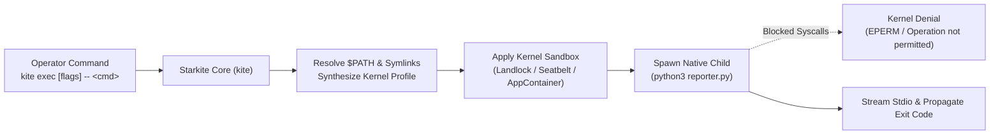

# Tutorial 02: Native Binary Execution (`kite exec`)

While `kite run` executes Starlark automation scripts, modern infrastructure workflows frequently require running external command-line tools—such as Python reporting scripts, Node.js workers, Go binaries, or shell scripts. Running third-party tools directly on the host exposes the system to supply chain risks, credential theft, and unauthorized network egress.

`kite exec` launches arbitrary host binaries and native scripts directly under Starkite's kernel sandbox engine without involving the Starlark interpreter. The kernel sandbox (Landlock and Seccomp on Linux, Seatbelt on macOS, AppContainers on Windows) wraps the native process tree with zero runtime overhead.

This tutorial demonstrates how to confine a native Python script (`reporter.py`), separate runner flags with the POSIX `--` delimiter, verify filesystem read and write boundaries, and observe OS kernel denials.

---

## Architecture: Native Process Sandboxing

Unlike userspace shims or wrappers that intercept libc calls, `kite exec` applies kernel-enforced confinement directly before the process executes:



Key features of `kite exec`:
1. **Authoritative Kernel Boundary**: The operating system kernel enforces path, execution, and socket restrictions across the child process and all subprocesses it spawns.
2. **POSIX Flag Delimiter (`--`)**: The double-dash delimiter cleanly separates Starkite flags from the native command arguments.
3. **Automatic `$PATH` Resolution**: Starkite locates binaries in `$PATH`, resolves package manager symlink chains (such as `/usr/local` or `/opt/homebrew`), and unmasks required shared libraries.
4. **Zero VM Overhead**: No Starlark VM is initialized; standard input, output, and error stream directly to the terminal.

---

## The Native Script: `reporter.py`

`reporter.py` is a standard Python 3 script that inspects environment variables, attempts to read an input dataset, writes an output report, and tests network connectivity:

```python
#!/usr/bin/env python3
"""reporter.py — Native Python report generator demonstrating Starkite kernel confinement."""

import json
import os
import platform
import socket
import sys
import time

def parse_args():
    args = {"output": None, "input": None, "probe_host": None}
    i = 1
    while i < len(sys.argv):
        arg = sys.argv[i]
        if arg == "--output" and i + 1 < len(sys.argv):
            args["output"] = sys.argv[i + 1]
            i += 2
        elif arg == "--input" and i + 1 < len(sys.argv):
            args["input"] = sys.argv[i + 1]
            i += 2
        elif arg == "--probe-host" and i + 1 < len(sys.argv):
            args["probe_host"] = sys.argv[i + 1]
            i += 2
        else:
            i += 1
    return args

def check_network(host, port=80, timeout=1.5):
    if not host:
        return {"probed": False, "connected": False, "error": "none"}
    s = socket.socket(socket.AF_INET, socket.SOCK_STREAM)
    s.settimeout(timeout)
    try:
        s.connect((host, port))
        s.close()
        return {"probed": True, "connected": True, "error": None}
    except Exception as e:
        return {"probed": True, "connected": False, "error": str(e)}

def main():
    opts = parse_args()

    # 1. Inspect environment variables
    env_keys = ["APP_ENV", "STAGE", "SECRET_TOKEN", "AWS_ACCESS_KEY_ID"]
    visible_env = {k: os.environ.get(k) for k in env_keys if k in os.environ}

    # 2. Filesystem read inspection
    input_data = None
    input_read_error = None
    if opts["input"]:
        try:
            with open(opts["input"], "r") as f:
                input_data = f.read().strip()
        except Exception as e:
            input_read_error = str(e)

    # 3. Network egress probe
    net_status = check_network(opts["probe_host"])

    # 4. Generate report payload
    report = {
        "status": "ok",
        "timestamp": time.strftime("%Y-%m-%dT%H:%M:%SZ", time.gmtime()),
        "platform": {
            "system": platform.system(),
            "python": platform.python_version(),
        },
        "environment": visible_env,
        "input_file": {
            "path": opts["input"],
            "loaded": input_data is not None,
            "bytes": len(input_data) if input_data else 0,
            "error": input_read_error,
        },
        "network": net_status,
    }

    # 5. Filesystem write inspection
    write_error = None
    if opts["output"]:
        try:
            with open(opts["output"], "w") as f:
                json.dump(report, f, indent=2)
            report["output_written"] = True
        except Exception as e:
            report["output_written"] = False
            write_error = str(e)
            report["output_error"] = write_error

    print(json.dumps(report, indent=2))

    if input_read_error or write_error:
        sys.exit(1)

if __name__ == "__main__":
    main()
```

---

## Step-by-Step Walkthrough

Navigate to the tutorial directory:

```bash
cd sandbox/02-native-binary-exec
```

### Step 1: Running with Read-Only Working Directory

Execute the native script, granting read-only access to `$CWD` and injecting an environment variable:

```bash
kite exec --sandbox-path-read=. -e APP_ENV=production -- python3 reporter.py --input sample_input.txt
```

*(host-specific values differ)*
```text
{
  "status": "ok",
  "timestamp": "2026-10-31T18:45:51Z",
  "platform": {
    "system": "Darwin",
    "python": "3.9.6"
  },
  "environment": {
    "APP_ENV": "production"
  },
  "input_file": {
    "path": "sample_input.txt",
    "loaded": true,
    "bytes": 27,
    "error": null
  },
  "network": {
    "probed": false,
    "connected": false,
    "error": "none"
  }
}
```

**Key observations:**
- The `--` delimiter ensures that `--input` is forwarded directly to `reporter.py` rather than being interpreted by `kite`.
- `sample_input.txt` is loaded successfully because `--sandbox-path-read=.` unmasked the directory.
- `APP_ENV` is visible in `environment` because it was explicitly forwarded via `-e APP_ENV=production`. Ambient host secrets (such as `AWS_ACCESS_KEY_ID`) remain scrubbed.

---

### Step 2: Observing Kernel Filesystem Write Denials

Attempt to write output to `output.json` without granting write permissions:

```bash
kite exec --sandbox-path-read=. -- python3 reporter.py --output output.json
```

*(host-specific values differ)*
```text
{
  "status": "ok",
  "timestamp": "2026-10-31T18:46:12Z",
  "platform": {
    "system": "Darwin",
    "python": "3.9.6"
  },
  "environment": {},
  "input_file": {
    "path": null,
    "loaded": false,
    "bytes": 0,
    "error": null
  },
  "network": {
    "probed": false,
    "connected": false,
    "error": "none"
  },
  "output_written": false,
  "output_error": "[Errno 1] Operation not permitted: 'output.json'"
}
```

**Why it failed:** Because `--sandbox-path-write` was not provided, the kernel sandbox denied the `open()` syscall with `O_WRONLY | O_CREAT`. The Python interpreter received `PermissionError: [Errno 1] Operation not permitted`, causing `reporter.py` to exit with non-zero status `1`.

---

### Step 3: Granting Surgical Write Access

Authorize write access to the working directory:

```bash
kite exec --sandbox-path-write=. -- python3 reporter.py --input sample_input.txt --output output.json
```

Inspect the generated file:

```bash
cat output.json
```

`output.json` now contains the valid JSON telemetry report.

---

### Step 4: Network Isolation & Outbound Egress

Attempt to probe an external host (`1.1.1.1`) under default air-gapped networking:

```bash
kite exec --sandbox-path-read=. -- python3 reporter.py --probe-host 1.1.1.1
```

*(host-specific values differ)*
```text
{
  "status": "ok",
  "network": {
    "probed": true,
    "connected": false,
    "error": "[Errno 1] Operation not permitted"
  }
}
```

The socket creation or connection syscall was blocked by the OS sandbox. Now authorize outbound network egress:

```bash
kite exec --sandbox-path-read=. --sandbox-net-allow -- python3 reporter.py --probe-host 1.1.1.1
```

*(host-specific values differ)*
```text
{
  "status": "ok",
  "network": {
    "probed": true,
    "connected": true,
    "error": null
  }
}
```

---

### Step 5: Process Telemetry (`--debug`)

Pass `--debug` to inspect the underlying kernel driver and execution metrics:

```bash
kite exec --debug --sandbox-path-read=. -- python3 reporter.py
```

*(host-specific values differ)*
```text
[telemetry] command="/usr/bin/python3 reporter.py" exit_code=0 duration=191.167373ms timed_out=false driver=seatbelt
```

Starkite logs the resolved absolute binary path, process exit code, wall-clock duration, timeout status, and the active OS kernel driver (`seatbelt` on macOS, `landlock` on Linux, `windows` on Windows).

---

## Clean Up

Remove the generated output artifact:

```bash
rm -f output.json
```

---

## Next Steps

Now that you know how to confine native processes:
- Proceed to [Tutorial 03: Mounts and Ephemeral Scratch (`--sandbox-mount`)](../03-mounts-and-scratch/README.md) to explore first-class path mappings and tmpfs in-memory scratch storage.
