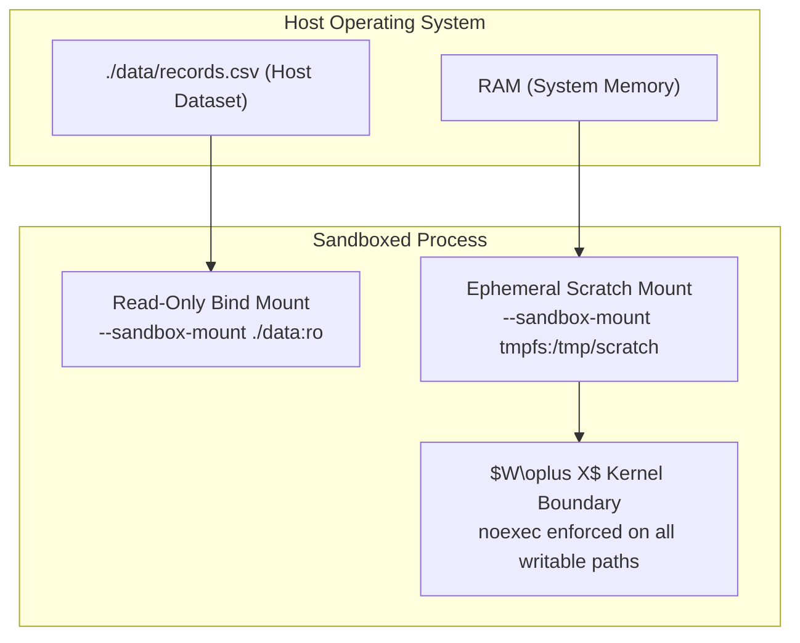

# Tutorial 03: Filesystem Mounts and Ephemeral Scratch Storage

Production automation scripts often require access to specific host directories—such as raw datasets, configuration bundles, or cached artifacts—while keeping the remainder of the host filesystem strictly isolated. Furthermore, build pipelines and data transformation tasks frequently need temporary workspace storage without persisting intermediate artifacts to disk or risking malware staging.

Starkite provides the `--sandbox-mount` flag to define explicit, kernel-enforced mount mappings and in-memory `tmpfs` scratch volumes. In combination with the Write-XOR-Execute ($W\oplus X$) security invariant, Starkite ensures that writable scratch areas can never be used to stage and execute malicious payloads.

This tutorial guides you through configuring read-only data mounts, staging temporary files in an ephemeral `tmpfs` scratch directory, and verifying the $W\oplus X$ kernel barrier.

---

## Mount Syntax and Architecture

The `--sandbox-mount` flag is repeatable and supports three formats:



1. **Full Bind Mount**: `<source>:<destination>[:<mode>]`  
   Maps a host `<source>` path to an absolute `<destination>` inside the sandbox. Mode defaults to read-only (`ro`); pass `rw` for read-write access.
   ```bash
   --sandbox-mount ./data:/data:ro
   ```
2. **Identity Bind Mount**: `<source>[:<mode>]`  
   Maps `<source>` to the identical destination path inside the sandbox with mode `ro` by default.
   ```bash
   --sandbox-mount ./data:ro
   ```
3. **In-Memory Tmpfs Mount**: `tmpfs:<destination>`  
   Mounts an isolated in-memory scratch filesystem at `<destination>` with default mode `rw`. Data exists only in memory for the duration of the execution and is destroyed upon process exit.
   ```bash
   --sandbox-mount tmpfs:/tmp/scratch
   ```

---

## Write-XOR-Execute ($W\oplus X$) Security Invariant

A fundamental defense against code injection and privilege escalation is **$W\oplus X$ (Write XOR Execute)**: memory or filesystem locations can be writable, or executable, but **never both simultaneously**.

In Starkite:
- All writable locations—including `$CWD`, `/tmp`, and explicit `rw` or `tmpfs` mounts—are mounted with `noexec` flags at the kernel level.
- An attacker or compromised dependency cannot download an executable binary or generate a shell script inside a writable scratch directory and then execute it.
- Kernel sandbox drivers (Landlock, Seatbelt, AppContainer) intercept the `execve` syscall on writable paths and terminate the execution attempt with `EPERM` (`Operation not permitted`).

---

## The Sample Dataset & Pipeline Script

### 1. Input Dataset: `data/records.csv`

```csv
instance_id,region,cpu_cores,memory_gb,status
i-01a2b3c4d5,us-east-1,4,16,running
i-02b3c4d5e6,us-east-1,8,32,running
i-03c4d5e6f7,us-west-2,2,8,stopped
i-04d5e6f7a8,us-west-2,16,64,running
i-05e6f7a8b9,eu-central-1,4,16,running
i-06f7a8b9c0,eu-central-1,8,32,stopped
```

### 2. Processing Script: `transform.star`

```python
#!/usr/bin/env kite
# transform.star — Dataset processing demonstrating read-only mounts, tmpfs scratch, and W^X invariants

def main():
    # -----------------------------------------------------------------------------
    # 1. Resolve Read-Only Dataset Mount
    # -----------------------------------------------------------------------------
    print("==> [Step 1] Resolving Read-Only Dataset")
    csv_path = None
    if fs.exists("./data/records.csv"):
        csv_path = "./data/records.csv"
    elif fs.exists("data/records.csv"):
        csv_path = "data/records.csv"

    if not csv_path:
        print("Error: records.csv not found in ./data.")
        print("Hint: mount the dataset using --sandbox-mount ./data:ro")
        os.exit(1)

    resolved_path = fs.path(csv_path).resolve().string
    print("  Input Dataset : " + resolved_path)

    # -----------------------------------------------------------------------------
    # 2. Parse and Aggregate Records
    # -----------------------------------------------------------------------------
    print("==> [Step 2] Processing Records via CSV Module")
    records = csv.file(resolved_path).read(header=True)
    print("  Total Records : " + str(len(records)))

    running_count = 0
    total_cores = 0
    total_memory = 0
    active_regions = {}

    for r in records:
        status = r.get("status", "").strip()
        if status == "running":
            running_count += 1
            cores = int(r.get("cpu_cores", "0"))
            mem = int(r.get("memory_gb", "0"))
            region = r.get("region", "unknown")
            total_cores += cores
            total_memory += mem
            active_regions[region] = active_regions.get(region, 0) + 1

    summary = {
        "generated_at": time.now().string(),
        "total_nodes": len(records),
        "running_nodes": running_count,
        "allocated_cores": total_cores,
        "allocated_memory_gb": total_memory,
        "active_regions": active_regions,
    }

    print("  Running Nodes : " + str(running_count))
    print("  Total Cores   : " + str(total_cores))
    print("  Total RAM (GB): " + str(total_memory) + "\n")

    # -----------------------------------------------------------------------------
    # 3. Ephemeral Scratch Storage Operations
    # -----------------------------------------------------------------------------
    print("==> [Step 3] Staging Intermediates to Ephemeral Scratch Storage")
    scratch_dir = "/tmp/scratch" if runtime.platform() != "windows" else "C:\\scratch"
    scratch_file = scratch_dir + "/summary.json"
    print("  Target Scratch: " + scratch_file)

    # Write summary artifact to scratch
    write_res = fs.try_write_text(scratch_file, json.encode(summary))
    if not write_res.ok:
        print("  Scratch Write : FAILED (" + write_res.error + ")")
        print("  Hint: pass --sandbox-mount tmpfs:" + scratch_dir + " on CLI")
        os.exit(1)

    print("  Scratch Write : OK (Wrote " + str(len(json.encode(summary))) + " bytes)")

    # Read back artifact to confirm roundtrip
    read_back = fs.read_text(scratch_file)
    print("  Verification  : Scratch readback confirmed (" + str(len(read_back)) + " bytes)\n")

    # -----------------------------------------------------------------------------
    # 4. Write-XOR-Execute (W^X) Invariant Verification
    # -----------------------------------------------------------------------------
    print("==> [Step 4] Enforcing Write-XOR-Execute (W^X) Invariant")
    exploit_script = scratch_dir + "/exploit.sh"
    fs.write_text(exploit_script, "#!/bin/sh\necho 'injected exploit payload'\n")
    fs.path(exploit_script).chmod(0o755)

    # In Starkite, all writable scratch mounts are mounted noexec.
    # The OS kernel blocks executing binaries or scripts directly from writable locations.
    print("  Staged Script : " + exploit_script + " (chmod 0755 in rw,noexec mount)")
    exec_res = os.try_exec(exploit_script, [])
    if not exec_res.ok:
        print("  Kernel W^X    : ENFORCED (Direct execution blocked: " + exec_res.error.strip() + ")")
    else:
        print("  Kernel W^X    : Warning: direct execution permitted under active profile")

    print("\n==> [Complete] Transform pipeline successfully executed under strict mount confinement!")
```

---

## Step-by-Step Walkthrough

Navigate to the tutorial directory:

```bash
cd sandbox/03-mounts-and-scratch
```

### Step 1: Execute Pipeline with Read-Only Data and Tmpfs Scratch

Execute `transform.star` under `sandbox-exec` with explicit mounts:

```bash
kite run ./transform.star \
  --sandbox-profile=sandbox-exec \
  --sandbox-mount tmpfs:/tmp/scratch
```

*(host-specific values differ)*
```text
==> [Step 1] Resolving Read-Only Dataset
  Input Dataset : /home/alice/projects/starkite-tutorials/sandbox/03-mounts-and-scratch/data/records.csv

==> [Step 2] Processing Records via CSV Module
  Total Records : 6
  Running Nodes : 4
  Total Cores   : 32
  Total RAM (GB): 128

==> [Step 3] Staging Intermediates to Ephemeral Scratch Storage
  Target Scratch: /tmp/scratch/summary.json
  Scratch Write : OK (Wrote 189 bytes)
  Verification  : Scratch readback confirmed (189 bytes)

==> [Step 4] Enforcing Write-XOR-Execute (W^X) Invariant
  Staged Script : /tmp/scratch/exploit.sh (chmod 0755 in rw,noexec mount)
  Kernel W^X    : ENFORCED (Direct execution blocked: fork/exec /tmp/scratch/exploit.sh: operation not permitted
  Hint: pass --sandbox-exec-allow=exploit.sh on CLI, or add "exploit.sh" to sandbox.<profile>.exec.allow in config.yaml)

==> [Complete] Transform pipeline successfully executed under strict mount confinement!
```

---

### Step 2: Verifying $W\oplus X$ Protection

In Step 4, the script staged an executable shell script (`exploit.sh`) inside `/tmp/scratch` and marked it executable with `chmod 0755`. When attempting direct invocation via `os.try_exec(exploit_script, [])`:

1. The OS kernel verified that `/tmp/scratch` was mounted with `noexec` (or restricted by Landlock/Seatbelt/AppContainer).
2. The `execve` syscall was denied before the binary could execute.
3. The returned error was `operation not permitted`.

This ensures that even if an untrusted dependency writes a script to disk, it cannot pivot into unauthorized process execution.

---

### Step 3: Verifying Scratch Ephemerality

Because `/tmp/scratch` is an in-memory `tmpfs` volume, any data written to it disappears when the process terminates:

```bash
ls -la /tmp/scratch/summary.json 2>/dev/null || echo "Scratch storage cleaned up"
```

No residual artifacts persist on the host filesystem.

---

## Next Steps

Now that you understand filesystem mounts, scratch storage, and $W\oplus X$:
- Proceed to [Tutorial 04: Network Confinement & Endpoint Filtering](../04-network-confinement/README.md) to learn how to air-gap scripts and allow specific remote API endpoints.
