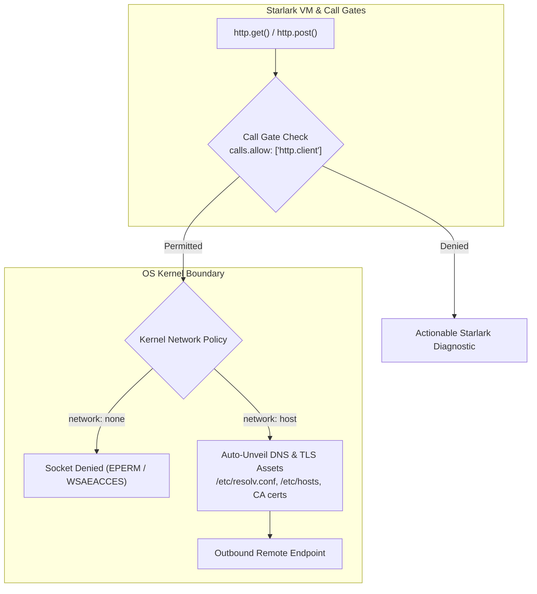

# Tutorial 04: Network Confinement & Endpoint Filtering

Outbound network access is one of the highest-risk capabilities in infrastructure automation. Untrusted scripts or compromised dependencies can exfiltrate sensitive environment variables, credentials, and source code, or download unauthorized binaries from the public internet.

To mitigate this risk, Starkite isolates processes in an air-gapped network namespace by default (`network: none`). When network egress is authorized, Starkite automatically unveils the host's DNS resolution configuration and trusted TLS root certificates while maintaining strict boundaries across the rest of the filesystem.

This tutorial guides you through testing endpoint connectivity with `health_check.star`, observing network denial diagnostics, and configuring network policies with `--sandbox-net-allow` and `--sandbox-net-deny=*`.

---

## Network Isolation Architecture

Starkite manages network confinement across both the in-VM Starlark runtime and the host operating system kernel:



### Automatic Network Asset Resolution

When network egress is unlocked (`--sandbox-net-allow` or `network: host`), a sandboxed process still requires access to host resolver configurations and trusted CA certificates to resolve domain names and establish secure HTTPS sessions.

Starkite's sandbox driver automatically inspects and unmasks the following host assets without exposing parent directories:
- **DNS Resolvers**: `/etc/resolv.conf` and `/etc/hosts`
- **TLS Certificate Authorities**:
  - Linux: `/etc/ssl/certs`, `/etc/pki/tls/certs`, `/etc/ca-certificates`
  - macOS: `/private/etc/ssl/cert.pem` and keychain root stores
  - Windows: Automated integration with Windows CryptoAPI and root cert store

---

## The Probing Script: `health_check.star`

`health_check.star` probes multiple external endpoints using `http.try_get()`, reporting latency and status codes when authorized, or capturing denial diagnostics when air-gapped:

```python
#!/usr/bin/env kite
# health_check.star — Remote service health prober demonstrating network confinement and DNS/TLS auto-unveiling

def probe_endpoint(url, label):
    print("  Probing       : " + label + " (" + url + ")")
    res = http.try_get(url, timeout="5s")
    if not res.ok:
        print("  Status        : BLOCKED / FAILED")
        print("  Diagnostic    : " + res.error.strip())
        return {"url": url, "label": label, "ok": False, "error": res.error.strip()}

    resp = res.value
    body_snippet = resp.get_text().strip()
    if len(body_snippet) > 60:
        body_snippet = body_snippet[:57] + "..."

    print("  Status        : OK (HTTP " + str(resp.status_code) + ")")
    print("  Response Body : " + body_snippet)
    return {"url": url, "label": label, "ok": True, "status_code": resp.status_code}

def main():
    print("==> [Network Confinement Audit] Probing Infrastructure Endpoints\n")

    endpoints = [
        ("https://api.github.com/zen", "GitHub Zen API"),
        ("https://httpbin.org/get", "HTTPBin Echo Service"),
    ]

    results = []
    for url, label in endpoints:
        info = probe_endpoint(url, label)
        results.append(info)
        print("")

    success_count = 0
    for r in results:
        if r["ok"]:
            success_count += 1

    summary = {
        "timestamp": time.now().string(),
        "total_probed": len(endpoints),
        "successful": success_count,
        "all_passed": success_count == len(endpoints),
    }

    print("==> [Health Check Summary]")
    print(json.encode(summary))

    if success_count == 0:
        print("\nNotice: Script is running under air-gapped network confinement.")
        print("Hint: Rerun with outbound networking authorized:")
        print("  kite run ./health_check.star --sandbox-net-allow")
        print("  kite run ./health_check.star --sandbox-profile=sandbox-net")
    elif success_count == len(endpoints):
        print("\nAll endpoints reached successfully under authorized network policy.")
```

---

## Step-by-Step Walkthrough

Navigate to the tutorial directory:

```bash
cd sandbox/04-network-confinement
```

### Step 1: Default Air-Gapped Execution

Execute `health_check.star` under default `deny-all`:

```bash
kite run ./health_check.star
```

*(host-specific values differ)*
```text
==> [Network Confinement Audit] Probing Infrastructure Endpoints

  Probing       : GitHub Zen API (https://api.github.com/zen)
  Status        : BLOCKED / FAILED
  Diagnostic    : permission denied: http.client GET("https://api.github.com/zen") - no matching allow rule
  grant "http.client" with --sandbox-profile=sandbox-net (or higher), or in the sandbox: section of config.yaml
  Hint: pass --sandbox-net-allow=api.github.com on CLI, or add "api.github.com" to sandbox.<profile>.network.allow in config.yaml

  Probing       : HTTPBin Echo Service (https://httpbin.org/get)
  Status        : BLOCKED / FAILED
  Diagnostic    : permission denied: http.client GET("https://httpbin.org/get") - no matching allow rule
  grant "http.client" with --sandbox-profile=sandbox-net (or higher), or in the sandbox: section of config.yaml
  Hint: pass --sandbox-net-allow=httpbin.org on CLI, or add "httpbin.org" to sandbox.<profile>.network.allow in config.yaml

==> [Health Check Summary]
{"all_passed":false,"successful":0,"timestamp":"2026-10-31T15:00:39Z","total_probed":2}

Notice: Script is running under air-gapped network confinement.
Hint: Rerun with outbound networking authorized:
  kite run ./health_check.star --sandbox-net-allow
  kite run ./health_check.star --sandbox-profile=sandbox-net
```

Under `deny-all`, the in-VM call gate traps all network requests before any TCP sockets are initialized.

---

### Step 2: Authorizing Outbound Network Egress

Authorize network egress with `--sandbox-net-allow`:

```bash
kite run ./health_check.star --sandbox-net-allow
```

*(host-specific values differ)*
```text
==> [Network Confinement Audit] Probing Infrastructure Endpoints

  Probing       : GitHub Zen API (https://api.github.com/zen)
  Status        : OK (HTTP 200)
  Response Body : Avoid administrative distraction.

  Probing       : HTTPBin Echo Service (https://httpbin.org/get)
  Status        : OK (HTTP 200)
  Response Body : {
  "args": {},
  "headers": {
    "Accept-Encoding": "gz...

==> [Health Check Summary]
{"all_passed":true,"successful":2,"timestamp":"2026-10-31T15:01:55Z","total_probed":2}

All endpoints reached successfully under authorized network policy.
```

**Key mechanisms executed:**
1. Starkite synthesized `http.client` allow rules in the VM.
2. The active sandbox driver attached host network access.
3. System TLS CA bundles were unmasked, enabling valid HTTPS handshakes without certificate validation errors.

---

### Step 3: Complete Air-Gap Enforcement (`--sandbox-net-deny=*`)

Even when a profile grants network access (such as `sandbox-net`), you can enforce an immutable air-gap by supplying `--sandbox-net-deny=*`:

```bash
kite run ./health_check.star --sandbox-profile=sandbox-net --sandbox-net-deny='*'
```

*(host-specific values differ)*
```text
==> [Network Confinement Audit] Probing Infrastructure Endpoints

  Probing       : GitHub Zen API (https://api.github.com/zen)
  Status        : BLOCKED / FAILED
  Diagnostic    : permission denied: http.client GET("https://api.github.com/zen") - blocked by deny rule: http.client
  Hint: pass --sandbox-net-allow=api.github.com on CLI, or add "api.github.com" to sandbox.<profile>.network.allow in config.yaml

  Probing       : HTTPBin Echo Service (https://httpbin.org/get)
  Status        : BLOCKED / FAILED
  Diagnostic    : permission denied: http.client GET("https://httpbin.org/get") - blocked by deny rule: http.client
  Hint: pass --sandbox-net-allow=httpbin.org on CLI, or add "httpbin.org" to sandbox.<profile>.network.allow in config.yaml

==> [Health Check Summary]
{"all_passed":false,"successful":0,"timestamp":"2026-10-31T15:02:06Z","total_probed":2}
```

Deny rules always take precedence over allow rules. `--sandbox-net-deny=*` acts as an unbypassable kill switch.

---

## Next Steps

Now that you know how network confinement and TLS/DNS asset resolution operate:
- Proceed to [Tutorial 05: In-VM Starlark Call Gates (`calls.allow` & `calls.deny`)](../05-in-vm-call-gates/README.md) to explore granular function-level authorization and `config.yaml` profile grammar.
