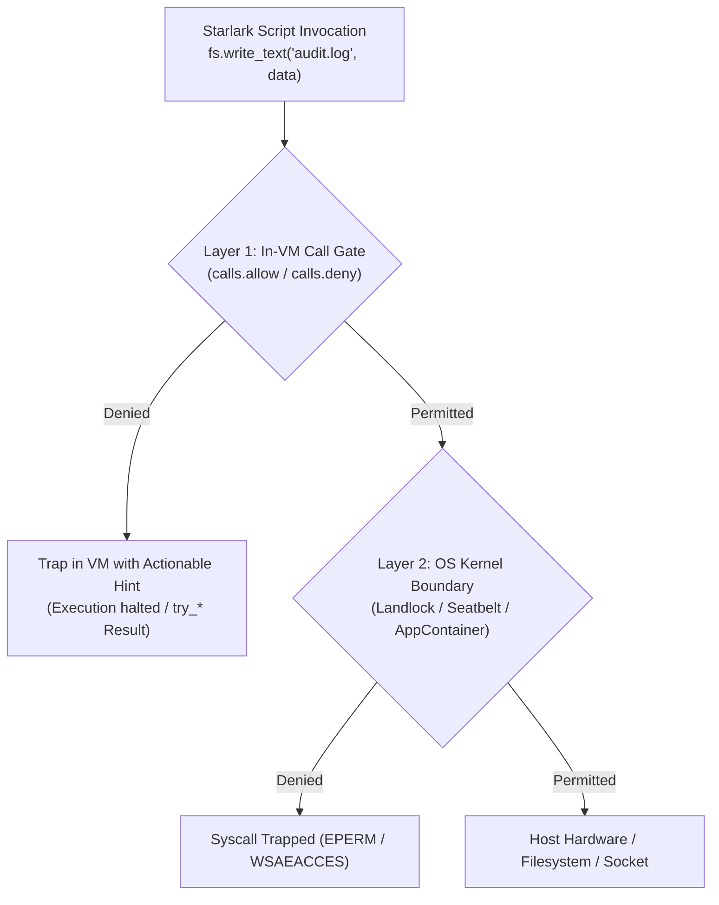

# Tutorial 05: In-VM Starlark Call Gates (`calls.allow` & `calls.deny`)

Operating system kernel sandboxes (Landlock, Seatbelt, AppContainers) provide authoritative isolation for system calls like file descriptors, sockets, and child processes. However, relying exclusively on OS-level enforcement has limitations: kernel errors can terminate processes abruptly with generic `EPERM` codes, and certain fine-grained operations (such as distinguishing between reading a file versus checking its existence, or scoping database drivers) cannot be natively expressed in kernel LSM rulesets.

Starkite addresses this through a **dual-layer defense model**. In addition to OS kernel containment, Starkite evaluates Starlark API operations inside the virtual machine before any syscall reaches the operating system.

This tutorial guides you through configuring fine-grained call gates in `config.yaml`, testing them with `cluster_ops.star`, and understanding the rule grammar and evaluation precedence.

---

## Dual-Layer Defense Architecture

Every operation invoked by a Starlark script passes through two independent security gates:



1. **Layer 1: In-VM Call Gate**: Fast, memory-resident inspection. Any API call (`fs.*`, `os.*`, `http.*`, `k8s.*`, `sql.*`) is validated against active allow and deny rules. Violations are trapped gracefully and format actionable diagnostic hints.
2. **Layer 2: OS Kernel Boundary**: Authoritative containment enforced by the kernel. Even if code attempts to bypass userspace controls, the OS kernel blocks unauthorized access.

Pure-compute modules (`math`, `json`, `yaml`, `strings`, `hash`, `time`, `base64`) perform no I/O and bypass call gate checks.

---

## Rule Grammar & Evaluation Semantics

Call gate rules follow a concise, structured grammar:

```text
module.category[([function_list:]resource)]
```

- **`module`**: Target module name (`fs`, `os`, `http`, `ssh`, `k8s`, `sql`, `mcp`, `io`, or `*`).
- **`category`**: Operation category (`read`, `write`, `delete`, `exec`, `client`, `server`, `open`, or `*`).
- **`function_list`**: (Optional) Comma-separated list of functions within that category.
- **`resource`**: (Optional) File path, glob pattern (`**`), or destination host pattern.

### Common Rule Examples

| Pattern | Description |
| :--- | :--- |
| `*.*` | Allows any module, category, and operation |
| `fs.*` | Allows all operations within the `fs` module |
| `fs.read` | Allows reading any path accessible to the script |
| `fs.read($CWD/**)` | Allows reading files located within `$CWD` and subdirectories |
| `fs.write` | Allows creating and modifying files |
| `fs.delete` | Allows file deletion (`fs.path(...).remove()`) |
| `os.exec` | Allows launching child processes |
| `http.client` | Allows outbound HTTP requests |

### Evaluation Precedence: Deny-First

Starkite evaluates call rules with **deny-first** precedence:
1. If an operation matches any rule in `calls.deny`, it is **denied immediately**, even if an allow rule matches.
2. If an operation matches a rule in `calls.allow`, it is permitted.
3. If no allow rule matches, the operation fails closed under `DefaultDeny`.

---

## The Configuration & Script

### 1. Profile Definitions: `config.yaml`

```yaml
# config.yaml — Fine-grained in-VM Starlark call gate policies
sandbox:
  ops-read:
    network: none
    paths:
      read: ["."]
    calls:
      allow:
        - "fs.read"
        - "json.*"
        - "yaml.*"
      deny:
        - "os.exec"
        - "fs.write"

  ops-admin:
    base: sandbox-exec
    exec:
      allow: ["echo", "git"]
      deny: ["rm"]
    calls:
      deny:
        - "fs.delete"
```

- **`ops-read`**: An audit-only profile. Grants filesystem read and JSON/YAML serialization, but explicitly denies file writes and subprocess execution.
- **`ops-admin`**: An administrative profile inheriting from `sandbox-exec`. Permits reading, writing, and executing `echo` and `git`, but explicitly denies file deletion (`fs.delete`).

### 2. Operations Script: `cluster_ops.star`

```python
#!/usr/bin/env kite
# cluster_ops.star — Demonstrating fine-grained in-VM Starlark call gates (calls.allow / calls.deny)

def check_op(name, result_tuple):
    ok, detail = result_tuple
    status = "ALLOWED" if ok else "DENIED"
    print("  " + name + " : " + status)
    if not ok:
        print("    └─ Reason: " + detail)

def test_read():
    res = fs.try_read_text("config.yaml")
    if res.ok:
        return (True, "Read " + str(len(res.value)) + " bytes")
    return (False, res.error.strip().splitlines()[0])

def test_json():
    # Pure-compute modules (json, yaml, strings, math) are always permitted
    payload = json.encode({"cluster": "prod-k8s-01", "healthy": True})
    return (True, "Encoded " + str(len(payload)) + " bytes")

def test_write():
    res = fs.try_write_text("test_audit.log", "audit-entry\n")
    if res.ok:
        return (True, "Wrote audit log")
    return (False, res.error.strip().splitlines()[0])

def test_delete():
    # Attempting to delete a file — should be blocked by calls.deny: ["fs.delete"]
    res = fs.path("test_audit.log").try_remove()
    if res.ok:
        return (True, "Removed audit log")
    return (False, res.error.strip().splitlines()[0])

def main():
    print("==> [In-VM Call Gate Evaluation] Checking Module & Category Permissions\n")

    check_op("fs.read (config.yaml)", test_read())
    check_op("json.encode (payload)", test_json())
    check_op("fs.write (audit log)", test_write())
    check_op("fs.delete (audit log)", test_delete())

    # Clean up test_audit.log if it exists and deletion wasn't blocked
    if fs.exists("test_audit.log"):
        fs.path("test_audit.log").try_remove()

    print("\n==> [Call Gate Verification Complete]")
```

---

## Step-by-Step Walkthrough

Navigate to the tutorial directory:

```bash
cd sandbox/05-in-vm-call-gates
```

### Step 1: Run Under `ops-read` Profile

Execute `cluster_ops.star` using the read-only profile:

```bash
kite run ./cluster_ops.star --sandbox-profile=ops-read
```

*(host-specific values differ)*
```text
==> [In-VM Call Gate Evaluation] Checking Module & Category Permissions

  fs.read (config.yaml) : ALLOWED
  json.encode (payload) : ALLOWED
  fs.write (audit log) : DENIED
    └─ Reason: permission denied: fs.write write("/home/alice/projects/starkite-tutorials/sandbox/05-in-vm-call-gates/test_audit.log") - blocked by deny rule: fs.write
  fs.delete (audit log) : DENIED
    └─ Reason: permission denied: fs.delete remove("/home/alice/projects/starkite-tutorials/sandbox/05-in-vm-call-gates/test_audit.log") - no matching allow rule

==> [Call Gate Verification Complete]
```

**Evaluation analysis:**
- `fs.read` and `json.encode` succeeded.
- `fs.write` was intercepted by `calls.deny: ["fs.write"]` before touching disk.
- `fs.delete` was denied under default-deny semantics because `ops-read` includes no allow rule for deletion.

---

### Step 2: Run Under `ops-admin` Profile

Execute `cluster_ops.star` using the administrative profile:

```bash
kite run ./cluster_ops.star --sandbox-profile=ops-admin
```

*(host-specific values differ)*
```text
==> [In-VM Call Gate Evaluation] Checking Module & Category Permissions

  fs.read (config.yaml) : ALLOWED
  json.encode (payload) : ALLOWED
  fs.write (audit log) : ALLOWED
  fs.delete (audit log) : DENIED
    └─ Reason: permission denied: fs.delete remove("/home/alice/projects/starkite-tutorials/sandbox/05-in-vm-call-gates/test_audit.log") - blocked by deny rule: fs.delete

==> [Call Gate Verification Complete]
```

**Evaluation analysis:**
- `fs.write` succeeded because `ops-admin` inherits workspace write capabilities from `sandbox-exec`.
- `fs.delete` was denied specifically by `calls.deny: ["fs.delete"]`. Even though workspace write is permitted, deletion is explicitly forbidden.

---

### Step 3: Granular CLI Overrides

You can inject or override call gate rules directly from the CLI without modifying `config.yaml`:

```bash
# Allow read and JSON, but deny write via CLI flag
kite run ./cluster_ops.star \
  --sandbox-path-read=. \
  --sandbox-call-deny=fs.write
```

---

## Clean Up

Remove any temporary files:

```bash
rm -f test_audit.log
```

---

## Next Steps

Now that you understand in-VM Starlark call gates:
- Proceed to [Tutorial 06: Environment Variable Sanitization & Forwarding](../06-env-sanitization/README.md) to explore the 3-tier environment synthesis model.
