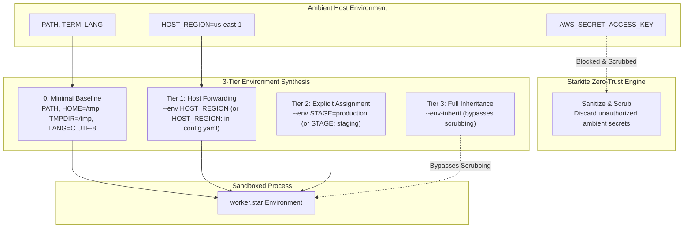

# Tutorial 06: Environment Variable Sanitization & Forwarding

Environment variables are the most common vector for accidental credential exfiltration in automation workflows. Modern developer machines and CI/CD runners maintain dozens of sensitive ambient variables—such as `AWS_SECRET_ACCESS_KEY`, `GITHUB_TOKEN`, `KUBECONFIG`, and database credentials. Untrusted scripts or third-party packages can read these variables from the process environment and exfiltrate them.

Starkite eliminates ambient credential exposure by sanitizing the process environment by default. Confined processes execute with a minimal, safe baseline. You control environment visibility through a declarative **3-tier environment synthesis model**.

This tutorial demonstrates how ambient variables are scrubbed, how to declare static and forwarded variables in `config.yaml`, how to override values via CLI flags, and how to use `--debug` to identify scrubbed variables.

---

## The 3-Tier Environment Synthesis Model

Starkite synthesizes the process environment before the sandbox locks down:



1. **Tier 1: Selective Host Forwarding** (`--env KEY` or `KEY:` in `config.yaml`):  
   Forwards an existing variable from the host environment. If the variable is not set on the host, it is omitted.
2. **Tier 2: Explicit Assignment** (`--env KEY=VALUE` or `KEY: val` in `config.yaml`):  
   Injects an explicit key-value pair without reading the host environment.
3. **Tier 3: Full Host Inheritance** (`--env-inherit`):  
   Forwards the complete ambient host environment. Use this only for trusted administrative scripts.

---

## Safe Minimal Baseline

Under the default sandbox, a process receives only five sanitized system variables:
- `HOME=/tmp`: Isolates the workload from the user's real home directory (`~/.ssh`, `~/.aws`, `~/.kube`).
- `TMPDIR=/tmp`: Points temporary directory resolution to the isolated scratch workspace.
- `PATH`: Forwarded so standard system utilities can be located.
- `LANG=C.UTF-8`: Provides predictable UTF-8 character encoding.
- `TERM`: Preserves terminal capability negotiation.

All other ambient host variables are dropped.

---

## The Configuration & Script

### 1. Profile Definition: `config.yaml`

```yaml
# config.yaml — Environment configuration and forwarding profile
sandbox:
  worker-profile:
    base: sandbox-path
    env:
      STAGE: staging
      API_ENDPOINT: https://internal.service.local
      HOST_REGION:
```

- `STAGE`: Injected with static value `"staging"`.
- `API_ENDPOINT`: Injected with static value `"https://internal.service.local"`.
- `HOST_REGION:` (empty value): Forwarded from the host environment if present.

### 2. Worker Script: `worker.star`

```python
#!/usr/bin/env kite
# worker.star — Demonstrating zero-trust environment scrubbing and the 3-tier synthesis model

def main():
    print("==> [Environment Sanitization Audit] Inspecting Process Environment\n")

    # 1. Baseline Safe Environment
    print("1. Standard Baseline Environment Variables:")
    print("   HOME       : " + os.env("HOME"))
    print("   TMPDIR     : " + os.env("TMPDIR"))
    print("   LANG       : " + os.env("LANG"))
    print("   PATH       : " + (os.env("PATH")[:30] + "..." if len(os.env("PATH")) > 30 else os.env("PATH")))

    # 2. Injected Profile / CLI Variables
    print("\n2. Workload Configuration Variables:")
    stage = os.env("STAGE")
    api_endpoint = os.env("API_ENDPOINT")
    host_region = os.env("HOST_REGION")

    print("   STAGE        : " + (stage if stage else "<not set>"))
    print("   API_ENDPOINT : " + (api_endpoint if api_endpoint else "<not set>"))
    print("   HOST_REGION  : " + (host_region if host_region else "<not set>"))

    # 3. Ambient Host Secrets (Should be scrubbed by default)
    print("\n3. Ambient Host Secrets (Zero-Trust Scrubbing Check):")
    aws_secret = os.env("AWS_SECRET_ACCESS_KEY")
    db_pass = os.env("DATABASE_PASSWORD")

    print("   AWS_SECRET_ACCESS_KEY : " + (aws_secret if aws_secret else "[SCRUBBED / EMPTY]"))
    print("   DATABASE_PASSWORD     : " + (db_pass if db_pass else "[SCRUBBED / EMPTY]"))

    summary = {
        "timestamp": time.now().string(),
        "stage": stage,
        "api_endpoint": api_endpoint,
        "host_region": host_region,
        "secrets_leak_prevented": (aws_secret == "" and db_pass == ""),
    }

    print("\n==> [Environment Audit Summary]")
    print(json.encode(summary))
```

---

## Step-by-Step Walkthrough

Navigate to the tutorial directory:

```bash
cd sandbox/06-env-sanitization
```

### Step 1: Default Confinement & Ambient Secret Scrubbing

Simulate an ambient secret on the host and run the script under `sandbox-path`:

```bash
AWS_SECRET_ACCESS_KEY=super-secret-production-key \
  kite run ./worker.star --sandbox-profile=sandbox-path
```

*(host-specific values differ)*
```text
==> [Environment Sanitization Audit] Inspecting Process Environment

1. Standard Baseline Environment Variables:
   HOME       : /tmp
   TMPDIR     : /tmp
   LANG       : C.UTF-8
   PATH       : /usr/local/bin:/usr/bin:/bin...

2. Workload Configuration Variables:
   STAGE        : <not set>
   API_ENDPOINT : <not set>
   HOST_REGION  : <not set>

3. Ambient Host Secrets (Zero-Trust Scrubbing Check):
   AWS_SECRET_ACCESS_KEY : [SCRUBBED / EMPTY]
   DATABASE_PASSWORD     : [SCRUBBED / EMPTY]

==> [Environment Audit Summary]
{"api_endpoint":"","host_region":"","secrets_leak_prevented":true,"stage":"","timestamp":"2026-10-31T15:09:05Z"}
```

Even though `AWS_SECRET_ACCESS_KEY` was exported on the host, the script received an empty string. The host secret never crossed the sandbox boundary.

---

### Step 2: Diagnostic Scrubbing Hints (`--debug`)

Pass `--debug` to observe how Starkite detects attempts to read scrubbed host variables:

```bash
AWS_SECRET_ACCESS_KEY=super-secret-production-key \
  kite run ./worker.star --sandbox-profile=sandbox-path --debug
```

*(host-specific values differ)*
```text
[DEBUG] env "AWS_SECRET_ACCESS_KEY" requested by script is present on host but scrubbed by sandbox.
  Hint: pass --env AWS_SECRET_ACCESS_KEY on CLI, or declare "AWS_SECRET_ACCESS_KEY:" in sandbox.<profile>.env in config.yaml
```

When a script queries an environment variable that exists on the host but was omitted from the sandbox synthesis, Starkite warns the operator and provides the exact remediation syntax.

---

### Step 3: Declarative Configuration via `config.yaml`

Run the script using `worker-profile`, supplying `HOST_REGION` in the ambient environment:

```bash
HOST_REGION=us-east-1 \
  kite run ./worker.star --sandbox-profile=worker-profile
```

*(host-specific values differ)*
```text
==> [Environment Sanitization Audit] Inspecting Process Environment

1. Standard Baseline Environment Variables:
   HOME       : /tmp
   TMPDIR     : /tmp
   LANG       : C.UTF-8
   PATH       : /usr/local/bin:/usr/bin:/bin...

2. Workload Configuration Variables:
   STAGE        : staging
   API_ENDPOINT : https://internal.service.local
   HOST_REGION  : us-east-1

3. Ambient Host Secrets (Zero-Trust Scrubbing Check):
   AWS_SECRET_ACCESS_KEY : [SCRUBBED / EMPTY]
   DATABASE_PASSWORD     : [SCRUBBED / EMPTY]

==> [Environment Audit Summary]
{"api_endpoint":"https://internal.service.local","host_region":"us-east-1","secrets_leak_prevented":true,"stage":"staging","timestamp":"2026-10-31T15:09:35Z"}
```

`STAGE` and `API_ENDPOINT` were populated from `config.yaml`, `HOST_REGION` was forwarded from the host, and ambient secrets remained scrubbed.

---

### Step 4: Selective CLI Overrides

Override `STAGE` dynamically without editing `config.yaml`:

```bash
HOST_REGION=us-east-1 \
  kite run ./worker.star --sandbox-profile=worker-profile -e STAGE=production
```

*(host-specific values differ)*
```text
2. Workload Configuration Variables:
   STAGE        : production
   API_ENDPOINT : https://internal.service.local
   HOST_REGION  : us-east-1
```

CLI flags take precedence over profile definitions in `config.yaml`.

---

### Step 5: Full Inheritance (`--env-inherit`)

When executing trusted local administrative tools that require access to the developer's full environment:

```bash
AWS_SECRET_ACCESS_KEY=super-secret-key \
  kite run ./worker.star --sandbox-profile=sandbox-path --env-inherit
```

*(host-specific values differ)*
```text
1. Standard Baseline Environment Variables:
   HOME       : /home/alice
   TMPDIR     : /tmp

3. Ambient Host Secrets (Zero-Trust Scrubbing Check):
   AWS_SECRET_ACCESS_KEY : super-secret-key
   DATABASE_PASSWORD     : [SCRUBBED / EMPTY]
```

`--env-inherit` forwards the real `$HOME` and all ambient host variables.

---

## Next Steps

Now that you understand environment isolation and forwarding:
- Proceed to [Tutorial 07: Cross-Platform Kernel Drivers](../07-cross-platform-drivers/README.md) to inspect OS-level enforcement across Linux (Landlock), macOS (Seatbelt), and Windows (AppContainer).
