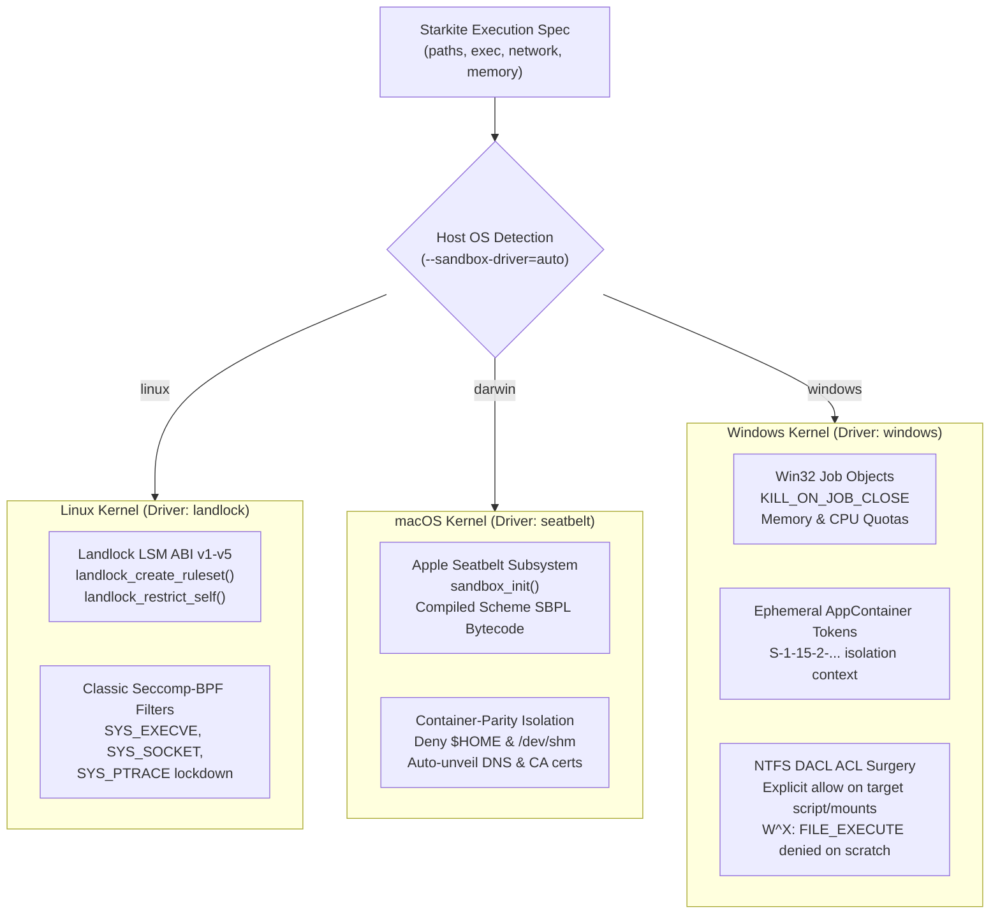

# Tutorial 07: Cross-Platform Kernel Drivers

A key design principle of Starkite is **unprivileged, OS-native kernel sandboxing**. Rather than relying on heavyweight virtual machines or requiring administrative root/sudo privileges to set up namespaces, Starkite integrates directly with the native security subsystems of Linux, macOS, and Windows.

When you run `kite run` or `kite exec`, Starkite automatically selects the appropriate kernel driver for the host platform (`--sandbox-driver=auto`). This tutorial explores how Starkite's kernel drivers operate, walks through the runtime inspection script `probe.star`, and examines real validation outputs across macOS, Linux, and Windows.

---

## The Three OS Kernel Drivers

Starkite maps zero-trust sandbox policies directly to the authoritative security primitives of each supported operating system:



### 1. Linux: Landlock LSM & Classic Seccomp-BPF (`landlock`)

On Linux (kernel 5.13+), Starkite isolates processes without requiring root privileges or container runtimes:
- **Landlock LSM**: Calls `landlock_create_ruleset()` and `landlock_restrict_self()` to constrain filesystem paths. Filesystem read and write rights are restricted strictly to authorized directories. Parent and home directories remain completely inaccessible.
- **Classic Seccomp-BPF**: Attaches BPF syscall filters to enforce network and process boundaries:
  - Blocks process execution syscalls (`SYS_EXECVE`, `SYS_EXECVEAT`) when running under `deny-all` or `sandbox-path`.
  - Disables socket creation (`SYS_SOCKET`) when network mode is `none`.
  - Restricts signal delivery (`SYS_KILL`) and debugging (`SYS_PTRACE`) strictly to processes within the sandbox process tree.

### 2. macOS: Dynamic Seatbelt SBPL (`seatbelt`)

On macOS, Starkite binds dynamically to Apple's Seatbelt sandbox framework via `sandbox_init`:
- Compiles an in-memory Scheme Sandbox Profile Language (SBPL) profile tailored to the script's exact capability grants.
- Enforces container-parity isolation by denying broad access to `$HOME`, protecting SSH keys (`~/.ssh`), cloud credentials (`~/.aws`), and shell history.
- Unmasks system dynamic linkers, libc frameworks, DNS resolvers (`/etc/resolv.conf`), and macOS keychain root CA bundles.

### 3. Windows: AppContainer & Job Objects (`windows`)

On Windows 10/11 and Windows Server 2022+, Starkite enforces isolation through five coordinated Win32 kernel primitives:
- **Win32 Job Objects**: Enforces `JOB_OBJECT_LIMIT_KILL_ON_JOB_CLOSE` to ensure child process trees terminate completely when the runner exits, alongside memory ceilings (`JOB_OBJECT_LIMIT_JOB_MEMORY`).
- **Ephemeral AppContainer Tokens**: Derives a scoped, throwaway AppContainer SID (`S-1-15-2-...`) for the session, executing child processes in an unprivileged isolation context.
- **NTFS Discretionary Access Control (DACL)**: Surgically unmasks only the script file and explicit mount targets, leaving `%USERPROFILE%` and host directories inaccessible.
- **Write-XOR-Execute ($W\oplus X$) Enforcement**: Temporary scratch directories grant read and write permissions while explicitly denying `FILE_EXECUTE` in a single DACL transaction.

---

## The Driver Probe Script: `probe.star`

`probe.star` inspects the active runtime platform, driver list, default driver, and verifies that sensitive host paths are protected:

```python
#!/usr/bin/env kite
# probe.star — Cross-platform sandbox runtime and kernel driver probe

def main():
    print("==> [Kernel Sandbox Driver Probe] Inspecting Platform Primitives\n")

    plat = runtime.platform()
    arch = runtime.arch()
    def_driver = sandbox.default_driver()
    available_drivers = sandbox.list_drivers()

    print("  Host Platform     : " + plat + " (" + arch + ")")
    print("  Go Runtime        : " + runtime.go_version())
    print("  Default Driver    : " + def_driver)
    print("  Available Drivers : " + json.encode(available_drivers))

    # Kernel mechanism description by platform
    mechanism = "unknown"
    if plat == "linux":
        mechanism = "Landlock LSM (ABI v1-v5) + Classic Seccomp-BPF process/socket filters"
    elif plat == "darwin":
        mechanism = "Apple Seatbelt (sandbox_init with compiled Scheme SBPL bytecode)"
    elif plat == "windows":
        mechanism = "AppContainer isolation, Win32 Job Objects, NTFS DACLs, and WFP filtering"

    print("  Kernel Mechanism  : " + mechanism)

    # -----------------------------------------------------------------------------
    # Filesystem & Boundary Validation
    # -----------------------------------------------------------------------------
    print("\n==> [Sandbox Boundary Validation]")

    # Check scratch directory using safe try_exists
    scratch_dir = "/tmp" if plat != "windows" else "C:\\scratch"
    scratch_res = fs.try_exists(scratch_dir)
    scratch_ok = scratch_res.ok and scratch_res.value
    print("  Scratch Path      : " + scratch_dir + " (accessible=" + str(scratch_ok) + ")")

    # Probe sensitive host path (container-parity isolation test)
    sensitive_path = "/root/.ssh" if plat == "linux" else "/var/root/.ssh"
    if plat == "darwin":
        sensitive_path = "/etc/master.passwd"
    elif plat == "windows":
        sensitive_path = "C:\\Windows\\System32\\config\\SAM"

    print("  Probing Sensitive : " + sensitive_path)
    res = fs.try_read_text(sensitive_path)
    if not res.ok:
        print("  Isolation Status  : PROTECTED (Access denied by sandbox: " + res.error.strip().splitlines()[0] + ")")
    else:
        print("  Isolation Status  : WARNING (Sensitive path accessible)")

    probe_result = {
        "timestamp": time.now().string(),
        "platform": plat,
        "arch": arch,
        "default_driver": def_driver,
        "available_drivers": available_drivers,
        "kernel_mechanism": mechanism,
        "host_protected": not res.ok,
    }

    print("\n==> [Driver Probe Telemetry]")
    print(json.encode(probe_result))
    print("\nKernel driver probe verified across active OS sandbox.")
```

---

## Multi-Platform Validation Results

### 1. macOS Validation (`seatbelt`)

Execute `probe.star` on macOS:

```bash
kite run ./probe.star
```

*(host-specific values differ)*
```text
==> [Kernel Sandbox Driver Probe] Inspecting Platform Primitives

  Host Platform     : darwin (arm64)
  Go Runtime        : go1.27.0
  Default Driver    : seatbelt
  Available Drivers : ["docker","gvisor","nerdctl","podman","seatbelt"]
  Kernel Mechanism  : Apple Seatbelt (sandbox_init with compiled Scheme SBPL bytecode)

==> [Sandbox Boundary Validation]
  Scratch Path      : /tmp (accessible=True)
  Probing Sensitive : /etc/master.passwd
  Isolation Status  : PROTECTED (Access denied by sandbox: permission denied: fs.read read_file("/private/etc/master.passwd") - no matching allow rule)

==> [Driver Probe Telemetry]
{"arch":"arm64","available_drivers":["docker","gvisor","nerdctl","podman","seatbelt"],"default_driver":"seatbelt","host_protected":true,"kernel_mechanism":"Apple Seatbelt (sandbox_init with compiled Scheme SBPL bytecode)","platform":"darwin","timestamp":"2026-10-31T15:11:00Z"}

Kernel driver probe verified across active OS sandbox.
```

---

### 2. Linux Validation (`landlock`)

Execute `probe.star` on native Linux:

```bash
kite run ./probe.star
```

*(host-specific values differ)*
```text
==> [Kernel Sandbox Driver Probe] Inspecting Platform Primitives

  Host Platform     : linux (amd64)
  Go Runtime        : go1.26.2
  Default Driver    : landlock
  Available Drivers : ["docker","gvisor","landlock","nerdctl","podman"]
  Kernel Mechanism  : Landlock LSM (ABI v1-v5) + Classic Seccomp-BPF process/socket filters

==> [Sandbox Boundary Validation]
  Scratch Path      : /tmp (accessible=True)
  Probing Sensitive : /root/.ssh
  Isolation Status  : PROTECTED (Access denied by sandbox: permission denied: fs.read read_file("/root/.ssh") - no matching allow rule)

==> [Driver Probe Telemetry]
{"arch":"amd64","available_drivers":["docker","gvisor","landlock","nerdctl","podman"],"default_driver":"landlock","host_protected":true,"kernel_mechanism":"Landlock LSM (ABI v1-v5) + Classic Seccomp-BPF process/socket filters","platform":"linux","timestamp":"2026-10-31T19:11:42Z"}

Kernel driver probe verified across active OS sandbox.
```

---

### 3. Windows Validation (`windows`)

Execute `probe.star` on native Windows 11 (PowerShell):

```powershell
.\kite.exe run .\probe.star
```

*(host-specific values differ)*
```text
==> [Kernel Sandbox Driver Probe] Inspecting Platform Primitives

  Host Platform     : windows (amd64)
  Go Runtime        : go1.27.0
  Default Driver    : windows
  Available Drivers : ["docker","gvisor","nerdctl","podman","windows"]
  Kernel Mechanism  : AppContainer isolation, Win32 Job Objects, NTFS DACLs, and WFP filtering

==> [Sandbox Boundary Validation]
  Scratch Path      : C:\scratch (accessible=False)
  Probing Sensitive : C:\Windows\System32\config\SAM
  Isolation Status  : PROTECTED (Access denied by sandbox: permission denied: fs.read read_file("C:\Windows\System32\config\SAM") - no matching allow rule)

==> [Driver Probe Telemetry]
{"arch":"amd64","available_drivers":["docker","gvisor","nerdctl","podman","windows"],"default_driver":"windows","host_protected":true,"kernel_mechanism":"AppContainer isolation, Win32 Job Objects, NTFS DACLs, and WFP filtering","platform":"windows","timestamp":"2026-10-31T12:13:43-07:00"}

Kernel driver probe verified across active OS sandbox.
```

---

## Driver Override Flag (`--sandbox-driver`)

By default, `--sandbox-driver=auto` selects the native OS kernel driver. You can explicitly select an available driver or container engine:

```bash
# Explicit OS kernel driver
kite run ./probe.star --sandbox-driver=seatbelt     # On macOS
kite run ./probe.star --sandbox-driver=landlock     # On Linux
kite run ./probe.star --sandbox-driver=windows      # On Windows

# Or route through an OCI container engine
kite run ./probe.star --sandbox-driver=docker
kite run ./probe.star --sandbox-driver=podman
```

---

## Next Steps

Now that you understand native OS kernel drivers:
- Proceed to [Tutorial 08: Container Sandbox Drivers (`podman`, `docker`, `gvisor`)](../08-container-drivers/README.md) to learn how Starkite executes workloads inside hardened, ephemeral OCI containers.
