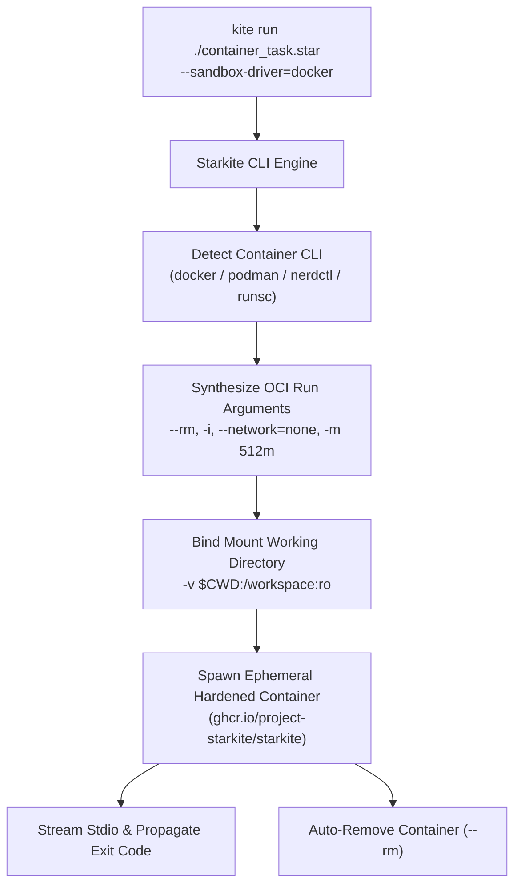

# Tutorial 08: Container Sandbox Drivers (`podman`, `docker`, `gvisor`)

While Starkite's native OS kernel drivers (Landlock, Seatbelt, AppContainers) provide zero-overhead isolation on the host, certain operational environments require executing automation runbooks within strict OCI container boundaries. Container-based sandboxing is essential when:
- Workloads require specific Linux userland tools (e.g. `apk`, `apt`, custom C libraries) not present on the host.
- You need hardware-level or microVM virtualization (such as Google's **gVisor** `runsc` Sentry kernel).
- Organizational compliance mandates containerized isolation for untrusted third-party scripts.

Starkite provides first-class support for OCI container sandbox drivers: **Podman** (rootless), **Docker**, **Nerdctl**, and **gVisor**. When configured, Starkite provisions an ephemeral container, applies zero-trust network and filesystem constraints, streams I/O, and automatically destroys the container upon completion.

This tutorial guides you through configuring container drivers in `config.yaml`, managing resource limits, and executing `container_task.star`.

---

## Container Driver Architecture

When you select a container driver, Starkite orchestrates the container CLI behind the scenes:



### Supported Container Drivers

| Driver | Engine Binary | Confinement Mechanism | Typical Environment |
| :--- | :--- | :--- | :--- |
| `podman` | `podman` | Rootless user namespaces, OCI runtime (crun/runc) | RHEL, Fedora, unprivileged Linux hosts |
| `docker` | `docker` | Docker daemon, containerd cgroups & namespaces | Standard CI/CD runners, local workstations |
| `nerdctl` | `nerdctl` | Direct containerd integration | Kubernetes nodes, minimal container hosts |
| `gvisor` | `runsc` | MicroVM application kernel (Sentry), userland syscall intercept | High-security multi-tenant infrastructure |

---

## The Configuration & Task Script

### 1. Profile Definitions: `config.yaml`

```yaml
# config.yaml — Ephemeral OCI container sandbox profiles
sandbox:
  container-runner:
    driver: docker
    image: ghcr.io/project-starkite/starkite:latest
    max_memory: 512MB
    timeout: 60s
    network: none
    paths:
      read: ["."]

  podman-runner:
    driver: podman
    image: ghcr.io/project-starkite/starkite:latest
    max_memory: 256MB
    timeout: 30s
    network: none
    paths:
      read: ["."]
```

### 2. Workload Script: `container_task.star`

```python
#!/usr/bin/env kite
# container_task.star — Automated workload executing inside an ephemeral OCI container sandbox

def main():
    print("==> [Container Sandbox Execution] Initializing Workload\n")

    # 1. Environment & Container Telemetry
    print("1. Container Environment Metadata:")
    print("   Platform        : " + runtime.platform() + " (" + runtime.arch() + ")")
    print("   Go Version      : " + runtime.go_version())
    print("   CPUs Available  : " + str(runtime.cpu_count()))

    # Check for container filesystem signatures
    is_docker = fs.try_exists("/.dockerenv").ok and fs.try_exists("/.dockerenv").value
    cgroup_info = "<not accessible>"
    cgroup_res = fs.try_read_text("/proc/1/cgroup")
    if cgroup_res.ok:
        first_cgroup = cgroup_res.value.strip().splitlines()[0] if cgroup_res.value else ""
        cgroup_info = first_cgroup[:40]

    print("   /.dockerenv     : " + str(is_docker))
    print("   cgroup Signature: " + cgroup_info)

    # 2. Ephemeral In-Memory Computation
    print("\n2. Processing Bounded Container Workload:")
    records_count = 5000
    calc_hash = hash.text("container-task-" + str(records_count)).sha256()
    print("   Batch Size      : " + str(records_count) + " records")
    print("   Result SHA-256  : " + calc_hash[:24] + "...")

    # 3. Testing Container Network Isolation
    print("\n3. Testing Container Network Isolation:")
    net_probe = http.try_get("https://httpbin.org/get", timeout="2s")
    if not net_probe.ok:
        print("   Network Status  : AIR-GAPPED (Outbound socket blocked: " + net_probe.error.strip().splitlines()[0] + ")")
    else:
        print("   Network Status  : CONNECTED (HTTP " + str(net_probe.value.status_code) + ")")

    telemetry = {
        "timestamp": time.now().string(),
        "runtime": runtime.platform(),
        "dockerenv_present": is_docker,
        "batch_hash": calc_hash,
        "network_airgapped": not net_probe.ok,
    }

    print("\n==> [Container Task Completed Successfully]")
    print(json.encode(telemetry))
```

---

## Step-by-Step Walkthrough

Navigate to the tutorial directory:

```bash
cd sandbox/08-container-drivers
```

### Step 1: Execute via Docker Driver Profile

Execute the workload under the `container-runner` profile:

```bash
kite run ./container_task.star --sandbox-profile=container-runner
```

*(host-specific values differ)*
```text
==> [Container Sandbox Execution] Initializing Workload

1. Container Environment Metadata:
   Platform        : linux (amd64)
   Go Version      : go1.26.2
   CPUs Available  : 4
   /.dockerenv     : True
   cgroup Signature: 0::/docker/4a1b2c3d4e5f6a7b8c9d0e1f2a3b4c5d

2. Processing Bounded Container Workload:
   Batch Size      : 5000 records
   Result SHA-256  : 717b1872389385cd0448ff4b...

3. Testing Container Network Isolation:
   Network Status  : AIR-GAPPED (Outbound socket blocked: dial tcp: lookup httpbin.org: no such host)

==> [Container Task Completed Successfully]
{"batch_hash":"717b1872389385cd0448ff4b429bb492623b6f57d2844f68a6a91e5e5d73cf8c","dockerenv_present":true,"network_airgapped":true,"runtime":"linux","timestamp":"2026-10-31T15:15:00Z"}
```

**Key mechanisms executed:**
- Starkite invoked `docker run --rm -i --network=none -m 512m ...`.
- The container executed with `/.dockerenv` present and isolated cgroup namespaces.
- The network probe failed closed because the container was started with `--network=none`.
- When execution finished, Docker automatically removed the container instance.

---

### Step 2: Selecting Drivers via CLI Flag

You can override the driver and container image directly on the command line:

```bash
# Run via rootless Podman
kite run ./container_task.star \
  --sandbox-driver=podman \
  --sandbox-max-memory=256MB

# Run with a custom base image
kite run ./container_task.star \
  --sandbox-driver=docker \
  --sandbox-image=ghcr.io/project-starkite/starkite:latest
```

---

### Step 3: gVisor Sandboxing (`gvisor`)

On hosts where Google's gVisor runtime (`runsc`) is installed, Starkite can execute workloads through the gVisor Sentry application kernel:

```bash
kite run ./container_task.star --sandbox-driver=gvisor
```

gVisor intercepts all system calls in a userland Sentry kernel, preventing kernel exploits or escape attempts from touching the host Linux kernel.

---

## Next Steps

Now that you understand OCI container drivers:
- Proceed to [Tutorial 09: Module Trust Boundaries (`mod.yaml`)](../09-module-trust-boundaries/README.md) to explore declarative module dependencies and non-escalation invariants.
