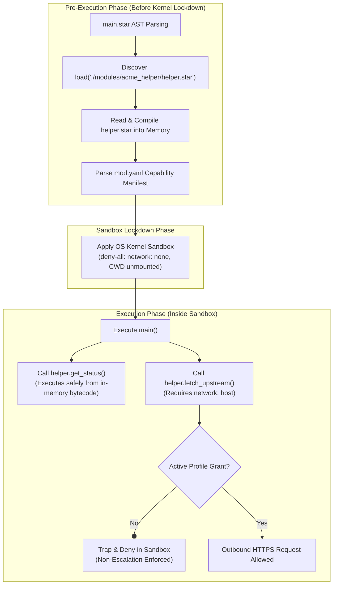

# Tutorial 09: Module Trust Boundaries (`mod.yaml`)

Modern software automation relies heavily on reusable modules, libraries, and shared packages. However, importing external code introduces critical supply chain risks: a compromised dependency could attempt to access local credentials, inspect the host filesystem, or exfiltrate environment secrets.

Starkite eliminates module-level supply chain vulnerabilities through two core architectural guarantees:
1. **In-Memory AST Closure Pre-Loading**: Local and external `.star` files imported via top-level `load()` statements are discovered, parsed, and cached in memory *before* the sandbox locks down. Modular scripts can run under the zero-trust `deny-all` profile without needing filesystem read grants for `$CWD`.
2. **The Non-Escalation Principle**: A module's `mod.yaml` manifest declares the minimum capabilities the module requires to function, but this declaration is **never a self-grant**. All code within an imported module executes strictly within the operator's active capability boundary.

This tutorial guides you through creating a local module (`acme_helper`), importing it into `main.star`, and verifying in-memory closure pre-loading and non-escalation enforcement.

---

## Architecture: Module Isolation & Pre-Loading



### Static `load()` Closure Pre-Loading

When you execute `kite run ./main.star`, Starkite's pre-runner statically traces all top-level `load()` statements before initializing OS kernel isolation. It parses `helper.star` and embeds its compiled bytecode in the runtime thread dictionary. When the kernel sandbox boundary activates, the parent script and its modules execute from memory without needing filesystem access to their source files on disk.

### The Non-Escalation Principle

When an external module declares capability requirements in its `mod.yaml` (such as `sandbox: network: host`), those requirements inform the operator of what the module needs to function. They **do not grant** those privileges to the module. If the operator runs the script under a profile lacking those capabilities (e.g. `deny-all`), any attempt by the module to perform privileged operations fails closed.

---

## Module Layout & Code

The tutorial module is organized as follows:

```text
09-module-trust-boundaries/
├── main.star
└── modules/
    └── acme_helper/
        ├── mod.yaml
        └── helper.star
```

### 1. Module Manifest: `modules/acme_helper/mod.yaml`

```yaml
namespace: acme
name: acme_helper
version: 1.0.0
description: Acme helper utilities requiring network egress
sandbox:
  network: host
```

### 2. Module Implementation: `modules/acme_helper/helper.star`

In Starkite, public module functions and variables are exported as members of a module struct:

```python
# helper.star - Implementation of acme_helper module

def get_status():
    return {
        "namespace": "acme",
        "name": "acme_helper",
        "version": "1.0.0",
        "loaded_via": "in-memory AST closure pre-loading",
    }

def fetch_upstream():
    resp = http.get("https://httpbin.org/get")
    return {
        "status_code": resp.status_code,
        "endpoint": "https://httpbin.org/get",
    }
```

### 3. Parent Automation Script: `main.star`

`main.star` loads `helper` using `load("./modules/acme_helper/helper.star", "helper")`:

```python
#!/usr/bin/env kite
# main.star — Parent automation script demonstrating module trust boundaries

# In Starkite, external modules are wrapped in a module struct:
# load("./modules/acme_helper/helper.star", "helper") -> helper.get_status()
load("./modules/acme_helper/helper.star", "helper")

def main():
    print("==> [Module Trust Boundary Audit] Testing Module Confinement\n")

    # 1. In-Memory AST Closure Pre-Loading
    # Notice that helper.get_status() executes even under default 'deny-all' where
    # the working directory is NOT mounted into the sandbox!
    status_info = helper.get_status()
    print("1. Module Closure Pre-Loading:")
    print("   Module Identity : " + status_info["namespace"] + "/" + status_info["name"])
    print("   Resolution Mode : " + status_info["loaded_via"])
    print("   Status          : VERIFIED (Module executed from memory closure)\n")

    # 2. Non-Escalation Boundary Enforcement
    # Even though modules/acme_helper/mod.yaml declared sandbox: network: host,
    # the module cannot self-grant capabilities beyond the active operator profile.
    print("2. Enforcing Non-Escalation Principle:")
    print("   Invoking module function helper.fetch_upstream()...")

    probe_res = http.try_get("https://httpbin.org/get", timeout="2s")
    if not probe_res.ok:
        print("   Escalation Gate : REJECTED (Outbound network blocked by active profile)")
        print("   Diagnostic      : " + probe_res.error.strip().splitlines()[0])
        print("   Security Result : Non-escalation invariant enforced; third-party modules cannot self-grant capabilities.")
    else:
        print("   Escalation Gate : PERMITTED (Operator explicitly authorized network egress)")
        data = helper.fetch_upstream()
        print("   Upstream Status : HTTP " + str(data["status_code"]))

    print("\n==> [Audit Complete] Module trust boundaries enforced successfully.")
```

---

## Step-by-Step Walkthrough

Navigate to the tutorial directory:

```bash
cd sandbox/09-module-trust-boundaries
```

### Step 1: Run Under Default `deny-all` Profile

Execute `main.star` without any capability flags:

```bash
kite run ./main.star
```

*(host-specific values differ)*
```text
==> [Module Trust Boundary Audit] Testing Module Confinement

1. Module Closure Pre-Loading:
   Module Identity : acme/acme_helper
   Resolution Mode : in-memory AST closure pre-loading
   Status          : VERIFIED (Module executed from memory closure)

2. Enforcing Non-Escalation Principle:
   Invoking module function helper.fetch_upstream()...
   Escalation Gate : REJECTED (Outbound network blocked by active profile)
   Diagnostic      : permission denied: http.client GET("https://httpbin.org/get") - no matching allow rule
   Security Result : Non-escalation invariant enforced; third-party modules cannot self-grant capabilities.

==> [Audit Complete] Module trust boundaries enforced successfully.
```

**Key security observations:**
- In Step 1, `helper.get_status()` executed successfully from memory even though `$CWD` was not mounted in the sandbox.
- In Step 2, the module attempted to perform an outbound HTTP request. Even though `modules/acme_helper/mod.yaml` declared `sandbox: network: host`, the request was rejected immediately because the operator did not grant network access.

---

### Step 2: Authorize Required Capabilities

Re-run the script, granting the required outbound network access:

```bash
kite run ./main.star --sandbox-net-allow
```

*(host-specific values differ)*
```text
==> [Module Trust Boundary Audit] Testing Module Confinement

1. Module Closure Pre-Loading:
   Module Identity : acme/acme_helper
   Resolution Mode : in-memory AST closure pre-loading
   Status          : VERIFIED (Module executed from memory closure)

2. Enforcing Non-Escalation Principle:
   Invoking module function helper.fetch_upstream()...
   Escalation Gate : PERMITTED (Operator explicitly authorized network egress)
   Upstream Status : HTTP 200

==> [Audit Complete] Module trust boundaries enforced successfully.
```

With `--sandbox-net-allow` explicitly provided by the operator, `helper.fetch_upstream()` completed the HTTP request.

---

## Next Steps

Now that you understand module trust boundaries and pre-loading:
- Proceed to [Tutorial 10: Sandboxing AI-Generated Code & Agent Tool Loops](../10-agentic-ai-eval/README.md) to learn how to safely evaluate untrusted LLM-generated code in Model Context Protocol (MCP) and agentic systems.
