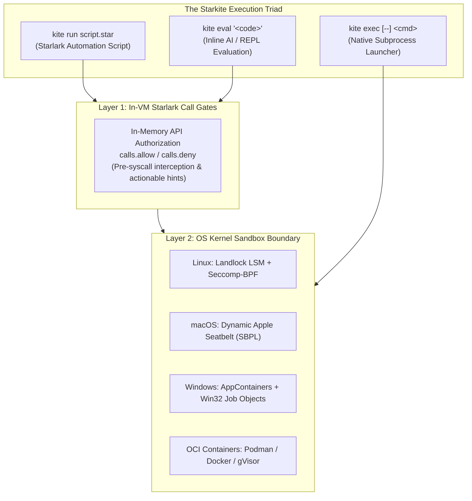
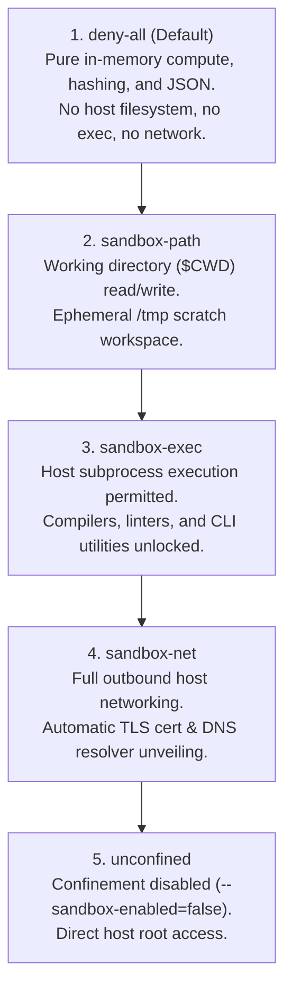

# Starkite Sandbox & Zero-Trust Security Architecture

Automation runbooks, infrastructure scripts, and AI agent tools operate with immense power: they deploy containers, modify cloud resources, configure Kubernetes clusters, and orchestrate remote servers. However, running automation scripts directly on host environments creates serious security vulnerabilities:
- Malicious or compromised packages can exfiltrate developer credentials, SSH keys, or cloud access tokens.
- Misconfigured scripts can accidentally delete working directories or corrupt host operating system state.
- Untrusted AI-generated code snippets can escape execution boundaries or initiate rogue network connections.

**Starkite** solves these challenges by enforcing **zero-trust kernel execution by default**. Rather than requiring operators to opt into security, every script executed via `kite run` or `kite eval`, and every external command launched via `kite exec`, begins confined within an operating system kernel boundary and in-VM capability gate under the `deny-all` profile.

---

## The Dual-Layer Defense Model

Starkite isolates workloads through two coordinated defense layers:



1. **Layer 1: In-VM Starlark Call Gates (`calls.allow` / `calls.deny`)**  
   Evaluated in memory before any syscall reaches the operating system. API operations (`fs.*`, `os.*`, `http.*`, `k8s.*`, `sql.*`) are validated against active profile rules. If an unauthorized call is attempted, Starkite halts gracefully and emits actionable remediation hints.
2. **Layer 2: OS Kernel Sandbox Boundary**  
   Unprivileged, authoritative OS isolation enforced by the operating system kernel. Even if untrusted native machine code is launched via `kite exec`, the OS kernel prevents unauthorized filesystem writes, process execution, or network socket creation.

---

## The 5-Rung Capability Ladder

Privileges in Starkite follow a strict superset hierarchy where each rung unlocks specific capabilities:



---

## Core Security Invariants

Starkite enforces five universal security invariants across all execution profiles:

1. **Write-XOR-Execute ($W\oplus X$)**: All writable directories (`$CWD`, `/tmp`, and explicit scratch mounts) are mounted with `noexec` flags at the kernel level. Workloads cannot generate a script or binary in a writable location and execute it as a child process.
2. **Ambient Secret Sanitization**: The host environment is scrubbed by default. Workloads receive only a safe baseline (`PATH`, `HOME=/tmp`, `TMPDIR=/tmp`, `LANG=C.UTF-8`, `TERM`). Sensitive host credentials (`AWS_SECRET_ACCESS_KEY`, `KUBECONFIG`) are never leaked unless explicitly forwarded.
3. **In-Memory AST Closure Pre-Loading**: Local and external `.star` files imported via top-level `load()` statements are resolved, parsed, and cached in memory before the sandbox boundary is locked down. Modular scripts execute without needing filesystem read permissions for `$CWD`.
4. **Module Non-Escalation**: Third-party module manifests (`mod.yaml`) declaring required capabilities cannot self-grant permissions. Execution is constrained by the operator's active profile.
5. **IPC & Shared Memory Isolation**: Host shared memory segments (`/dev/shm`, `/run/shm`) and System V IPC primitives are blocked to prevent cross-process memory inspection.

---

## Tutorial Catalog

This suite provides 10 comprehensive, production-grade tutorials covering every dimension of Starkite's sandboxing architecture:

| # | Tutorial | Focus Area | Key Commands & Flags | Primary Description |
| :--- | :--- | :--- | :--- | :--- |
| **01** | [Zero-Trust Ladder](01-zero-trust-ladder/README.md) | Capability Ladder | `kite run`, `--sandbox-profile` | Walkthrough of the 5-rung privilege ladder from `deny-all` to `unconfined`, demonstrating actionable denial diagnostics. |
| **02** | [Native Binary Exec](02-native-binary-exec/README.md) | Host Process Confinement | `kite exec -- <cmd>` | Confining native Python and shell processes under kernel isolation with the POSIX `--` delimiter and telemetry. |
| **03** | [Mounts and Scratch](03-mounts-and-scratch/README.md) | Filesystem Mappings | `--sandbox-mount`, `tmpfs:` | Granular host path bind mounts (`ro`/`rw`), ephemeral in-memory `tmpfs` scratch, and Write-XOR-Execute ($W\oplus X$) verification. |
| **04** | [Network Confinement](04-network-confinement/README.md) | Network Isolation | `--sandbox-net-allow`, `--sandbox-net-deny` | Outbound network egress policies, endpoint filtering, and automated host DNS and TLS CA bundle unveiling. |
| **05** | [In-VM Call Gates](05-in-vm-call-gates/README.md) | Starlark API Policies | `calls.allow`, `calls.deny` | Fine-grained function and resource-level authorization in `config.yaml` using deny-first evaluation grammar. |
| **06** | [Env Sanitization](06-env-sanitization/README.md) | Environment Protection | `--env`, `--env-inherit`, `--debug` | The 3-tier environment synthesis model (host forwarding, explicit assignment, full inheritance) and scrubbed secret detection. |
| **07** | [Cross-Platform Drivers](07-cross-platform-drivers/README.md) | Native Kernel LSMs | `--sandbox-driver=auto` | Deep dive into native OS kernel drivers: Linux Landlock + Seccomp-BPF, macOS Seatbelt SBPL, and Windows AppContainers. |
| **08** | [Container Drivers](08-container-drivers/README.md) | OCI Virtualization | `podman`, `docker`, `gvisor` | Running automation runbooks inside ephemeral hardened containers with custom OCI images and resource constraints. |
| **09** | [Module Trust Boundaries](09-module-trust-boundaries/README.md) | Supply Chain Security | `mod.yaml`, `load()` | In-memory AST closure pre-loading and enforcing the Non-Escalation Principle across third-party module imports. |
| **10** | [Agentic AI Evaluation](10-agentic-ai-eval/README.md) | AI & MCP Confinement | `kite eval`, `--timeout`, MCP runner | Safely evaluating untrusted AI-generated code snippets, prompt injection containment, and Model Context Protocol (MCP) tool loops. |

---

## Cross-Platform Compatibility Matrix

Starkite sandbox primitives are verified across all major operating systems:

| Platform | Primary Driver | Filesystem Isolation | Process Confinement | Network Isolation | Ephemeral Scratch |
| :--- | :--- | :--- | :--- | :--- | :--- |
| **Linux** (kernel 5.13+) | `landlock` | Landlock LSM ABI v1–v5 | Classic Seccomp-BPF (`SYS_EXECVE`) | Seccomp-BPF (`SYS_SOCKET`) | Kernel `tmpfs` |
| **macOS** (12.0+) | `seatbelt` | Dynamic Apple Seatbelt (SBPL) | Seatbelt `(deny process-exec)` | Seatbelt socket filters | In-memory `/tmp` |
| **Windows** (10/11, 2022+) | `windows` | NTFS DACL unmasking | Win32 Job Objects & AppContainers | Windows Filtering Platform | NTFS noexec scratch |
| **Any Platform** | `docker` / `podman` | Container volume mounts | OCI runtime isolation | OCI bridge / none network | Ephemeral container fs |

---

## Running the Tutorials

Clone the repository and verify your Starkite installation:

```bash
# Verify Starkite CLI version
kite version

# Navigate to any tutorial directory
cd sandbox/01-zero-trust-ladder
kite run ./system_audit.star
```

Each tutorial directory contains a self-contained `README.md` with complete architecture explanations, runnable code samples, step-by-step commands, and realistic terminal outputs.
