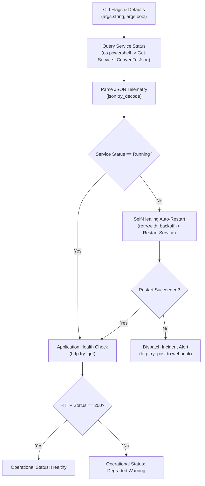

# Windows Service Health & Self-Healing Watchdog with Starkite

Automating Windows infrastructure often involves managing critical background services—such as IIS web servers, Windows Container daemons, build runners, and internal API services. When one of these services halts unexpectedly, downstream workloads fail, creating unplanned downtime.

Writing operational watchdogs using traditional Windows scripting requires navigating several challenges:
* **Fragile Batch Scripts**: Batch files lack native JSON parsing, structured error handling, and robust network retry capabilities.
* **Complex PowerShell Boilerplate**: Implementing exponential backoff, jitter, HTTP health probes, and structured error traps in PowerShell typically demands hundreds of lines of verbose script code with `$ErrorActionPreference` and nested `try/catch/finally` blocks.

**Starkite** (`kite`) provides a streamlined alternative. It combines the deterministic, Python-like syntax of **Starlark** with native Go runtime modules for PowerShell process execution, JSON decoding, exponential backoff retries, and HTTP client requests. This tutorial guides you through building a self-healing Windows service watchdog in under 100 lines of readable, maintainable Starlark.

---

## Architecture Overview

The watchdog inspects a designated Windows service, evaluates its runtime state against the Windows Service Control Manager (SCM), triggers automated self-healing with backoff when stopped, and confirms that the service's HTTP health probe responds successfully:



---

## Prerequisites

Before executing the tutorial script, ensure your Windows host meets the following requirements:

1. **Starkite CLI (`kite.exe`)**: Verify that `kite.exe` is installed and present in your `PATH`:
   ```powershell
   kite version
   ```
2. **PowerShell Environment**: PowerShell 5.1 (`powershell.exe`) or PowerShell 7+ (`pwsh`) installed and accessible in the system path.
3. **Administrative Privileges**: Launch an elevated PowerShell session (*Run as Administrator*) so the watchdog can issue restart requests to the Windows Service Control Manager.

---

## The Watchdog Script: `service-watchdog.star`

The complete script is organized into declarative option parsing, PowerShell process execution, resilient retry logic, and HTTP endpoint verification:

```python
#!/usr/bin/env kite
# service-watchdog.star — Self-healing Windows service monitor and recovery runbook

# -----------------------------------------------------------------------------
# 1. CLI Options & Configuration Schema
# -----------------------------------------------------------------------------
args.string(
    "service",
    shorthand = "s",
    default = "Spooler",
    help = "Target Windows service name (e.g. Spooler, W3SVC, docker)",
)

args.string(
    "health-url",
    shorthand = "u",
    default = "http://localhost:8080/healthz",
    help = "Application HTTP health check endpoint to probe",
)

args.string(
    "webhook-url",
    shorthand = "w",
    default = "",
    help = "Webhook URL for incident notification if recovery fails",
)

args.bool(
    "dry-run",
    default = False,
    help = "Preview service checks without restarting or altering state",
)

# -----------------------------------------------------------------------------
# 2. Helper: Safe JSON Decoding
# -----------------------------------------------------------------------------
def safe_json_decode(text):
    s = text.strip()
    if not s or not (s.startswith("{") or s.startswith("[")):
        return None
    res = json.try_decode(s)
    if res.ok:
        return res.value
    return None

# -----------------------------------------------------------------------------
# 3. Main Watchdog Execution
# -----------------------------------------------------------------------------
def main():
    opts = args.parse()

    if runtime.platform() != "windows":
        print("Notice: Current platform is '%s'. Running against platform defaults." % runtime.platform())

    ps = os.powershell(timeout = "30s")

    # Step A: Query Windows Service status as structured JSON
    cmd = "Get-Service -Name '" + opts.service + "' -ErrorAction SilentlyContinue | Select-Object Status, StartType | ConvertTo-Json -Compress"
    res = ps.try_exec(cmd)
    svc = safe_json_decode(res.stdout) if res.ok else None

    if not svc:
        print("Error: Windows service '%s' not found on this host." % opts.service)
        return

    status = svc.get("Status")
    print("Inspecting Windows service '%s': status is %s" % (opts.service, status))

    # Step B: Auto-remediate with exponential backoff if stopped
    # ServiceControllerStatus enum: 4 = Running, 1 = Stopped
    is_running = status == 4 or status == "Running" or status == 4.0
    if not is_running:
        print("Service '%s' is stopped. Initiating self-healing restart..." % opts.service)

        if opts.dry_run:
            print("[Dry-Run] Would attempt service restart with exponential backoff.")
            return

        def restart():
            r = ps.try_exec("Restart-Service -Name '" + opts.service + "' -Force")
            if not r.ok:
                fail("Service restart failed: " + r.stderr.strip())

        recovery = retry.with_backoff(
            restart,
            max_attempts = 3,
            delay = "2s",
            max_delay = "10s",
            jitter = True,
        )

        if not recovery.ok:
            print("Recovery failed after %d attempts: %s" % (recovery.attempts, recovery.error))
            if opts.webhook_url:
                payload = {
                    "event": "service_recovery_failed",
                    "service": opts.service,
                    "host": os.hostname(),
                    "attempts": recovery.attempts,
                    "error": recovery.error,
                }
                http.try_post(opts.webhook_url, body = payload, timeout = "5s")
                print("Incident alert dispatched to webhook.")
            return

        print("Service '%s' successfully restarted." % opts.service)

    # Step C: Verify application HTTP health endpoint
    probe = http.try_get(opts.health_url, timeout = "5s")
    if probe.ok and probe.value.status_code == 200:
        print("Application probe OK: '%s' returned HTTP 200." % opts.health_url)
    else:
        status_info = ("HTTP " + str(probe.value.status_code)) if probe.ok else probe.error
        print("Warning: Application probe for '%s' reported: %s" % (opts.health_url, status_info))
```

---

## Detailed Step-by-Step Walkthrough

### Step 1: Declaring Command-Line Options (`args.*`)

Configuration values should be overridable without editing script source code. Starkite's built-in `args` module establishes typed CLI options with shorthand aliases, default fallbacks, and automatic `--help` generation:

```python
args.string("service", shorthand = "s", default = "Spooler", help = "Target Windows service name")
args.string("health-url", shorthand = "u", default = "http://localhost:8080/healthz", help = "Health endpoint")
args.string("webhook-url", shorthand = "w", default = "", help = "Alert webhook URL")
args.bool("dry-run", default = False, help = "Preview mode without modifying services")
```

When you call `opts = args.parse()`, Starkite matches CLI arguments passed to `kite run`, populating the `opts` object with typed attributes such as `opts.service` and `opts.health_url`.

### Step 2: Querying the Windows Service Control Manager (`os.powershell()`)

To retrieve live status without scraping unstructured text, you can instruct PowerShell to format query objects as JSON via `ConvertTo-Json`:

```python
ps = os.powershell(timeout = "30s")
cmd = "Get-Service -Name '" + opts.service + "' -ErrorAction SilentlyContinue | Select-Object Status, StartType | ConvertTo-Json -Compress"
res = ps.try_exec(cmd)
```

The `os.powershell()` constructor automatically discovers `pwsh` (PowerShell Core) or falls back to `powershell.exe` (Windows PowerShell). Calling `ps.try_exec()` returns an `ExecResult` containing `ok`, `code`, `stdout`, and `stderr`, preventing uncaught shell exceptions from terminating your script prematurely.

### Step 3: Parsing Structured Telemetry (`json.try_decode()`)

Output produced by `ConvertTo-Json` is deserialized directly into native Starlark dictionaries using `json.try_decode()`:

```python
def safe_json_decode(text):
    s = text.strip()
    if not s or not (s.startswith("{") or s.startswith("[")):
        return None
    res = json.try_decode(s)
    if res.ok:
        return res.value
    return None
```

The resulting dictionary provides typed access to Windows service properties:
* `Status`: In PowerShell, service status represents a `ServiceControllerStatus` enumeration (`4` = `Running`, `1` = `Stopped`).
* `StartType`: Indicates service startup behavior (`2` = `Automatic`, `3` = `Manual`, `4` = `Disabled`).

### Step 4: Self-Healing Recovery with Exponential Backoff (`retry.with_backoff`)

When a service is stopped, immediate restart attempts can encounter transient system contention or port locking. Starkite's `retry.with_backoff()` manages restart sequencing using exponential delays and randomized jitter:

```python
def restart():
    r = ps.try_exec("Restart-Service -Name '" + opts.service + "' -Force")
    if not r.ok:
        fail("Service restart failed: " + r.stderr.strip())

recovery = retry.with_backoff(
    restart,
    max_attempts = 3,
    delay = "2s",
    max_delay = "10s",
    jitter = True,
)
```

* `max_attempts = 3`: Limits restart attempts to prevent endless restart loops on permanently broken configurations.
* `delay = "2s"` and `max_delay = "10s"`: Dynamically doubles the waiting interval between consecutive attempts.
* `jitter = True`: Introduces random timing variation to prevent thundering herd spikes when multiple services restart simultaneously.

### Step 5: Probing Application Readiness (`http.try_get`)

A running Windows service process does not guarantee that its application listener is ready to process traffic. The watchdog sends a non-blocking HTTP GET request to verify operational health:

```python
probe = http.try_get(opts.health_url, timeout = "5s")
if probe.ok and probe.value.status_code == 200:
    print("Application probe OK: '%s' returned HTTP 200." % opts.health_url)
```

By using `http.try_get()`, connection timeouts or network resets are captured safely in the result object rather than aborting execution.

### Step 6: Emitting Incident Webhooks (`http.try_post`)

If the service fails to recover after the configured retry quota, the script dispatches a structured JSON payload to an alert webhook (such as Slack, Microsoft Teams, or a central observability gateway):

```python
if not recovery.ok and opts.webhook_url:
    payload = {
        "event": "service_recovery_failed",
        "service": opts.service,
        "host": os.hostname(),
        "attempts": recovery.attempts,
        "error": recovery.error,
    }
    http.try_post(opts.webhook_url, body = payload, timeout = "5s")
```

---

## Running the Tutorial on Windows

### 1. View Available Options

Inspect the command-line help flags generated by the script's `args` schema:

```powershell
kite run .\service-watchdog.star --help
```

Output:
```text
Usage: kite run .\service-watchdog.star [flags]

Flags:
  -s, --service string       Target Windows service name (e.g. Spooler, W3SVC, docker) (default: "Spooler")
  -u, --health-url string    Application HTTP health check endpoint to probe (default: "http://localhost:8080/healthz")
  -w, --webhook-url string   Webhook URL for incident notification if recovery fails (default: "")
      --dry-run              Preview service checks without restarting or altering state
  -h, --help                 Show help for service-watchdog.star
```

### 2. Steady-State Execution

Execute the watchdog against the default Windows Print Spooler service (`Spooler`):

```powershell
kite run --sandbox-enabled=false .\service-watchdog.star
```

Output:
```text
Inspecting Windows service 'Spooler': status is 4.0
Warning: Application probe for 'http://localhost:8080/healthz' reported: connection refused
```

### 3. Simulating an Outage and Observing Self-Healing

To observe self-healing recovery, stop the service in an elevated PowerShell terminal before running the watchdog:

```powershell
# Stop the service to simulate a crash
Stop-Service Spooler -Force

# Execute the watchdog to trigger automated remediation
kite run --sandbox-enabled=false .\service-watchdog.star
```

Output:
```text
Inspecting Windows service 'Spooler': status is 1.0
Service 'Spooler' is stopped. Initiating self-healing restart...
Service 'Spooler' successfully restarted.
Warning: Application probe for 'http://localhost:8080/healthz' reported: connection refused
```

Verify that the Windows Service Control Manager confirms the service is running again:

```powershell
Get-Service Spooler
```

```text
Status   Name               DisplayName                           
------   ----               -----------                           
Running  Spooler            Print Spooler                         
```

### 4. Customizing Target Services and Health Endpoints

You can target any installed Windows service (such as Docker or IIS) and specify an active health check URL:

```powershell
kite run --sandbox-enabled=false .\service-watchdog.star `
  --service docker `
  --health-url http://127.0.0.1:2375/_ping `
  --webhook-url https://hooks.example.com/services
```

### 5. Running in Dry-Run Mode

Verify status evaluation without triggering real restarts or modifying service state:

```powershell
kite run --sandbox-enabled=false .\service-watchdog.star --dry-run
```

---

## Operational Note: Administrative Permissions vs. Sandboxing

When operating as a host management runbook, the watchdog interacts directly with the Windows Service Control Manager via Win32 system APIs. Under Starkite's Windows sandbox driver (`--sandbox-driver=windows`), subprocesses are confined within restricted AppContainers and Job Objects, which strip administrative tokens by design. 

For privileged host operations—such as restarting services, updating system drivers, or mounting disk volumes—execute the runbook with `--sandbox-enabled=false` from an elevated terminal.
